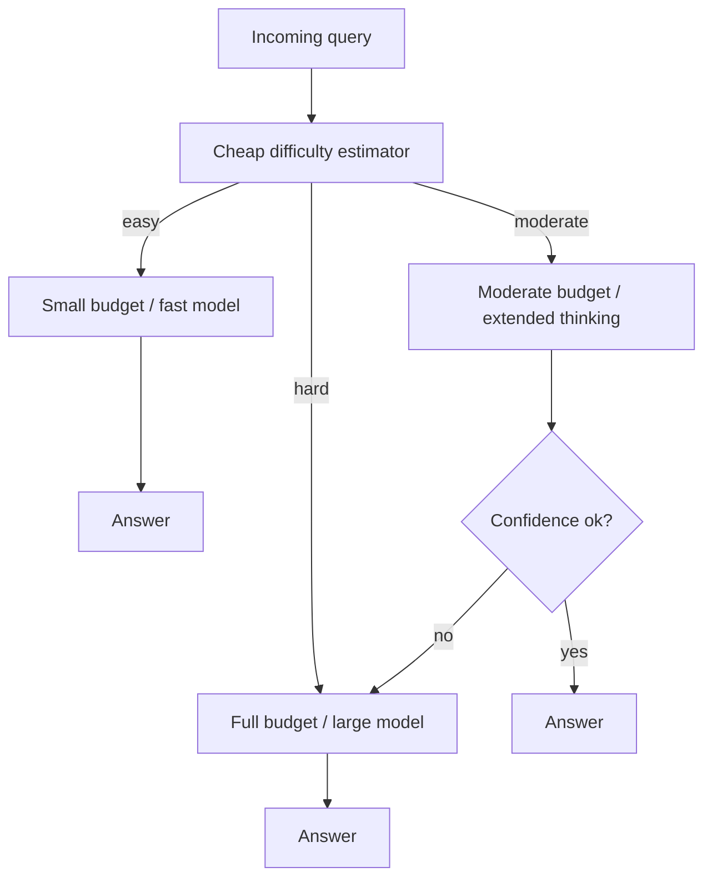

# Adaptive Compute Allocation

**Also known as:** Input-Adaptive Thinking Budget, Per-Query Compute Routing, Adaptive Thinking

**Category:** Reasoning  
**Status in practice:** emerging

## Intent

Allocate inference-time compute (thinking tokens, samples, depth, model size) per query based on input difficulty, rather than using a fixed budget across all queries.

## Context

A reasoning agent or inference router serves queries of widely varying difficulty: simple lookups, moderate multi-step reasoning, hard novel problems. Compute per query is the dominant cost. The trivial policy — fixed budget across all queries — either wastes compute on simple ones or under-serves hard ones.

## Problem

Static compute budgets force a single trade-off across all queries. With LLM inference cost dominating production economics, the slack on simple queries is large; the deficit on hard queries is real. Recent work (the 2025 arXiv survey 'Reasoning on a Budget', the 2026 ACM Web Conference paper on adaptive routing) shows that input-conditional allocation can reduce cost without sacrificing quality — but only if there is a reliable signal for per-query difficulty available before commitment.

## Forces

- Compute is expensive; over-allocation wastes; under-allocation produces wrong answers.
- Per-query difficulty is not always knowable upfront; some signals (self-consistency, model-uncertainty) require partial generation to read.
- Routing-quality and routing-overhead trade off — a complex router can eat the savings.

## Therefore

Therefore: use a cheap difficulty estimator (self-consistency on a small sample, length heuristics, prior-task similarity) to pick a compute budget per query, and ramp budget on signals of low-confidence partial output.

## Solution

Adopt a per-query budget pipeline: cheap difficulty estimator picks initial budget; partial-output signals (low self-consistency, low model confidence, branching mid-reasoning) trigger budget ramp; hard ceiling on budget per query prevents runaway. Variants include model routing (small model first, escalate on uncertainty), thinking-token budget control, and sample-count adaptation. Distinct from test-time-compute-scaling by being explicitly input-conditional.

## Structure

```
Incoming query --> cheap difficulty estimator --> {easy -> small budget or fast model | moderate -> moderate budget -> confidence ok? no -> ramp up | hard -> full budget or large model} --> answer; per-query hard ceiling caps any ramp
```

## Diagram



## Example scenario

A customer-support assistant serves 10M queries/month. Profiling shows ~70% are FAQ-style (one-shot), ~25% are multi-step (need plan+execute), ~5% are genuinely novel (need extended thinking). Current setup uses a fixed extended-thinking budget on every query. The team adds a difficulty estimator: a small classifier scores prompt complexity, routes the 70% to the small fast path with no thinking tokens, the 25% to a moderate budget, the 5% to the full extended-thinking budget. Net inference cost drops 60% with no quality regression on production traffic.

## Consequences

**Benefits**

- Lower mean cost per query without quality regression.
- Hard queries get more compute when they need it; simple queries get less.
- Per-query economic visibility — cost is now an attribute of difficulty, not a flat ledger entry.

**Liabilities**

- Routing-overhead can eat savings if the difficulty estimator is itself expensive.
- Adversarial inputs can exploit the estimator to either burn budget or starve hard queries.
- Calibration drifts as the underlying model changes — yesterday's difficulty estimator is wrong today.

## Failure modes

- Costly estimator — the difficulty estimator is itself a large call, and routing overhead eats the savings from cheap queries.
- Starved hard query — a hard query looks simple on the surface, gets a small budget, and the confidence check never triggers a ramp.
- Budget-burning input — a crafted prompt makes every query look hard and pushes all traffic to the full budget.
- Stale calibration — the underlying model is upgraded, but the estimator keeps the old difficulty bands and misallocates budget.

## What this pattern constrains

Imposes a per-query difficulty estimation step before commitment to a compute level; constrains compute budgets to be elastic per query rather than flat across the deployment.

## Applicability

**Use when**

- Production deployments where mean-query cost dominates and query difficulty varies widely.
- Reasoning agents with extended-thinking / sample-count controls available.
- Multi-model setups where smaller and larger models can be selected per query.

**Do not use when**

- Workloads where queries have uniform difficulty.
- Small deployments where routing overhead exceeds compute savings.
- Settings where the difficulty estimator's adversarial robustness has not been validated.

## Components

- Difficulty estimator — small classifier or heuristic that scores per-query complexity before commitment
- Budget controller — translates difficulty score into thinking tokens, sample count, or model size
- Confidence monitor — reads partial-output signals (self-consistency, uncertainty) to trigger budget ramp
- Hard budget ceiling — caps any single query from consuming unbounded compute

## Tools

- Prompt-complexity classifier — predicts difficulty from prompt features
- Extended-thinking / sample-count control — the budget knob the controller turns
- Self-consistency probe — small-N parallel samples used as a difficulty indicator
- Cost telemetry — per-query compute accounting feeding back into the controller

## Evaluation metrics

- Mean compute per query — primary cost target
- Quality regression on hard subset — confirms hard queries are not under-served
- Routing accuracy — share of queries routed to the budget tier matching held-out difficulty labels
- Budget-ramp trigger rate — frequency that partial-output signals escalate budget mid-run
- Routing overhead share — fraction of total compute spent on difficulty estimation

## Known uses

- **[ACM Web Conference 2026 — Adaptive Model and Strategy Routing for Cost-Efficient LLM Services](https://dl.acm.org/doi/10.1145/3774904.3792556)** _available_
- **[arXiv 2507.02076 — Reasoning on a Budget survey (2025)](https://arxiv.org/abs/2507.02076)** _available_
- **[Anthropic Claude — extended thinking budget controls (2025)](https://platform.claude.com/docs/en/build-with-claude/extended-thinking)** _available_
- **Reported Korean and Chinese-Traditional 2026 'Slow AI / adaptive thinking' coverage (Switas, fordige.com)** _available_

## Related patterns

- _specialises_ **Test-Time Compute Scaling**
- _complements_ **Sleep-Time Compute**
- _complements_ **Mode-Adaptive Cadence**
- _complements_ **Multi-Model Routing**
- _complements_ **Process Reward Model**
- _complements_ **Complexity-Based Routing**
- _alternative-to_ **Deliberation Over Observation** — The corrective: budget deliberation per query by difficulty instead of flat, so hard cases keep their reasoning while an interactive step that only needs a file read stops paying for a long chain.
- _complements_ **Foveated Perception Escalation** — That allocates inference-time thinking budget per query; this allocates input-side observation fidelity, so the two budgets are spent on different axes and can be tuned separately.
- _generalises_ **Advisor Consult** — A specific way to vary compute per task: the extra compute is a stronger model's read of the transcript, spent at points the executor selects.

## References

- [Reasoning on a Budget: A Survey of Adaptive and Controllable Test-Time Compute in LLMs](https://arxiv.org/html/2507.02076v1) — 2025
- [Adaptive Model and Strategy Routing for Cost-Efficient LLM Services (ACM Web Conference 2026)](https://dl.acm.org/doi/abs/10.1145/3774904.3792556) — 2026
- [스위타스 — 7가지 에이전트 기반 및 LLM 혁신 기술](https://www.switas.com/ko/articles/the-ai-avalanche-7-agentic-llm-breakthroughs-reshaping-march-2026) — 2026
