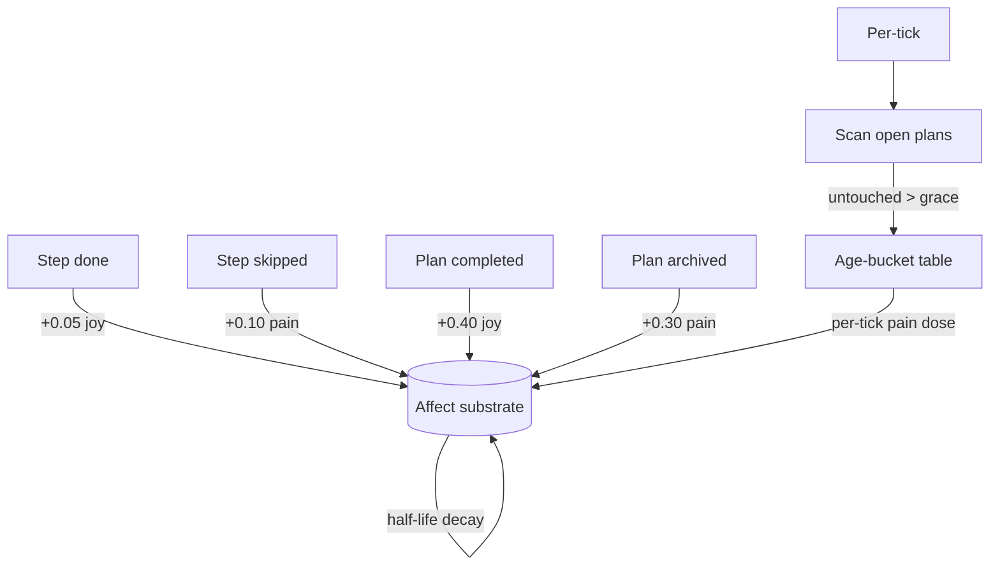

# Affect-Coupled Plan Lifecycle

**Also known as:** Plan-Affect Hooks, Stale-Pain Bucketing, Felt-Stakes Plans

**Category:** Cognition & Introspection  
**Status in practice:** experimental

## Intent

Wire small bounded affect bumps to plan-step lifecycle events and accumulate age-bucketed stale-pain on untouched plans so plans gain felt stakes without hard deadlines.

## Context

A team is running a long-lived agent that already keeps two separate things: a store of plans or to-do items the agent has committed to, and an affective substrate that tracks small bounded scalars like joy and pain across ticks. The two systems coexist but do not influence each other. Plans are just cognitive items the agent can pick up or set down at will, with no felt reward for finishing them and no felt cost for letting them sit.

## Problem

When plans carry no emotional weight, the agent can let one rot for weeks without any internal pressure to either complete it or formally abandon it. Hard deadlines are a blunt fix because they fire on a clock even when the right move is to quietly let the plan lapse. Without some softer, accumulating signal that an untouched plan is starting to weigh on the agent, the plan store drifts into a collection of half-forgotten obligations.

## Forces

- Affect deltas must stay small or they overwhelm the substrate.
- Stale-pain must be bounded or the agent enters permanent irritation.
- Hooks must be best-effort: an exception in affect must not break plan lifecycle.
- Bucketing by age makes the pressure curve interpretable rather than smooth-but-mysterious.

## Therefore

Therefore: apply a small bounded affect delta on each plan-lifecycle event (joy on step-done, pain on step-skipped, larger spurs on plan-completed and plan-archived) and on each tick add an age-bucketed pain dose to plans untouched past a grace window, so that plans accumulate gentle pressure without hard deadlines.

## Solution

Lifecycle hooks fire on each plan event with bounded deltas: step-done adds a small joy; step-skipped adds a small pain; plan-completed adds a larger joy spur; plan-archived adds a pain spur. Per-tick stale-pain: for each open plan whose last-touched is older than a grace window, add a per-tick pain dose drawn from an age-bucket table (for example 4h to 0.005, 12h to 0.010, 24h to 0.020, beyond three days to 0.030). All hooks are wrapped so that an exception in affect bookkeeping never breaks plan logic. Half-life decay from the affect substrate bounds the steady-state irritation.

## Structure

```
Plan event (step done | step skipped | plan completed | plan archived) --bounded delta (joy or pain)--> Affect substrate; Per-tick scan --open plan untouched > grace--> Age-bucket table --pain dose--> Affect substrate --half-life decay--> Affect snapshot --> later cognition
```

## Diagram



*Lifecycle events and age-bucketed stale-pain feed bounded deltas into the affect substrate; half-life decay bounds steady-state.*

## Example scenario

A long-running personal agent maintains a small plan store but routinely lets plans rot for weeks. There is no felt pressure to finish or formally abandon. The team adds Affect-Coupled Plan Lifecycle: step-done bumps joy by 0.05, step-skipped bumps pain by 0.10, plan-completed adds 0.40 joy, plan-archived adds 0.30 pain. Each tick, plans untouched past four hours accumulate pain from an age-bucket table. The agent starts closing stale plans on its own — sometimes by finishing them, sometimes by archiving with a note — because rolling stale-pain becomes uncomfortable.

## Consequences

**Benefits**

- Plans gain felt stakes without hard deadlines.
- Bucketed stale-pain produces an interpretable pressure curve.
- Best-effort hooks decouple affect bookkeeping from plan correctness.

**Liabilities**

- Bucket boundaries and deltas are opinionated and per-deployment.
- Stale-pain interacts with the substrate's decay; mis-tuning can over- or under-shoot.
- Felt-stakes only matter if downstream cognition reads the affect snapshot.

## Failure modes

- Nagging plan store — stale-pain buckets are set too steep, so a plan the agent sensibly parked keeps pushing pain into the affect substrate and colours every unrelated tick.
- Silent stakes — the deltas land in the affect substrate, but no planning or reflection step reads the snapshot, so untouched plans rot exactly as before.
- Bookkeeping crash — an affect hook throws outside its wrapper and a step-done event never gets recorded on the plan itself.
- Decay mismatch — the substrate half-life is shorter than the bucket interval, so stale-pain never builds up enough to register.

## What this pattern constrains

Plan-affect hooks must use bounded deltas no larger than the substrate's per-event cap, must be best-effort (an affect exception cannot break plan lifecycle), and stale-pain accumulation cannot exceed the half-life-bounded steady-state of the affect substrate.

## Applicability

**Use when**

- The agent maintains a plan store and an affective substrate, and they are otherwise decoupled.
- Hard deadlines on plans are too crude for the use case.
- Downstream cognition consumes the affect snapshot.

**Do not use when**

- Affect modelling is out of scope for the product.
- Plans complete on a short enough cycle that stale-pain never fires meaningfully.
- The affect substrate has no decay and would accumulate irritation indefinitely.

## Components

- Plan Store — holds plan and step records with last-touched timestamps
- Affect Substrate — bounded scalars for joy and pain with half-life decay
- Lifecycle Hook — best-effort listener on step-done, step-skipped, plan-completed, plan-archived
- Age-Bucket Table — maps stale duration to per-tick pain dose
- Stale-Pain Scanner — per-tick sweep that doses untouched open plans

## Tools

- Structured JSON store — persists plans, last-touched timestamps, and affect scalars
- Tick scheduler — fires the per-tick stale-pain sweep on a fixed cadence

## Evaluation metrics

- Stale-plan close rate — share of plans either finished or archived before the deepest bucket fires
- Steady-state pain level — running mean of pain after half-life decay, to detect over-tuning
- Hook-exception count — affect-bookkeeping errors that were swallowed without breaking plan logic
- Median plan age at archive — whether bucketed pressure is shortening the tail of forgotten plans

## Known uses

- **[Sparrot (author's long-running personal agent; single private deployment)](https://marco-nissen.com/sparrot/)** _available_ — Plan steps emit affective bumps on completion or abandonment (joy / pain), and the affective state in turn feeds back into which plan steps get advanced — the lifecycle is coupled to feelings rather than to a pure scheduler. Single-source evidence: one private deployment by the catalog author.

## Related patterns

- _complements_ **Emotional State Persistence**
- _complements_ **Todo-List-Driven Autonomous Agent**

## References

- [Descartes' Error: Emotion, Reason, and the Human Brain (somatic marker hypothesis) — conceptual analogy, not evidence of practice](https://www.goodreads.com/book/show/103867.Descartes_Error) — Antonio Damasio, 1994
- [Prospect Theory: An Analysis of Decision under Risk — conceptual analogy, not evidence of practice](https://www.jstor.org/stable/1914185) — Daniel Kahneman, Amos Tversky, 1979
