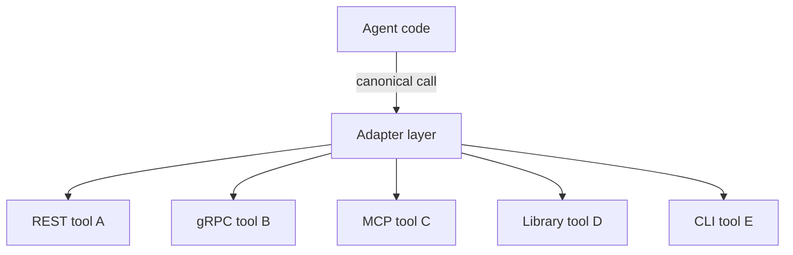

# Agent Adapter

**Also known as:** Agent-Tool Bridge, Tool-Schema Adapter

**Category:** Tool Use & Environment  
**Status in practice:** mature

## Intent

An interface layer connecting an agent's tool-calling protocol to heterogeneous external tools, normalizing their schemas into one the agent expects.

## Context

A team builds an agent that should use tools from multiple ecosystems (REST APIs, gRPC services, MCP servers, language-specific libraries, CLIs). Each tool has its own calling convention. Without adapters, the agent must know every convention.

## Problem

Heterogeneous tools force the agent to handle multiple calling conventions or restrict to one ecosystem. Without an adapter pattern, integration with each new tool ecosystem is bespoke. Differs from tool-discovery (finding tools) and tool-loadout (curating) — adapter normalizes the *interface* to the tools the agent has already found and selected.

## Forces

- Adapter layer adds latency on every tool call.
- Adapter must keep up with tool schema changes.
- Designing the agent-facing canonical schema is upfront work.

## Therefore

Therefore: introduce an adapter layer that translates between the agent's canonical tool-calling protocol and each external tool's native protocol; the agent sees one schema, the adapter handles per-tool translation.

## Solution

Define a canonical agent-facing tool schema (input fields, output schema, error model). Per external tool ecosystem (REST, gRPC, MCP, library, CLI), implement an adapter that translates {canonical request → native call} and {native response → canonical response}. Agent calls canonical interface only. Pair with mcp, tool-discovery, tool-loadout, agent-computer-interface.

## Structure

```
Agent code --canonical call--> Adapter layer --native call--> REST / gRPC / MCP / library / CLI tool --native response--> Adapter layer --canonical response--> Agent code
```

## Diagram



## Example scenario

An agent uses {REST CRM, gRPC search service, MCP knowledge-base, Python pandas library, bash git CLI}. Five ecosystems, one canonical agent schema {tool_name, args, expected_output_type}. Five adapters translate the canonical call into the appropriate native invocation. Agent code does not know REST from gRPC from MCP.

## Consequences

**Benefits**

- Agent sees one schema regardless of underlying tool ecosystem.
- New tool integrations are 'just write an adapter', not 'change the agent'.
- Per-ecosystem changes localized to the adapter.

**Liabilities**

- Adapter layer adds latency per call.
- Adapter maintenance — schemas drift, adapters lag.
- Canonical schema design — must be expressive enough for all wrapped tools.

## Failure modes

- Adapter lag — a native tool changes its schema and the adapter is not updated, so canonical calls start failing or returning wrong fields.
- Canonical schema too narrow — a tool's key option has no place in the canonical shape, and the agent cannot use it.
- Lost error detail — the adapter maps every native error to one generic code, and the agent cannot tell a retryable failure from a permanent one.
- Native call bypass — agent code calls one ecosystem directly for convenience, and the uniform interface starts to split.

## What this pattern constrains

The agent calls only the canonical interface; native calls are forbidden from agent code; adapters live in a separate layer.

## Applicability

**Use when**

- Agent uses tools from multiple ecosystems.
- Per-ecosystem schemas vary enough to warrant normalization.
- Adapter-maintenance burden is acceptable.

**Do not use when**

- All tools share one ecosystem (use that ecosystem's native interface).
- Latency budget cannot absorb adapter layer.
- No team capacity to maintain adapters per ecosystem.

## Components

- Canonical tool schema — single agent-facing interface
- Per-ecosystem adapter — translates canonical ↔ native
- Adapter registry — agent looks up adapters per tool
- Error normalizer — maps native errors to canonical error model

## Tools

- Canonical agent-facing tool schema
- Per-ecosystem adapter (REST/gRPC/MCP/lib/CLI)
- Adapter registry

## Evaluation metrics

- Adapter coverage — share of tools normalized
- Per-adapter latency overhead
- Schema drift detection — adapter vs native

## Known uses

- **[elcamy: 【論文紹介】LLMベースのAIエージェントのデザインパターン18選](https://blog.elcamy.com/posts/20431baf/)** _available_

## Related patterns

- _alternative-to_ **Model Context Protocol**
- _complements_ **Tool Discovery**
- _complements_ **Tool Loadout**
- _complements_ **Agent-Computer Interface**
- _complements_ **Tool/Agent Registry**
- _complements_ **Performative Message**
- _complements_ **Business + LLM Microservice Split**
- _complements_ **Crawler Dispatcher**
- _complements_ **Direct API Wrapper**
- _complements_ **Channel-Decoupled Agent Core** — Sibling adapter patterns at different boundaries: agent-adapter normalizes heterogeneous tools behind one tool-calling interface; this normalizes heterogeneous delivery channels behind one inbound/outbound contract.

## References

- [【論文紹介】LLMベースのAIエージェントのデザインパターン18選](https://blog.elcamy.com/posts/20431baf/) — 2026
