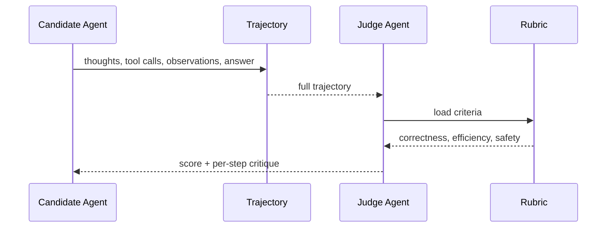

# Agent-as-a-Judge

**Also known as:** Trajectory Evaluator, Judge Agent

**Category:** Governance & Observability  
**Status in practice:** emerging

## Intent

Evaluate an agent's full trajectory (steps, tool calls, intermediate states) by another agent rather than scoring only the final output.

## Context

A team is evaluating an agent that solves multi-step tasks, such as fixing a bug in a real codebase or completing a chain of tool calls to answer a question. The agent emits a full trajectory: each intermediate thought, every tool call it issued, every observation it received, and a final answer. The team wants to know not just whether the final answer is right, but whether the agent got there through reasonable steps.

## Problem

A simple grader that looks only at the final answer cannot tell two agents apart when one solved the task cleanly and the other thrashed through twenty redundant tool calls, made a write outside its workspace, or stumbled into the right answer by luck. Process failures such as wasted spend, unsafe actions, or fragile reasoning are completely invisible to answer-only scoring. The team is forced to choose between cheap-but-shallow grading and expensive manual review of every run.

## Forces

- Trajectory evaluation is more expensive than answer-only judging.
- Judge agents have their own biases and failure modes.
- Trajectory schemas vary per agent framework.

## Therefore

Therefore: feed the candidate's full trajectory (thoughts, tool calls, observations, final answer) into a separate judge agent scoring against an explicit rubric, so that process quality is graded alongside the answer rather than inferred from it.

## Solution

A judge agent receives the candidate agent's full trajectory: thoughts, tool calls, observations, intermediate state, and final answer. It evaluates against a rubric covering correctness, efficiency, and process quality. Outputs a structured verdict with rationale.

## Structure

```
Candidate agent (thoughts, tool calls, observations, answer) --> Trajectory store --full trajectory--> Judge agent <--criteria-- Rubric (correctness, efficiency, safety) --> Verdict record (score + per-step critique)
```

## Diagram



## Example scenario

A team running a coding-agent benchmark notices that two agent versions get the same final answer but one wastes twenty extra tool calls and once tried to write outside the workspace. Scoring only the final patch, both look equal. They wire in an Agent-as-Judge that reads each full trajectory — every thought, tool call, and observation — and rates correctness, efficiency, and safety against a rubric. The wasteful version drops to a lower verdict and is sent back for tuning before the change merges.

## Consequences

**Benefits**

- Catches process-level failures that hide behind right answers.
- Inspectable judge rationales.

**Liabilities**

- Cost: trajectory evaluation is expensive.
- Judge calibration on trajectory rubrics is its own dataset effort.

## Failure modes

- Truncated trajectory — the trace store drops tool observations or intermediate state, so the judge scores a partial record and misses the unsafe step.
- Uncalibrated rubric — the judge applies efficiency and safety criteria inconsistently across runs, and two similar trajectories get very different scores.
- Cost blowout — every run is sent through full trajectory review, and evaluation spend grows faster than the agent's own spend.
- Answer anchoring — the judge reads a correct final answer first and then waves through the twenty redundant tool calls that led to it.

## What this pattern constrains

The judge sees the full trajectory, not just the final output; answer-only evaluation is not used in this pattern.

## Applicability

**Use when**

- Agent tasks succeed or fail along their trajectory in ways the final answer cannot reveal.
- You have access to the full trajectory (thoughts, tool calls, observations) of the candidate agent.
- Process-quality signals (efficiency, redundant steps, unsafe actions) matter for the eval verdict, not just correctness.

**Do not use when**

- Only the final output is checkable and the trajectory carries no evaluable structure.
- Trajectory evaluation cost is unjustified for the use case (cheap LLM-as-judge on the answer suffices).
- Judge-agent calibration cannot be funded as its own dataset effort.

## Components

- Candidate Agent — emits the trajectory under evaluation (thoughts, tool calls, observations, final answer)
- Trajectory Store — captures the full per-step record the judge will read
- Judge Agent — reads the trajectory end-to-end and applies the rubric
- Rubric — explicit criteria covering correctness, efficiency, and process safety
- Verdict Record — structured score plus per-step critique returned for review

## Tools

- Trajectory capture (Langfuse, LangSmith) — persists per-step inputs, outputs, and tool calls so the judge has a complete record
- Judge LLM API — runs the rubric pass over each trajectory
- Agent-as-a-Judge reference framework (MetaGPT) — published rubric and judge implementation

## Evaluation metrics

- Process-failure catch rate — fraction of bad-trajectory runs the judge flags that answer-only grading missed
- Redundant-step detection rate — share of inefficient runs identified as such by the judge
- Unsafe-action recall — fraction of out-of-workspace writes or other unsafe steps the judge surfaces
- Judge-vs-human agreement on trajectory rubrics — calibration signal on the judge itself
- Cost per trajectory verdict — overhead of trajectory evaluation vs answer-only grading

## Known uses

- **[MetaGPT Agent-as-a-Judge](https://github.com/metauto-ai/agent-as-a-judge)** _available_
- **SWE-Bench-style agentic benchmarks** _available_

## Related patterns

- _specialises_ **LLM-as-Judge**
- _uses_ **Eval Harness**
- _uses_ **Decision Log**
- _alternative-to_ **Blind Grader with Isolated Context**
- _used-by_ **Scorer Live Monitoring**
- _alternative-to_ **Cascading Agent Failures**
- _alternative-to_ **Reward Hacking**
- _alternative-to_ **Sycophancy**
- _alternative-to_ **Agent Scheming**
- _used-by_ **Rigor Relocation**
- _complements_ **Agent Evaluator**
- _complements_ **Sampled Prompt Trace Eval**
- _used-by_ **Trust and Reputation Routing**
- _alternative-to_ **Checklist Partial-Credit Scoring** — Holistic trajectory judgement is the baseline this pattern replaces: checklist partial credit was measured against it and separated skill effects better (AUC 0.689 against 0.619).
- _complements_ **Chance-Corrected Judge Validation** — Trajectory judging is where measured discrimination is weakest, around 0.54 to 0.65 AUROC, so a trajectory judge needs its own meta-evaluation set rather than one built from final answers.

## References

- [Agent-as-a-Judge: Evaluate Agents with Agents](https://arxiv.org/abs/2410.10934) — Zhuge, Zhao, Ashley, Wang, Khizbullin, Xiong, Liu, Chang, Zhang, Yang, Liu, Huang, Schmidhuber, 2024
- [Agent design pattern catalogue: A collection of architectural patterns for foundation model based agents](https://doi.org/10.1016/j.jss.2024.112278) — Yue Liu, Sin Kit Lo, Qinghua Lu, Liming Zhu, Dehai Zhao, Xiwei Xu, Stefan Harrer, Jon Whittle, 2025
