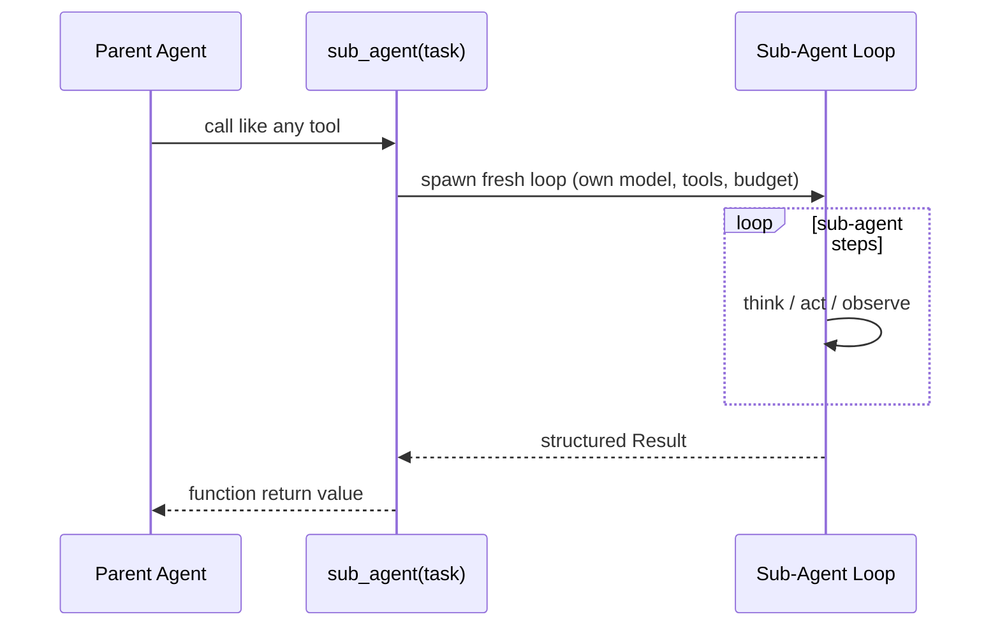

# Agent-as-Tool Embedding

**Also known as:** Sub-Agent as Function, Nested Agent, Agent Wrapped in a Tool Signature

**Category:** Multi-Agent  
**Status in practice:** emerging

## Intent

Wrap a sub-agent (with its own loop, prompt, and tool palette) behind a single function-shaped tool signature, so the parent agent calls it like any other tool and never sees the sub-agent's internal turns.

## Context

A parent agent is handling an overall goal and runs into a bounded sub-task — search the web for a topic and summarise the findings, plan a multi-day itinerary, audit a directory of files — that deserves its own focused loop with its own model, tool palette, and step budget. The parent does not need to watch the sub-task being solved; it only needs the answer.

## Problem

If the parent watches every turn the sub-agent takes, the parent's context window fills up with intermediate searches and tool calls that have nothing to do with the parent's own job, and the parent's reasoning starts to entangle with the sub-agent's internals. Building a full multi-agent broadcast bus to coordinate the two is far more machinery than the situation needs. Without a clean boundary, the team ends up choosing between bloated parent context and over-engineered coordination.

## Forces

- Nested loops add abstraction; parent shouldn't care about how sub solves it.
- The function-shaped tool signature is already the agent's native composition unit.
- Sub-agent failure has to surface cleanly to the parent.
- Cost attribution across nesting depth is non-trivial.

## Therefore

Therefore: expose the sub-agent behind a function-shaped tool signature with its own loop, model, and budget, so that the parent composes it like any other tool and never inherits its intermediate turns.

## Solution

Define the sub-agent as `def sub_agent(task: str, ...) -> Result`. The parent calls it like any other tool. Inside the function: a fresh agent loop with its own model, tool palette, and step budget runs to completion or failure, returning a structured result. Parent context records only the call and the return value. Step budget and timeout are enforced by the wrapper, not by the sub-agent's prompt.

## Structure

```
Parent agent -> tool_call(sub_agent, task) -> [hidden: sub-agent loop] -> Result -> Parent agent.
```

## Diagram



## Example scenario

A travel-planning agent needs to research hotel options, which itself takes ten or twenty turns of search and filtering. Putting all those turns into the parent's transcript bloats context and entangles the planner with hotel-search internals. The team wraps the hotel sub-agent behind a single function-shaped tool: the parent calls research_hotels(criteria) and gets back a structured shortlist. The sub-agent's internal turns stay sealed behind that signature.

## Consequences

**Benefits**

- Composition without ad-hoc multi-agent infrastructure.
- Parent context stays small and stable.
- Sub-agent can be replaced or upgraded behind the same signature.

**Liabilities**

- Hidden costs: sub-agent failures or timeouts surprise the parent.
- Debugging requires traceability across the boundary (parent sees only the return).
- Recursive nesting can spiral cost if the sub-agent itself spawns more.

## Failure modes

- Surprise timeout — the sub-agent runs out of budget mid-task and returns a bare failure, and the parent has no plan for a tool that can fail this way.
- Opaque bad result — the sub-agent returns a confident but wrong value, and because the parent sees only the return, nobody can tell which inner step went wrong.
- Recursive cost spiral — the sub-agent itself wraps further sub-agents as tools, and one parent call fans out into a deep, expensive tree.
- Budget in the prompt — the step limit lives in the sub-agent's instructions rather than the wrapper, and the sub-agent talks itself past it.

## What this pattern constrains

The parent may not access the sub-agent's intermediate turns; only the return value crosses the boundary.

## Applicability

**Use when**

- A sub-task is well-scoped enough that the parent should see only its result, not its turns.
- Putting the sub-agent's intermediate state into parent context would bloat tokens or couple parent reasoning to sub-agent internals.
- The sub-agent has its own model, tool palette, or step budget that should not leak into the parent loop.

**Do not use when**

- The parent must observe and steer sub-agent steps in real time.
- Sub-agent failures need to be diagnosable from the parent context without a separate trace.
- The sub-task is one or two model calls — function-style tool wrapping is cheaper than spawning an agent loop.

## Components

- Parent agent — composes the sub-agent like any other tool and never sees its intermediate turns
- Tool-shaped wrapper — function signature that hides the sub-agent loop behind a single call
- Sub-agent loop — independent agent with its own model, prompt, tool palette, and step budget
- Budget enforcer — caps wall-clock, steps, and tokens at the wrapper boundary, not in the sub-prompt

## Tools

- LLM API — separate inference channels for parent and sub-agent, often different models
- Tool catalogue — palette scoped to the sub-agent and invisible to the parent
- Trace recorder — captures sub-agent steps for debugging the boundary on failure

## Evaluation metrics

- Parent context bloat avoided — tokens the parent would have absorbed without the boundary
- Sub-agent success rate at the boundary — share of calls that return a usable Result inside budget
- Boundary latency overhead — extra wall-clock from spawning a fresh loop versus inline tool use
- Recursive nesting depth observed — how often a sub-agent spawns its own sub-agents, against the cap
- Cost attribution accuracy — token spend correctly tagged to parent vs sub for billing

## Known uses

- **[Hugging Face Transformers Agents (multi-agent)](https://huggingface.co/docs/transformers/v4.47.1/agents_advanced)** _available_ — ReactCodeAgent embeds sub-agents as callable Python functions.
- **[smolagents](https://huggingface.co/docs/smolagents/)** _available_ — Same pattern; sub-agents exposed as ordinary tool functions to a CodeAgent.
- **[OpenAI Agents SDK / handoffs](https://openai.github.io/openai-agents-python/)** _available_ — Adjacent pattern with explicit handoff semantics rather than function-call nesting.
- **[Sparrot](https://marco-nissen.com/sparrot/)** _available_ — The subagent runtime wraps each sub-agent as a single opaque tool call from the parent's point of view, so the parent reasons about 'invoke subagent X' rather than micromanaging its turns.

## Related patterns

- _specialises_ **Orchestrator-Workers**
- _complements_ **Subagent Isolation**
- _specialises_ **Hierarchical Agents**
- _uses_ **Tool Use**
- _complements_ **Step Budget**
- _complements_ **RL-Trained Conductor Orchestrator**
- _complements_ **Visual Workflow Graph**
- _complements_ **BPMN/DMN Deterministic Shell Around Agent**
- _composes-with_ **Agentic Behavior Tree**
- _complements_ **Context Folding** — Both hide a sub-computation's turns from the parent; embedding does it at a call boundary, folding does it mid-trajectory via branch/return.
- _alternative-to_ **Advisor Consult** — Both expose a second model as a tool, but with opposite boundaries: an embedded sub-agent runs its own loop and tools and hides its turns from the parent, while an advisor has no loop or tools and reads the caller's full transcript. Embedding delegates work; the advisor lends judgement.

## References

- [Hugging Face Transformers — Agents Advanced (Multi-Agents)](https://huggingface.co/docs/transformers/v4.47.1/agents_advanced)
