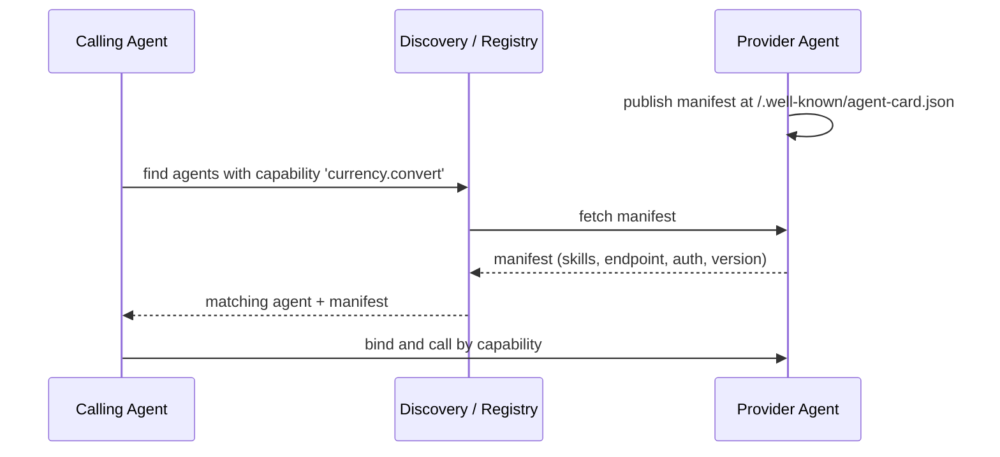

# Agent Capability Manifest

**Also known as:** Agent Card, Agent Capability Descriptor, Well-Known Agent Manifest

**Category:** Multi-Agent  
**Status in practice:** emerging

## Intent

Let each agent publish a standardized self-description — identity, skills, endpoint, and auth needs — at a well-known location, so others discover it and bind by capability at runtime instead of through hardcoded coupling.

## Context

A team is building systems where agents from different teams or vendors must work together — one agent calling another's service, a client routing a task to whichever agent can handle it. Each agent has an identity, a set of skills, an endpoint, and authentication requirements. The team has to decide how one agent or client learns what another agent can do and how to reach it, without that knowledge being baked into code on both sides.

## Problem

Hardcoding which agent does what, where it lives, and how to authenticate couples every caller to every callee: when an agent changes its skills, endpoint, or auth, every caller breaks until it is updated by hand. Embedding the same facts in a central configuration moves the coupling but not the brittleness. And when agents come from different vendors, there is no shared way to even express what an agent offers, so integration is bespoke per pair. Without a common, machine-readable self-description, discovery is manual and binding is rigid.

## Forces

- A caller needs to know another agent's skills, endpoint, and auth before it can use it.
- Hardcoding those facts couples every caller to every callee and breaks on change.
- Agents from different vendors need a shared way to express what they offer.
- Discovery should happen at runtime, by capability, not at build time by identity.
- The description must be machine-readable yet stable enough to bind against.

## Therefore

Therefore: have each agent serve a standardized, versioned self-description at a well-known location, so any caller can fetch it, learn the agent's capabilities and how to reach it, and bind by capability at runtime rather than against hardcoded coordinates.

## Solution

Define a standard schema for an agent's self-description — identity, skills or capabilities, service endpoint, supported protocols, and authentication requirements — and have each agent serve it as a machine-readable manifest at a well-known, discoverable location. Callers and registries fetch the manifest to learn what the agent can do and how to reach it, then bind by capability rather than by hardcoded address. The manifest is versioned so consumers can detect change, and because the format is shared, agents from different vendors interoperate without bespoke per-pair integration. A registry can aggregate many manifests; a peer can also fetch one directly.

## Structure

```
Agent serves manifest (identity, skills, endpoint, auth, version) at a well-known URL -> caller or registry fetches it -> discovers capabilities -> binds by capability at runtime. A registry may aggregate many manifests into a catalogue.
```

## Diagram



*Each agent publishes a versioned capability manifest at a well-known location; callers discover and bind by capability instead of hardcoding coordinates.*

## Example scenario

A travel-planning agent needs a currency-conversion service it did not ship with. Instead of hardcoding an endpoint, it fetches candidate agents' capability manifests, finds one that advertises a 'currency.convert' skill with a reachable endpoint and an auth scheme it supports, and binds to it at runtime. When that service later moves hosts or adds a skill, it updates its manifest; the travel agent re-fetches and keeps working without a code change.

## Consequences

**Benefits**

- Callers bind by capability at runtime instead of hardcoding identity and address.
- An agent can change its endpoint or skills by updating its manifest, without breaking callers that re-fetch.
- A shared format lets agents from different vendors interoperate without per-pair integration.
- Registries can aggregate manifests for catalogue-style discovery.

**Liabilities**

- A manifest is an attack surface: a forged or poisoned descriptor can misdirect callers.
- Self-declared capabilities may overstate what an agent can actually do.
- Stale or unversioned manifests cause callers to bind against outdated facts.
- A well-known location and shared schema are themselves a standard to agree on and maintain.

## Failure modes

- Poisoned manifest — a forged descriptor at the well-known location points callers to an attacker's endpoint.
- Overstated skills — an agent lists a capability it handles poorly, and callers bind to it by capability and get bad results.
- Stale cache — a manifest has no version, callers keep a cached copy, and they call an endpoint or auth scheme that changed.
- Schema split — two vendors extend the shared schema differently, and a registry can no longer match their capabilities.

## What this pattern constrains

A caller may not hardcode another agent's skills, endpoint, or auth; it must discover them from the agent's published manifest and bind by capability, and a manifest without a version cannot be safely cached.

## Applicability

**Use when**

- Agents from different teams or vendors must discover and call each other.
- Callers should bind to agents by capability at runtime, not by hardcoded address.
- Agent endpoints, skills, or auth change often enough that hardcoding is brittle.
- A registry or peer-to-peer discovery layer consumes agent descriptions.

**Do not use when**

- All agents are in one codebase under one team and direct wiring is simpler.
- The set of agents and their interfaces is fixed and rarely changes.
- Self-declared capabilities cannot be trusted and no verification is possible.
- A single static registry entry already suffices and no per-agent manifest is needed.

## Components

- Capability manifest — versioned machine-readable descriptor of identity, skills, endpoint, and auth
- Well-known endpoint — the standard location the agent serves its manifest from
- Manifest schema — the shared format that makes cross-vendor descriptions comparable
- Discovery client — fetches and parses manifests to match agents by capability
- Registry — optional aggregator that collects manifests for catalogue-style lookup

## Tools

- Well-known URI server — serves the manifest at the standard discoverable path
- Manifest schema validator — checks a descriptor conforms to the shared format
- Capability matcher — selects agents whose advertised skills fit a task

## Evaluation metrics

- Bind-by-capability rate — share of agent calls resolved via manifest rather than hardcoded address
- Manifest freshness — age of cached manifests relative to the agent's current version
- Discovery success rate — fraction of capability queries that resolve to a usable agent
- Capability-overstatement rate — calls that fail because advertised skills exceeded actual ability
- Cross-vendor interop rate — share of integrations working without per-pair custom code

## Known uses

- **[A2A Agent Card](https://agent2agent.info/docs/concepts/agentcard/)** _available_ — JSON descriptor served at /.well-known/agent-card.json; Google Agent2Agent open standard with 50+ partners including LangChain, Salesforce, and SAP.
- **[Model Context Protocol server manifests](https://modelcontextprotocol.io/)** _available_ — MCP servers describe their tools and resources so clients discover capabilities at connect time.
- **[AGNTCY agent directory](https://agntcy.org/)** _available_ — Discovery and identity components for the Internet of Agents (Linux Foundation).

## Related patterns

- _complements_ **Inter-Agent Communication** — Agents read each other's manifests to learn how to address and authenticate inter-agent calls before exchanging messages.
- _complements_ **Tool/Agent Registry** — A registry aggregates many agent capability manifests into one queryable catalogue.
- _complements_ **Agent-Readable Commerce Surface** — Both publish a machine-readable description at a known location for agents to consume; the manifest advertises an agent's skills, the commerce surface advertises a merchant's catalog and checkout.
- _complements_ **Signed Agent Card** — The manifest publishes an agent's identity and skills for runtime discovery; signed agent card is the authenticity layer that lets a consumer trust the manifest before binding.
- _complements_ **Co-Tenant Interference Profiling** — A manifest declares what a controller can touch; profiling measures what it actually moves, and the gap between the two is exactly where indirect conflicts live.
- _complements_ **Actuation-Scope-Registered Control Loops** — A manifest declares what an agent can do so that callers can discover and bind to it; this registry declares what a loop may write and which indicator it optimises so that overlap between loops becomes a set intersection. Discovery versus conflict detection, using the same declaration discipline.

## References

- [Agent Card — Agent2Agent Protocol](https://agent2agent.info/docs/concepts/agentcard/) — 2025
- [Announcing the Agent2Agent Protocol (A2A)](https://developers.googleblog.com/en/a2a-a-new-era-of-agent-interoperability/) — 2025
- [Agent Discovery in Internet of Agents: Challenges and Solutions](https://arxiv.org/abs/2511.19113) — 2025
- [AGNTCY — open infrastructure for the Internet of Agents](https://agntcy.org/) — 2025
