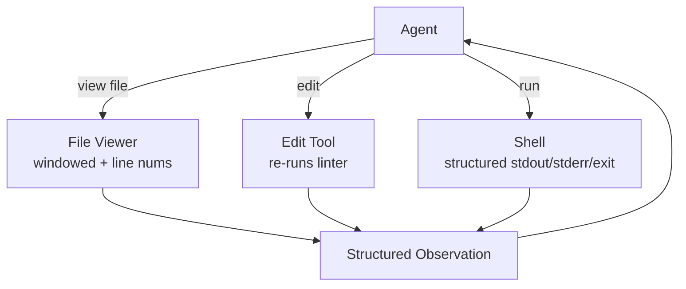

# Agent-Computer Interface

**Also known as:** ACI, Agent-Friendly Tooling, SWE-Agent ACI

**Category:** Tool Use & Environment  
**Status in practice:** emerging

## Intent

Design the tool surface for an LLM agent specifically, with affordances different from human-facing CLIs.

## Context

A team is building a coding agent, a research agent, or another domain agent that drives a file system, a shell, a web page, or an API that was originally designed for a human sitting at a keyboard. The agent is expected to read, edit, and act over those surfaces inside a fixed context budget, often for hundreds of turns per task.

## Problem

Human-facing tools are wrong-shaped for the agent: a normal text editor returns a whole 4000-line buffer when the agent only needs ten lines, a generic shell prints unbounded stdout that overflows context, and a web page returns minified JavaScript instead of structured state. The agent burns turns scrolling, paginating, and re-reading content it cannot fit, and signal-poor outputs (no exit codes, no linter feedback) hide the information the model actually needs to decide its next step.

## Forces

- Agent-friendly tools require parallel implementations alongside human ones.
- Tool surface must balance agent ergonomics with capability completeness.
- Linter / type signal exposure helps but adds output volume.

## Therefore

Therefore: design a parallel tool surface targeted at the agent's reasoning shape rather than the human's, so that each call returns windowed, structured, lint-aware output that fits the context budget.

## Solution

Design tools specifically for agents: file viewer that shows a windowed slice with line numbers, edit tool that re-runs linter and shows results, shell that returns structured stdout/stderr/exit-code, search tool that filters and ranks. Each tool's signature + return type optimised for the agent's context budget and reasoning shape.

## Structure

```
Agent --view--> File viewer (windowed slice + line numbers) | --edit--> Edit tool (re-runs linter) | --run--> Shell (stdout, stderr, exit code) --> Structured observation --> Agent (next step)
```

## Diagram



## Example scenario

An engineering team wires their agent to the standard bash and a desktop-grade text editor. Every diff balloons into a 4000-line buffer, output gets truncated mid-stack-trace, and the agent burns turns scrolling. They replace the surface with an Agent-Computer Interface: a file_view tool that returns numbered windows with elision markers, an edit tool that takes line ranges, and a run tool that streams the last 200 lines plus exit code. Task success rates rise sharply on the same model.

## Consequences

**Benefits**

- Substantial accuracy gains over human-CLI tools at the same task.
- Inspectable design choices per tool.

**Liabilities**

- Two interface surfaces to maintain (agent + human).
- ACI design is empirical; iterations needed.

## Failure modes

- Human tool passed through — a raw shell or editor is exposed as a primary tool, and one unbounded output fills the context before the agent reaches the lines it needs.
- Silent edit — the edit tool writes the change but does not re-run the linter, so the agent moves on with a syntax error it never saw.
- Interface drift — the agent-facing tool and the human-facing tool are changed separately, and the agent ends up with stale arguments or missing features.
- Untested affordances — the tool shapes are guessed once and never revised, so the agent keeps paginating and re-reading in the same wasteful way.

## What this pattern constrains

Agent tools follow a deliberate ACI design contract; raw human-CLI tools are not exposed as primary tools.

## Applicability

**Use when**

- Off-the-shelf human tools (shells, editors, web pages) overwhelm the agent's context with noise.
- You can curate a small, agent-specific tool surface (windowed file viewer, structured shell, ranked search).
- You measure agent performance and want the tool layer to be a tunable variable.

**Do not use when**

- The agent must use unmodified human tools verbatim (e.g. legal or audit constraint).
- Tool surface changes faster than you can re-curate agent-friendly wrappers.
- The agent runs against one-off APIs where building a curated surface is not worth the effort.

## Components

- Agent — consumer of windowed observations and emitter of typed tool calls
- File Viewer — returns a windowed slice with line numbers instead of the whole buffer
- Edit Tool — applies edits and re-runs linter so the result is part of the observation
- Structured Shell — returns stdout, stderr, and exit code as separate typed fields
- Search Tool — filters and ranks matches so the agent never sees raw unbounded grep output

## Tools

- Agent-shaped editor and shell wrappers — replace human-facing CLIs with windowed, line-numbered, exit-code-aware variants
- Linter or type checker — runs after every edit so feedback rides back in the same observation

## Evaluation metrics

- Tokens per observation — how aggressively the windowed surface beats raw tool output
- Turns to task completion — whether agent-shaped affordances cut the number of round trips
- Tool-call validity rate — fraction of calls that pass the typed signature without retry
- Lint-or-test feedback latency — time from edit to the linter result being visible to the agent
- Context-overflow incidents — runs aborted because a single observation blew the window

## Known uses

- **[SWE-Agent (Princeton)](https://github.com/princeton-nlp/SWE-agent)** _available_
- **Claude Code's curated tool set** _available_
- **Cursor's contextual file edit tools** _available_

## Related patterns

- _specialises_ **Tool Use**
- _complements_ **Tool Loadout**
- _generalises_ **Synthetic Filesystem Overlay**
- _complements_ **JSON-Only Action Schema**
- _complements_ **Agent Privilege Escalation**
- _complements_ **Agent Adapter**
- _complements_ **Large Action Models (LAMs)**
- _complements_ **Hierarchical Tool Selection**
- _complements_ **Tool Transition Fusion**
- _complements_ **Machine-Checkable Tool Contract** — Designs the tool surface for a model rather than a human; this pattern says which channel of that surface each constraint belongs in.

## References

- [SWE-Agent: Agent-Computer Interfaces Enable Automated Software Engineering](https://arxiv.org/abs/2405.15793) — Yang, Jimenez, Wettig, Lieret, Yao, Narasimhan, Press, 2024
