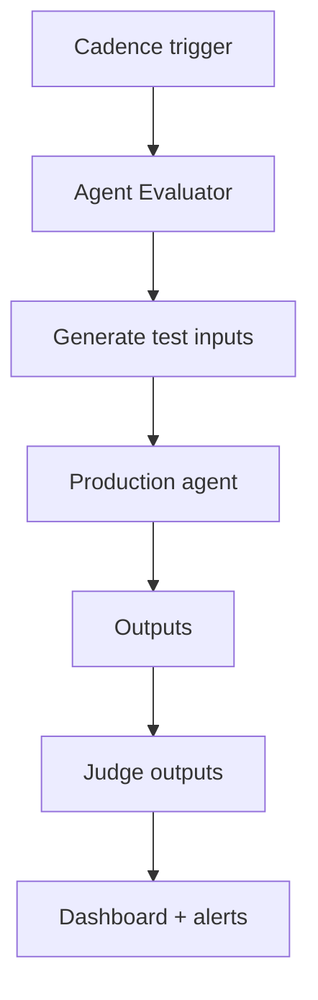

# Agent Evaluator

**Also known as:** Agent-Performance Testing Harness, Dedicated Agent-Test Agent

**Category:** Governance & Observability  
**Status in practice:** emerging

## Intent

A dedicated agent or harness whose sole job is running tests against another agent's outputs to evaluate performance; distinct from eval-harness (offline batch) and llm-as-judge (per-output).

## Context

A team has an agent in production. Quality is measured via final-output eval and ad-hoc sampling. There is no standing component whose role is *to test the agent* — testing happens during development and stops once shipped.

## Problem

Without a dedicated agent-evaluator role, agent quality measurement is human-driven and bursty. The agent-evaluator pattern names this as a standing component: an agent (possibly automated, possibly LLM-driven) whose job is to test the production agent on an ongoing basis. Differs from eval-harness (offline batch) by being an active, ongoing tester; from llm-as-judge by being agent-level not output-level.

## Forces

- Agent-evaluator is another agent to operate — more infrastructure.
- Designing meaningful agent-evaluator tests requires domain knowledge.
- Tests can become rituals if not maintained.

## Therefore

Therefore: stand up a dedicated agent-evaluator as a first-class component — it generates test inputs (covering edge cases, adversarial cases, drift checks), runs them against the production agent, and reports results to a dashboard.

## Solution

Agent-evaluator runs continuously or on a cadence. Generates test inputs from (a) a curated suite, (b) variations of production traffic, (c) synthetic edge cases. Submits to the production agent. Judges outputs (LLM-as-judge or deterministic check). Reports pass-rate metrics over time. Pair with eval-harness, llm-as-judge, dual-evaluation-offline-online, artifact-evaluation.

## Structure

```
Cadence trigger --> Agent evaluator --> Test-input generator (curated suite + production variations + synthetic edge cases) --> Production agent --> Outputs --> Output judge (LLM-as-judge + deterministic checks) --> Pass-rate dashboard + alerts
```

## Diagram



## Example scenario

A customer-service agent has a sibling agent-evaluator. Every hour the evaluator: generates 50 test inputs (10 from curated suite, 30 from production-traffic variations, 10 synthetic edge cases), submits to the production agent, judges outputs via LLM-as-judge + deterministic checks, posts metrics. Dashboard shows pass rate over time; a 4% drop triggers PagerDuty.

## Consequences

**Benefits**

- Continuous quality measurement without burst-eval rituals.
- Edge-case coverage maintained by an ongoing process.
- Drift caught by ongoing tests, not by waiting for user complaints.

**Liabilities**

- Another agent to operate and maintain.
- Test design is ongoing work.
- Cost of running tests in production (model calls + judging).

## Failure modes

- Narrow test generation — the evaluator keeps producing variations of the same curated cases, and new kinds of failure in production go untested.
- Evaluator left unowned — the evaluator agent breaks or stalls, its dashboard goes flat, and the flat line is read as stable quality.
- Test traffic in production — evaluator inputs reach the production agent with real side effects or mixed into user metrics.
- Weak judge on edge cases — synthetic edge cases need judgement the deterministic checks cannot give, and the LLM judge passes wrong answers.

## What this pattern constrains

Agent-evaluator is a standing component, not an ad-hoc tool; tests run on a cadence, results are dashboarded.

## Applicability

**Use when**

- Production agent whose quality must be continuously assured.
- Engineering capacity to operate the evaluator.
- Tests can be generated automatically or curated periodically.

**Do not use when**

- Single-user or prototype agents where ad-hoc eval suffices.
- Cost of running tests in production is prohibitive.
- No team capacity for test design and maintenance.

## Components

- Test-input generator — curated + traffic-variation + synthetic
- Production agent — system under test
- Output judge — LLM-as-judge + deterministic checks
- Dashboard + alerting — metrics over time

## Tools

- Test-input generator (curated + traffic-variation + synthetic)
- Production agent system under test
- Output judge (LLM-as-judge + deterministic)

## Evaluation metrics

- Continuous pass rate (rolling window)
- Edge-case coverage rate
- Drift detection latency

## Known uses

- **[elcamy: 【論文紹介】LLMベースのAIエージェントのデザインパターン18選](https://blog.elcamy.com/posts/20431baf/)** _available_

## Related patterns

- _complements_ **Eval Harness**
- _complements_ **LLM-as-Judge**
- _complements_ **Dual Evaluation (Offline + Online)**
- _complements_ **Intermediate Artifact Evaluation**
- _complements_ **Agent-as-a-Judge**
- _complements_ **Decision Context Maps**
- _complements_ **Simulated-User Rollout Evaluation** — A standing tester that submits inputs and grades outputs; this pattern supplies the interlocutor those tests need when the task is conversational rather than single-shot.

## References

- [【論文紹介】LLMベースのAIエージェントのデザインパターン18選](https://blog.elcamy.com/posts/20431baf/) — 2026
