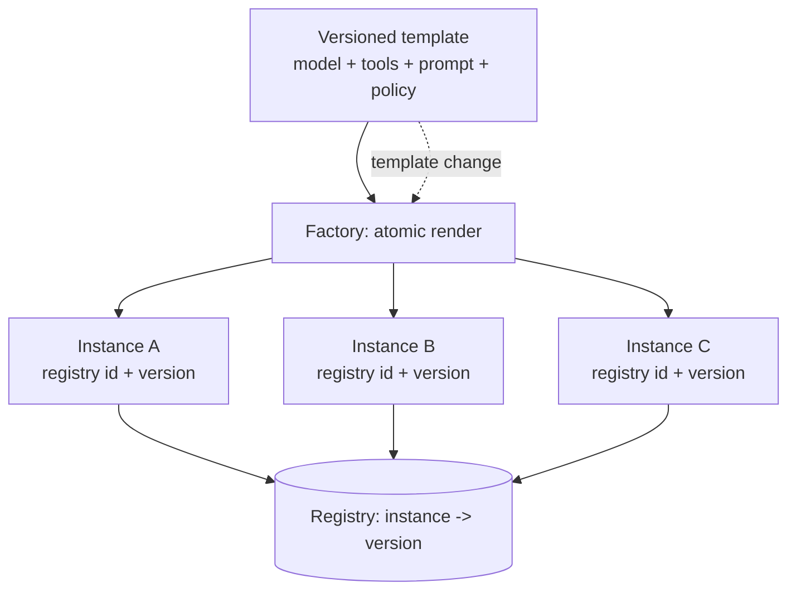

# Agent Factory

**Also known as:** Agent Template Factory, Fleet Agent Provisioning

**Category:** Governance & Observability  
**Status in practice:** emerging

## Intent

Manufacture agent instances from a versioned template that renders model, tools, and prompt atomically, with registry-backed identities, so a fleet stays consistent and one template change propagates instead of drifting per instance.

## Context

A team runs not one agent but many instances of one or more agent types — the same support agent deployed per customer, per product line, or per region, each needing its own configuration. Every instance binds a model, a tool set, a system prompt, and policy settings. The team has to decide how to stand up and maintain dozens or hundreds of these instances so they stay consistent as the underlying definition changes.

## Problem

Hand-configuring each instance, or copying a starter config and editing it, lets every instance drift: one keeps an old prompt, another points at a deprecated model, a third has a tool the others lack, and no one can say which version is running where. Rendering the pieces separately — prompt here, tool wiring there, model choice elsewhere — means a half-applied change can leave an instance internally inconsistent. When a fix has to reach the whole fleet, there is no single place to change it and no identity scheme to target instances, so updates are manual, partial, and unauditable.

## Forces

- Many instances of an agent type must stay consistent as the definition evolves.
- Rendering model, tools, and prompt separately allows half-applied, internally inconsistent instances.
- A fleet-wide fix needs one place to change and a way to target every affected instance.
- Each instance still needs its own identity and per-instance configuration.
- Without versioning and a registry, no one can say which definition is running where.

## Therefore

Therefore: render each agent instance in one atomic pass from a single versioned template, give it a registry-backed identity, and manage instances through a lifecycle, so one template change re-renders the fleet and per-instance drift cannot accumulate.

## Solution

Define each agent type as a versioned template that names its model, tools, prompt, and policy as one unit. A factory renders an instance from the template in a single atomic pass — never piecemeal — and registers it under a stable id with its template version recorded. Instances are managed through a lifecycle (create, read, update, retire), and a change to the template re-renders or migrates every instance bound to it, so a fleet-wide fix propagates from one place. The registry answers which template version each running instance carries, making drift visible and the fleet auditable.

## Structure

```
Versioned template (model + tools + prompt + policy) -> factory (atomic render) -> instance with registry id + template version; registry maps instance -> version; a template change re-renders or migrates every bound instance.
```

## Diagram



*One versioned template renders every instance atomically; the registry records which version each runs, so a template change propagates instead of drifting per instance.*

## Example scenario

A company deploys the same support agent to forty customers, each with its own knowledge base and branding. Early on each was copied and hand-edited; six months later three run an old prompt and one points at a retired model, and nobody can tell which. They move to an agent factory: one versioned template renders every instance atomically, each gets a registry id recording its template version, and a prompt fix re-renders the whole fleet from one change. Drift stops accumulating and an audit can list exactly what every customer is running.

## Consequences

**Benefits**

- A fleet-wide change is made once in the template and propagated, not edited per instance.
- Atomic rendering rules out half-applied, internally inconsistent instances.
- The registry answers which template version each instance is running.
- New instances are provisioned consistently rather than copied and tweaked.

**Liabilities**

- A bad template change propagates to the whole fleet at once; blast radius is large.
- The factory and registry are infrastructure to build and operate.
- Over-rigid templates make legitimate per-instance variation awkward.
- Re-rendering stateful instances must preserve their memory and in-flight work.

## Failure modes

- Fleet-wide bad change — a template edit with a wrong model id or broken tool reaches every bound instance in one pass.
- Out-of-band hotfix — an operator patches one instance in place during an incident, and the registry now records a version that instance no longer runs.
- Lost state on re-render — a template change re-renders stateful instances and drops their memory or in-flight work.
- Template sprawl — rigid templates cannot express small per-instance needs, so teams fork near-identical templates and drift returns at the template level.

## What this pattern constrains

An instance cannot be assembled piecemeal or edited in place out of band; it may only be rendered atomically from a versioned template and must carry a registry identity recording that version.

## Applicability

**Use when**

- Many instances of one or more agent types run, each with its own configuration.
- Instances must stay consistent as the underlying definition evolves.
- A fleet-wide change must reach every affected instance reliably.
- Auditing which definition version each instance runs matters.

**Do not use when**

- Only one or a few agents run and hand-configuration is tractable.
- Each agent is genuinely bespoke with little shared template to factor out.
- Instances are short-lived and never need a coordinated fleet update.
- The overhead of a template, factory, and registry exceeds the drift it prevents.

## Components

- Versioned template — single artifact binding model, tools, prompt, and policy for an agent type
- Factory — renders an instance from a template in one atomic pass
- Instance registry — stores each instance's stable id and the template version it carries
- Lifecycle manager — handles create, read, update, retire and fleet-wide migration
- Drift detector — flags instances whose running version lags the current template

## Tools

- Template engine — renders the atomic agent definition from the versioned template
- Agent registry or catalogue — stores instance identities and their template versions
- Configuration store — holds versioned templates and per-instance parameters

## Evaluation metrics

- Version skew across the fleet — share of instances not on the current template version
- Propagation time — wall-clock from a template change to the fleet re-rendered
- Partial-render rate — instances left internally inconsistent by a failed render
- Provisioning time per instance — cost of standing up a new instance from the template
- Audit coverage — fraction of running instances whose template version is known

## Known uses

- **[Microsoft Azure AI Foundry Agent Service](https://learn.microsoft.com/en-us/azure/ai-foundry/agents/)** _available_ — Provisions and manages agents from definitions at fleet scale; framed in the 'Agent Factory' design-pattern series.
- **[Salesforce Agentforce](https://www.salesforce.com/agentforce/)** _available_ — Agents instantiated from templated topics/actions and managed across an org.

## Related patterns

- _complements_ **Agent Persona Profile** — The factory renders the per-instance persona/profile this pattern defines as part of one atomic template.
- _complements_ **Agentic Golden Path** — The factory mass-produces correctly-configured instances; the golden path constrains the work each instance then produces.

## References

- [Agent Factory: the new era of agentic AI — common use cases and design patterns](https://azure.microsoft.com/en-us/blog/agent-factory-the-new-era-of-agentic-ai-common-use-cases-and-design-patterns/) — 2025
- [The Agent Factory: Building Consistent Agents at Scale](https://dev.to/chuckm/the-agent-factory-building-consistent-agents-at-scale-22an) — Chuck Meyer, 2025
- [Azure AI Foundry Agent Service](https://learn.microsoft.com/en-us/azure/ai-foundry/agents/) — 2025
