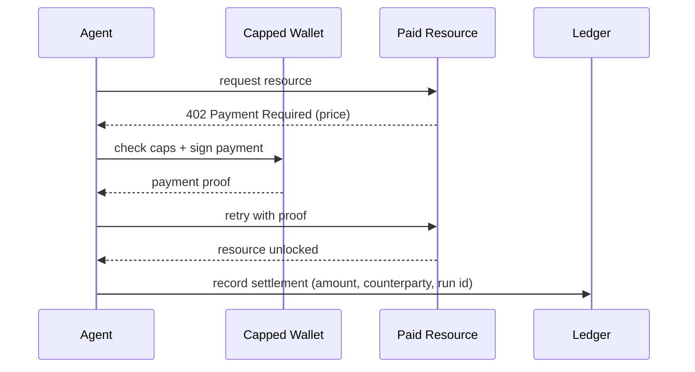

# Agent-Initiated Payment

**Also known as:** Autonomous Agent Settlement, Pay-Per-Call Agent, Agentic Commerce Payment, x402-style Payment

**Category:** Tool Use & Environment  
**Status in practice:** emerging

## Intent

Give an agent a bounded wallet so it can settle a payment mid-request to unlock a resource — answering a payment-required challenge with a verifiable proof — instead of routing every purchase through a human.

## Context

A team is running an agent that needs paid resources at runtime: a premium data feed, a metered API, compute or model inference, or a service offered by another agent. These resources increasingly expose a machine-payable endpoint — for example an HTTP 402 'Payment Required' response — that returns the data the moment a valid payment proof arrives. The team has to decide how the agent obtains and spends money for these calls without a person approving each one.

## Problem

Pre-provisioning every possible paid resource with an account, an API key, and a billing relationship does not scale to an agent that discovers what it needs as it runs, and it leaves spend untracked across dozens of providers. Putting a human in the loop for each purchase defeats the point of an autonomous run and stalls on sub-second resource calls. But handing an agent an open-ended payment instrument invites runaway spend, fraud, and purchases no one can later reconstruct or attribute.

## Forces

- Autonomous runs cannot pause for human approval on every paid resource call.
- An open-ended payment instrument invites runaway spend and fraud.
- Machine-payable endpoints settle in well under a second; account-and-invoice billing cannot keep that pace.
- Every payment must be reconstructable and attributable after the fact for audit and dispute.
- Resources are discovered at runtime, so pre-provisioning an account per provider does not scale.

## Therefore

Therefore: issue the agent a wallet scoped by hard spend caps and per-transaction limits, let it answer payment-required challenges with a verifiable proof, and write every settlement to an auditable ledger, so autonomy is bounded by budget rather than by a human in the loop.

## Solution

Provision the agent with a constrained wallet: a balance or credit line, a per-transaction ceiling, a total budget per run, and an allow-list of payable counterparties or resource classes. When a resource returns a payment-required challenge, the agent constructs a payment (for example a signed stablecoin transfer referenced in a payment header) and retries; the resource verifies the proof and releases the data. Each settlement is recorded to a ledger with the amount, counterparty, run id, and the action that triggered it, so spend is observable and attributable. Spend caps and the counterparty allow-list are enforced outside the model, so a compromised or confused agent cannot exceed them.

## Structure

```
Agent --request--> resource; resource --402 + price--> agent; agent --check caps, sign--> wallet; wallet --proof--> agent; agent --retry + proof--> resource (unlocked); agent --record--> ledger. Caps and allow-list sit outside the model.
```

## Diagram



*The agent answers a payment-required challenge with a proof drawn from a capped wallet, then records the settlement for audit.*

## Example scenario

A research agent hits a premium market-data API that responds 402 Payment Required with a price of a few cents. Instead of stopping to ask its operator, the agent — holding a wallet capped at five dollars for the run — signs a stablecoin micro-payment, attaches the proof, and retries; the API returns the data in under a second. The settlement is logged with the run id so the operator can later see exactly what was bought and why.

## Consequences

**Benefits**

- The agent can acquire resources discovered at runtime without pre-provisioned accounts.
- Settlement happens in-band and fast enough for per-call resource access.
- Spend is bounded by enforced caps rather than by human availability.
- A ledger makes every machine payment attributable to a run and an action.

**Liabilities**

- A wallet on an autonomous agent is a high-value target; key compromise is direct financial loss.
- Mispriced or adversarial resources can drain the budget up to the configured cap.
- Irreversible settlement (for example on-chain) leaves little recourse for a wrong or fraudulent charge.
- Cross-provider micro-payments fragment cost reporting unless the ledger consolidates them.

## Failure modes

- Wallet key theft — the agent's signing key is exposed, and an attacker spends the balance directly.
- Budget drain — an adversarial or mispriced resource keeps issuing payment challenges, and the agent pays up to the run cap for little value.
- Unrecoverable charge — an on-chain settlement goes to the wrong counterparty, and there is no way to reverse it.
- Untraced spend — a payment settles without a ledger entry or with a missing run id, and nobody can later say which action caused it.

## What this pattern constrains

The agent cannot spend beyond its enforced per-transaction and per-run caps, cannot pay counterparties outside its allow-list, and may not settle a payment that is not recorded to the ledger.

## Applicability

**Use when**

- The agent needs paid resources it discovers at runtime rather than a fixed pre-provisioned set.
- Resources expose machine-payable endpoints that settle faster than human approval allows.
- Spend can be bounded by enforced per-transaction and per-run caps.
- Payments must be attributable to a run and an action for audit.

**Do not use when**

- The set of paid resources is small and stable enough to pre-provision with accounts and keys.
- Each purchase is high-value or irreversible enough to warrant a human decision.
- No enforceable spend cap or counterparty allow-list can be put outside the model.
- The deployment cannot tolerate the fraud and key-custody risk of an agent-held wallet.

## Components

- Capped wallet — holds balance or credit with per-transaction and per-run spend limits enforced outside the model
- Payment challenge handler — detects payment-required responses and constructs a valid payment proof
- Counterparty allow-list — restricts which resources or agents the wallet will pay
- Settlement ledger — records amount, counterparty, run id, and triggering action for every payment
- Settlement rail — the stablecoin, card, or fiat channel that clears the payment and returns a proof

## Tools

- Machine-payable resource endpoint — API that issues a payment-required challenge and verifies proofs
- Wallet or key-management service — signs payments under enforced spend policy
- Settlement rail SDK — clears stablecoin, card, or fiat transactions and emits verifiable proofs

## Evaluation metrics

- Spend-cap breach attempts — count of payments blocked for exceeding per-transaction or per-run limits
- Cost per resolved task — total settled spend divided by completed runs
- Settlement latency — time from a payment-required challenge to an unlocked resource
- Unattributed-payment rate — share of settlements missing a run id or triggering action in the ledger
- Off-allow-list payment attempts — count of blocked payments to counterparties not on the allow-list

## Known uses

- **[x402 (Coinbase)](https://github.com/coinbase/x402)** _available_ — Revives HTTP 402: the agent sends a stablecoin payment proof in a payment header to unlock an API call; settles on-chain in roughly 200ms. Supported by Cloudflare and Circle.
- **[Agent Payments Protocol (AP2), Google + Coinbase](https://cloud.google.com/blog/products/ai-machine-learning/announcing-agents-to-payments-ap2-protocol)** _available_ — Gives autonomous agents a wallet, a programmable settlement rail, and auditable proofs to price, purchase, and get paid under a principal's mandate.
- **[Stripe + Tempo (MPP)](https://stripe.com/blog/machine-payments-protocol)** _available_ — Multi-rail agent payments spanning stablecoin, fiat, cards, and Bitcoin Lightning behind one interface.

## Related patterns

- _complements_ **Cost Gating** — Cost-gating supplies the spend thresholds that bound what the wallet may settle without escalation.
- _complements_ **Inter-Agent Communication** — Agent-to-agent commerce lets one agent pay another for a service over an inter-agent channel.
- _generalises_ **Session-Scoped Payment Authorization** — Session-scoped authorization specialises agent-initiated payment by making a capped session, not a single charge, the unit of approval.
- _complements_ **Verifiable Purchase Mandate** — Agent-initiated payment answers a payment-required challenge with a proof of payment; the mandate is the upstream proof of user authorization that makes that charge accountable.

## References

- [x402 and Agentic Commerce: Redefining Autonomous Payments in Financial Services](https://aws.amazon.com/blogs/industries/x402-and-agentic-commerce-redefining-autonomous-payments-in-financial-services/) — 2025
- [coinbase/x402](https://github.com/coinbase/x402) — 2025
- [当 AI Agent 接管你的钱包：未来支付体系的终极演进](https://www.cnblogs.com/informatics/p/19631662) — 2025
- [HTTP 402 Payment Required (MDN)](https://developer.mozilla.org/en-US/docs/Web/HTTP/Status/402)
