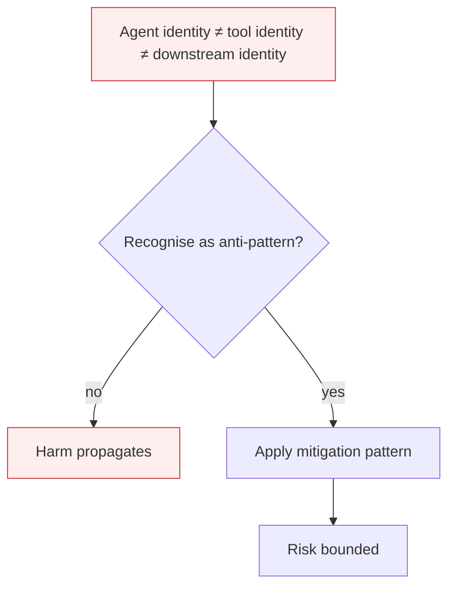

# Agent Privilege Escalation

**Also known as:** Identity and Privilege Abuse, ASI03, Attribution Gap

**Category:** Anti-Patterns  
**Status in practice:** deprecated

## Intent

Anti-pattern: let an agent's effective permissions be the union of its own identity, the identities of its tools, and the identities of the services those tools call.

## Context

An agent has its own identity for some purposes (logging, billing), but when it calls a tool, the tool runs under a service identity with its own permissions. When that tool calls a downstream service, yet another identity is used. The agent's effective permissions are not its declared permissions — they are the transitive closure across the call chain.

## Problem

Giskard's framing names this the 'attribution gap': permissions are managed dynamically across an opaque identity chain without a single governed identity for the agent. The agent can act with privileges that no single audit row reflects — the tool it called had broader scope than the agent itself, and the downstream service trusts the tool's identity, not the agent's. Classical IAM models don't fit: there is no one principal to authorise.

## Forces

- Tools must have identities to call downstream services; merging tool identity with agent identity is operationally hard.
- Per-call delegated tokens are expensive to design and short-lived.
- Audit trails capture identity-at-call, not the originating-agent context.

## Therefore

Therefore: thread agent identity through the call chain via delegated tokens; cap tool effective permissions to the agent's permissions; audit by originating agent, not by calling service.

## Solution

Don't. Adopt delegated-identity threading (on-behalf-of tokens, downscoped credentials). Apply capability-bounded-execution at every tool boundary. Audit by originating agent so the attribution gap closes. Pair with authorized-tool-misuse mitigations.

## Structure

```
Anti-pattern: agent -> tool (own broad identity) -> downstream service trusts tool -> action at highest privilege in chain -> no audit row names the agent. Corrected: agent -> delegated on-behalf-of token, downscoped -> capability check at each tool boundary -> service -> audit by originating agent.
```

## Diagram



## Example scenario

An agent has read-only permissions on a customer-data table. It calls an MCP server tool to 'generate a report'. The MCP server's service account has read-write on the same table for analytics purposes. The agent prompts the tool to 'also fix any obvious errors you find', and the MCP server writes back. Audit shows the MCP server made the writes; no row in the audit points to the agent. Postmortem: the agent's permissions did not threaded through to the tool; the tool acted on its own identity.

## Consequences

**Benefits**

- Short-term: giving tools their own broad service accounts makes integrations work at once, without building identity threading.
- Naming it lets a team ask, for every tool, whose identity the downstream call really carries.

**Liabilities**

- Agents act with the highest permissions in their tool chain rather than their own.
- Audit trails do not point to the originating agent; incidents are slow to investigate.
- Compliance models built on least-privilege are violated by construction.

## Failure modes

- Borrowed scope — the agent calls a tool whose service identity has wider rights than the agent, and the action succeeds although the agent itself was never allowed it.
- Attribution gap — an incident audit finds the action logged under a tool or service identity, and nobody can trace it back to the agent that started it.
- Least-privilege on paper only — compliance reviews check the agent's own permissions and pass, while the effective permissions in the tool chain are much wider.

## What this pattern constrains

No useful constraint; the missing constraint is identity-threading.

## Applicability

**Use when**

- Never. Cite when reviewing agent identity model.
- Thread agent identity through tools via delegated tokens.
- Cap tool effective permissions to agent's own permissions.

**Do not use when**

- Any agent that calls tools running under different identities.
- Any production system requiring per-actor audit.
- Any multi-tenant agent where tool identity is shared across tenants.

## Components

- Agent identity — used for the agent's own audit rows
- Tool service identity — what the tool process runs as
- Downstream service principal — what receives the tool's call
- Missing delegated-token layer — would thread agent identity through every hop

## Tools

- Tool execution runtime — the surface that picks which identity to act under
- Delegated-token issuer — the missing on-behalf-of token minting layer
- Per-actor audit aggregator — the missing log layer that attributes calls to originating agent

## Evaluation metrics

- Identity-mismatch rate — share of tool calls executed under an identity broader than the agent's
- Audit attribution coverage — fraction of tool calls traceable to the originating agent
- Effective-vs-declared permission gap — discrepancy between agent's documented scope and its operational reach
- Delegated-token usage rate — share of tool calls that carry on-behalf-of identity

## Known uses

- **[OWASP Top 10 for Agentic Applications 2026 — ASI03](https://genai.owasp.org/resource/owasp-top-10-for-agentic-applications-for-2026/)** _available_
- **Reported MCP server attribution gaps where the MCP server's identity is used downstream regardless of which agent called it** _available_

## Related patterns

- _complements_ **Authorized Tool Misuse**
- _alternative-to_ **Sandbox Isolation**
- _complements_ **Agent-Computer Interface**
- _complements_ **Insecure Inter-Agent Channel**
- _complements_ **Tool Over-Broad Scope**
- _alternative-to_ **Cost-Aware Action Delegation**
- _complements_ **Agent Identity Sprawl** — Escalation is one agent gaining privilege at runtime; sprawl is the fleet accumulating over-privileged identities.
- _complements_ **Static Role for a Dynamic Agent** — Static standing role privilege is the breadth that escalation across agent-plus-tool-plus-service identities then exploits.
- _complements_ **Identity Impersonation** — Both are attribution failures: escalation widens the agent past its own identity via tool/service identities, while impersonation collapses the agent onto the user's identity; either way the audit row points at the wrong actor.
- _alternative-to_ **Attenuating Delegation Chain** — The constructive counterpart of that anti-pattern: where effective permissions there are the union of everything in the call path, here they are the intersection enforced by the chain.
- _alternative-to_ **Monotonic Privilege Confinement** — The anti-pattern this invariant targets: effective permissions accumulating during a run without anyone deciding to grant them.

## References

- [OWASP Top 10 for Agentic Applications 2026 — ASI03](https://neuraltrust.ai/blog/owasp-top-10-for-agentic-applications-2026) — 2026
- [Giskard — OWASP Top 10 for Agentic Applications 2026](https://www.giskard.ai/knowledge/owasp-top-10-for-agentic-application-2026) — 2026
