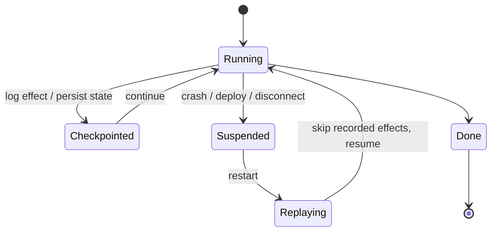

# Agent Resumption

**Also known as:** Durable Execution, Pause-and-Resume, Long-Running Agent State

**Category:** Governance & Observability  
**Status in practice:** mature

## Intent

Persist agent execution state so a long-running run survives restarts, deploys, or user disconnects.

## Context

A team runs an agent in production that takes minutes or hours to finish a single task, for example scraping and summarising a long list of pages, or driving a multi-step migration. During that time the worker process may be restarted by a deploy, killed by a host failure, or disconnected from the user's session. Operators and end users both expect work in flight to survive these everyday events rather than being thrown away.

## Problem

If the agent keeps all of its state in memory and the process dies, the run is gone and the user has to start over, sometimes after waiting forty minutes for nothing. Naively retrying from scratch repeats every side effect that already ran, so emails get sent twice, charges get doubled, and external systems see the same write multiple times. The team is forced to choose between fragile long-running agents and giving up on long-running agents altogether.

## Forces

- Checkpoint frequency vs cost.
- What to persist; what to recompute.
- Resumability requires deterministic enough replay or full state capture.

## Therefore

Therefore: either replay a deterministic log of recorded effects or restore a periodic snapshot of agent state, and pass idempotency keys to every side-effect target, so that a restart resumes mid-flight without duplicating work.

## Solution

Two production approaches. (a) Deterministic replay of recorded effects (Temporal/Inngest pattern): state = inputs + log of side-effects; on resume, the engine re-executes the workflow code, skipping side-effects that already have logged results. (b) Checkpoint snapshots of agent state (LangGraph Cloud pattern): periodically serialise plan, working memory, partial outputs, pending tool calls; restore on restart. Both approaches require deterministic idempotency keys passed to side-effect targets so a replayed-but-unlogged call is deduplicated downstream. Without this, crash-between-effect-and-log produces duplicates.

## Structure

```
Workflow engine runs agent --> each side effect (with idempotency key) --> Effect log / Snapshot store --crash, deploy or disconnect--> Suspended --restart--> Resumer loads log or snapshot --> replay, skipping recorded effects --> continue from next step --> Done
```

## Diagram



## Example scenario

A research agent is forty minutes into a slow scrape-and-summarise run when the operator deploys a hotfix and the worker container restarts. Without persisted state, the run vanishes and the user re-issues the request. The team adds Agent Resumption: every step's plan, tool result, and intermediate state is checkpointed to durable storage, keyed by run id. After the restart, the worker reloads the checkpoint and continues from the next step instead of from scratch.

## Consequences

**Benefits**

- Reliability for long-running agents.
- Operations confidence: deploys do not lose user work.

**Liabilities**

- Checkpoint storage cost.
- Resumed runs may see drifted external state.
- Deterministic-replay requires the workflow code to be deterministic; non-deterministic code in the agent path corrupts on resume.
- Tools that don't accept an idempotency key cannot be safely resumed.

## Failure modes

- Duplicate side effect — the process crashes after an email is sent but before the effect is logged, and the replay sends it again because the target took no idempotency key.
- Non-deterministic replay — the workflow code reads the clock or a random value, so the replayed path diverges from the recorded one and the resumed state is corrupt.
- Stale world on resume — the run restarts hours later and acts on a checkpointed view of external systems that has since changed.
- Unserialisable state — a live connection or in-memory handle sits in the agent state, and the snapshot either fails or restores without it.

## What this pattern constrains

Agent state must be serialisable; non-serialisable in-memory references are forbidden in long-running paths.

## Applicability

**Use when**

- Agent runs are long enough that restarts, deploys, or disconnects would lose meaningful work.
- Side effects can be logged or snapshotted without breaking semantics on replay.
- Users or operators need to trust that an in-flight run will survive infrastructure events.

**Do not use when**

- Runs complete in seconds and can simply be retried from scratch.
- Side effects cannot be made idempotent and replay would double-charge or double-act.
- State is small and ephemeral by design (e.g. throwaway exploratory agents).

## Components

- Workflow Engine — drives the agent code and decides when to checkpoint or replay
- Effect Log — append-only record of completed side-effects keyed by step id
- Snapshot Store — durable storage holding serialised plan, working memory, and pending tool calls
- Idempotency Layer — passes deterministic keys to side-effect targets so replays do not duplicate writes
- Resumer — reloads the log or snapshot after a restart and continues from the next step

## Tools

- Temporal — durable workflow engine using deterministic replay of recorded effects
- Inngest — durable execution platform for resumable agent workflows
- LangGraph Cloud checkpointing — periodic serialised snapshots of agent state
- OpenAI Agents SDK durable execution — runtime hooks for pause and resume

## Evaluation metrics

- Resume success rate after restart — fraction of in-flight runs that continue cleanly instead of restarting from zero
- Duplicate side-effect rate — share of resumed runs that double-fired a tool call (target zero)
- Mean work-loss on host failure — seconds of progress lost between checkpoint and crash
- Snapshot storage cost per run — bytes persisted across the lifetime of a workflow
- Determinism-violation count — non-deterministic code paths detected during replay

## Known uses

- **[Devin sessions](https://docs.devin.ai/get-started/devin-intro)** _available_
- **[Manus tasks](https://manus.im/)** _available_
- **[OpenAI Agents SDK durable execution](https://openai.github.io/openai-agents-python/)** _available_
- **[Temporal-backed agents](https://temporal.io/)** _available_
- **[Inngest agents](https://www.inngest.com/docs)** _available_
- **[LangGraph Cloud checkpointing](https://langchain-ai.github.io/langgraph/concepts/persistence/)** _available_
- **[Sparrot](https://marco-nissen.com/sparrot/)** _available_ — The agent picks up after a crash or restart from its file-native state without losing its place; restarts close and reopen the window without erasing identity.

## Related patterns

- _complements_ **Scheduled Agent**
- _complements_ **Event-Driven Agent**
- _uses_ **Short-Term Thread Memory**
- _complements_ **Todo-List-Driven Autonomous Agent**
- _complements_ **Interrupt-Resumable Thought**
- _complements_ **Partial-Output Salvage**
- _generalises_ **Durable Workflow Snapshot**
- _complements_ **Blocking Sync Calls in Agent Loop**
- _complements_ **Stateless Reducer Agent**
- _complements_ **Test-Time Memorization (Titans)**
- _used-by_ **Interruptible Agent Execution**
- _complements_ **Managed Agent Runtime**
- _complements_ **Local-to-Cloud Handoff**
- _complements_ **Journaled LLM Call**
- _complements_ **Async Tool Handle** — A durable handle plus result store is exactly what lets a resumed run reconnect to a job started before the restart.
- _complements_ **Execution-State Ledger** — Resumption persists state so a run survives a restart; the problem here is staleness inside a single live run, where nothing crashed and the record is simply out of date.
- _complements_ **Forkable Agent Sandbox** — Resumption restores one timeline after an interruption; the same snapshot machinery, forked rather than resumed, supports exploration.

## References

- [Temporal: Durable execution](https://docs.temporal.io)
- [Inngest: AgentKit durable agents](https://www.inngest.com/docs)
