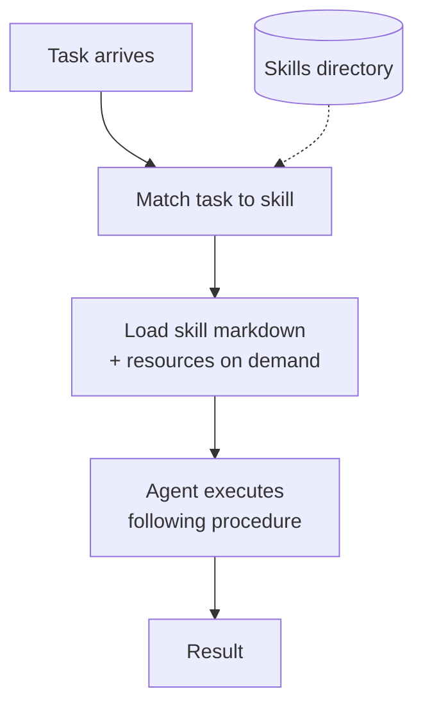

# Agent Skills

**Also known as:** Author-Time Procedures, Slash Commands, Agent Rules

**Category:** Tool Use & Environment  
**Status in practice:** emerging

## Intent

Package author-time procedures (markdown + optional resources) the agent loads on demand for specific task types.

## Context

A team is shipping an agent product that handles many distinct recurring workflows. The same agent might process refunds, change addresses, schedule appointments, and answer policy questions, each with its own multi-step procedure that the engineering or operations team has already worked out and wants the agent to follow consistently.

## Problem

Stuffing every workflow into one system prompt pushes context past tens of thousands of tokens and the agent still skips steps or blends procedures together. The alternative of dropping ad-hoc prompt files into the repository leaves the team with no clean way to version, review, or roll back individual procedures, and no clear story for how the agent decides which one applies to the current task.

## Forces

- Discovery: how does the agent know which skill applies?
- Versioning of authored procedures.
- Skill quality bounds agent quality on the relevant workflow.

## Therefore

Therefore: package each procedure as a markdown file the agent loads on demand for matching tasks, so that domain know-how lives in versioned author-time artefacts rather than burning prompt tokens or model weights.

## Solution

Package each procedure as a markdown file (and optional companion resources) under a known directory. The agent loads relevant skills on demand based on the current task. Skills are author-time artefacts versioned with the agent.

## Structure

```
Task arrives --> Match task to skill (Skills directory) --> Load skill markdown + resources on demand --> Agent executes following the procedure --> Result
```

## Diagram



## Example scenario

A customer-support agent now handles refunds, address changes, subscription pauses, and SIM swaps. Cramming every workflow into the system prompt has pushed it past 18k tokens and the agent still skips steps. The team breaks each workflow into an Agent Skill — a markdown file with the procedure plus a few example dialogues — that the agent loads on demand once the user's intent is classified. The base prompt shrinks; only the relevant procedure enters context for that conversation.

## Consequences

**Benefits**

- Workflow knowledge becomes a product surface.
- Versioned, reviewable, sharable.

**Liabilities**

- Discovery / matching overhead.
- Skill rot when not maintained.

## Failure modes

- Wrong skill loaded — the matcher picks a procedure for a similar-looking task, and the agent follows steps that do not fit the real one.
- Skill rot — a procedure is not updated after the tools or the codebase change, and the agent faithfully runs outdated steps.
- Off-script improvisation — the agent drifts away from the loaded procedure mid-task and blends it with steps from another workflow.
- Missed match — no skill is picked for a task that has one, and the agent falls back to guessing the procedure.

## What this pattern constrains

The agent operates within the procedure of the loaded skill; ad-hoc deviation is forbidden when a skill is active.

## Applicability

**Use when**

- You have many distinct procedures and stuffing them all into the system prompt would bloat context.
- Procedures are author-time artefacts that benefit from versioning alongside the agent.
- The agent can reliably classify which procedure applies to the current task.

**Do not use when**

- The agent has only a handful of procedures that fit comfortably in the system prompt.
- Procedures must be authored at runtime by the agent itself (use a runtime skill-library pattern instead).
- On-demand loading adds latency the use case cannot tolerate.

## Components

- Skill Loader — matches the current task to a skill and reads the markdown plus companion resources on demand
- Skills Directory — versioned author-time store of markdown procedures and their companion files
- Agent — executes by following the loaded procedure step by step
- Task Router — decides which skill applies to the incoming task

## Tools

- Filesystem reader — loads skill markdown and companion resources from the skills directory
- Version control — tracks skill changes alongside the agent that consumes them

## Evaluation metrics

- Skill-match precision — fraction of tasks routed to the correct skill
- Procedure-step adherence rate — how often the agent actually follows the loaded steps in order
- Context tokens saved versus monolithic prompt — reduction from loading only relevant skills
- Skill load latency — time from task arrival to executable procedure in context
- Skill churn rate — how often a skill is edited per week, signal of instability or active iteration

## Known uses

- **Anthropic Claude Skills** _available_
- **Claude Code slash commands** _available_
- **Cursor rules / .cursorrules** _available_
- **Continue prompts** _available_

## Related patterns

- _alternative-to_ **Skill Library** — Author-time vs agent-authored skills.
- _complements_ **Dynamic Scaffolding**
- _complements_ **Spec-First Agent**
- _complements_ **Toolformer**
- _complements_ **DSPy Signatures**
- _alternative-to_ **Prompt Bloat**
- _complements_ **Agent Persona Profile**
- _complements_ **Hierarchical Tool Selection**
- _complements_ **Tool Transition Fusion**

## References

- [Anthropic: Skills](https://platform.claude.com/docs/en/agents-and-tools/agent-skills/overview)
