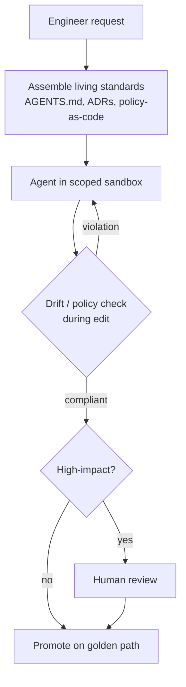

# Agentic Golden Path

**Also known as:** Paved Road for Agents, Golden Path agentique, Compliant-by-Construction Agent Platform

**Category:** Governance & Observability  
**Status in practice:** emerging

## Intent

Constrain an agent to the platform's curated golden path of living, machine-readable standards and check for drift as it works, so its output is compliant by construction rather than corrected later.

## Context

A team runs an internal developer platform that gives engineers paved roads — opinionated, supported workflows for building and deploying software. Now agents generate much of that software, scaffolding services, writing configuration, and opening changes. The platform's architectural standards have historically lived in templates, wikis, and the heads of senior engineers. The team has to decide how those standards reach an agent so its output follows the same paved road a careful human would.

## Problem

Templates capture standards at scaffold time and then rot: a service generated last year drifts from this year's observability, secret-management, and security conventions, and nobody notices until an audit. Conventions that live in wikis or senior engineers' heads are invisible to an agent, which will confidently produce plausible work that violates them. And when validation only runs at push time in continuous integration, the agent (like a human) discovers the violation after the work is done, forcing an expensive correction loop. The team needs the standards to be present and enforced while the agent works, not discovered afterward.

## Forces

- Standards captured once in a template rot as conventions evolve, while the scaffolded code does not.
- Conventions living in wikis or experts' heads are invisible to an agent generating work.
- Validation only at push time makes the agent discover violations after the work is done.
- Too tight a paved road blocks legitimate work; too loose a one lets non-compliant output through.
- Standards must be machine-readable for an agent to consume, yet stay authored and owned by humans.

## Therefore

Therefore: express the organisation's standards as living, machine-readable artifacts the platform assembles into the agent's context, and evaluate the agent's work against them continuously while it edits — not only at push time — so the paved road guides generation and drift is caught at the source.

## Solution

Shift the platform from template-driven to context-driven. Keep the organisation's standards as versioned, machine-readable artifacts — agent guidance files, architecture decision records, policy-as-code, reference examples — and assemble the relevant ones into the agent's context before it acts, so the golden path is what the agent sees. Run policy and drift checks continuously as the agent edits, surfacing violations in the loop rather than at a push-time gate. Keep the agent inside scoped sandboxes with short-lived credentials, and route high-impact changes to a human. Because the standards are living artifacts the platform propagates, updating a convention updates every agent's paved road at once, instead of leaving older scaffolds behind.

## Structure

```
Request --> context assembler (pulls living standards: AGENTS.md, ADRs, policy-as-code) --> agent in scoped sandbox --> continuous drift/policy check --(violation)--> back to agent; --(compliant)--> governance gate --(high-impact)--> human review --> promote on golden path.
```

## Diagram



*Living standards are assembled into the agent's context and checked for drift as it edits, so work lands on the paved road by construction.*

## Example scenario

An engineer asks the platform's agent to spin up a new service. A template-driven platform would scaffold last year's layout and let continuous integration reject it three standards later. The agentic golden path instead assembles the current observability, secret-management, and security standards into the agent's context, checks the generated config against policy-as-code as it is written, and flags a missing trace exporter before anything is pushed. The new service lands on the paved road on the first try, and when the organisation updates a standard, the next agent run picks it up automatically.

## Consequences

**Benefits**

- Agent output follows current standards by construction instead of being corrected after a push-time failure.
- Updating a standard propagates to every agent's context at once, so scaffolds stop drifting.
- Drift is surfaced while the agent edits, shortening the correction loop.
- Standards become explicit, machine-readable artifacts instead of tacit knowledge.

**Liabilities**

- Keeping standards as living machine-readable artifacts is ongoing curation work, not a one-time template.
- An over-constrained golden path blocks legitimate off-road work and pushes users to bypass the platform.
- Continuous in-loop checking adds latency and tooling the platform team must build and maintain.
- If context assembly picks the wrong standards, the agent is confidently guided down the wrong path.

## Failure modes

- Wrong standards assembled — the context assembler picks an outdated ADR or the wrong service's policy, and the agent follows it with confidence.
- Road too narrow — the golden path blocks a legitimate change it did not anticipate, and engineers start working outside the platform to get it done.
- Curation lapse — nobody updates the machine-readable standards after a convention changes, so every agent is guided to last year's practice at once.
- Check loop drag — in-loop drift checks are slow, each edit waits on them, and the agent spends more time checking than editing.

## What this pattern constrains

The agent may only operate within the platform's scoped sandbox and against the standards assembled into its context; high-impact changes must route to a human, and work that fails a drift check cannot be promoted past the golden path.

## Applicability

**Use when**

- Agents generate or modify software inside an organisation with real architectural standards.
- Standards can be captured as machine-readable artifacts (guidance files, ADRs, policy-as-code).
- Drift between generated work and current standards is a recurring, costly problem.
- An internal developer platform exists (or can exist) to assemble context and run checks.

**Do not use when**

- There is no internal platform and standards are too few to be worth formalising.
- Work is genuinely exploratory and a paved road would block the point of the task.
- Standards change so fast that maintaining living artifacts costs more than ad hoc review.
- A single push-time gate already catches violations cheaply enough at the team's scale.

## Components

- Standards repository — versioned, machine-readable artifacts (guidance files, ADRs, policy-as-code, reference examples)
- Context assembler — selects and injects the relevant standards into the agent's context before it acts
- Drift and policy checker — evaluates the agent's work against standards continuously while it edits
- Scoped sandbox — bounded execution environment with short-lived credentials for the agent
- Governance gate — routes high-impact changes to a human and blocks non-compliant promotion

## Tools

- Policy-as-code engine — evaluates generated work against codified standards
- Retrieval index over standards — surfaces the relevant decision records and guidance for the task at hand
- Internal developer platform — orchestrates context assembly, sandboxes, and golden-path workflows

## Evaluation metrics

- First-try compliance rate — share of agent outputs that pass standards without a correction loop
- Drift catch latency — time from a violation being written to it being surfaced
- Standard-propagation lag — time from updating a standard to agents picking it up
- Off-road bypass rate — how often users route around the platform to avoid the golden path
- High-impact escalation rate — fraction of changes correctly routed to human review

## Known uses

- **[Spotify Backstage golden paths](https://backstage.io/)** _available_ — Origin of the golden-path / paved-road concept for internal developer platforms; increasingly mapped to natural-language agent requests.
- **[Internal developer platforms with AGENTS.md context](https://agents.md/)** _available_ — Platforms that assemble agent guidance files, architecture decision records, and policy-as-code into the agent's context before it acts.
- **[Port](https://www.port.io/)** _available_ — Internal developer portal adding guardrails and gates for agent actions on the golden path.

## Related patterns

- _complements_ **Own Your Prompts (12-Factor Agents)** — Owning the standards as versioned artifacts is what makes them assemblable into the agent's context.
- _complements_ **Policy-as-Code Gate** — Policy-as-code is the executable form of the standards the golden path checks against, run continuously rather than only at a gate.
- _complements_ **Agent Factory** — The factory mass-produces correctly-configured instances; the golden path constrains the work each instance then produces.
- _alternative-to_ **Context-Driven Architecture Drift** — The golden path is the positive remedy — encode standards as machine-readable context and drift-check in the loop; this entry is the failure that occurs without it.
- _complements_ **Ratified Design Philosophy** — The golden path supplies machine-readable standards and drift checks; this pattern adds the ranked philosophy behind them and the owner-ratified loop through which they change.

## References

- [Du Golden Path passif au Golden Path agentique : architecture technique d'une IDP augmentée par l'IA](https://www.journaldunet.com/business/1550509-du-golden-path-passif-au-golden-path-agentique-architecture-technique-d-une-idp-augmentee-par-l-ia/) — 2026
- [Paved Roads, Golden Paths, Guardrails and Railroads](https://thenewstack.io/paved-roads-golden-paths-guardrails-and-railroads/) — 2025
- [Backstage — Open platform for building developer portals](https://backstage.io/) — 2025
