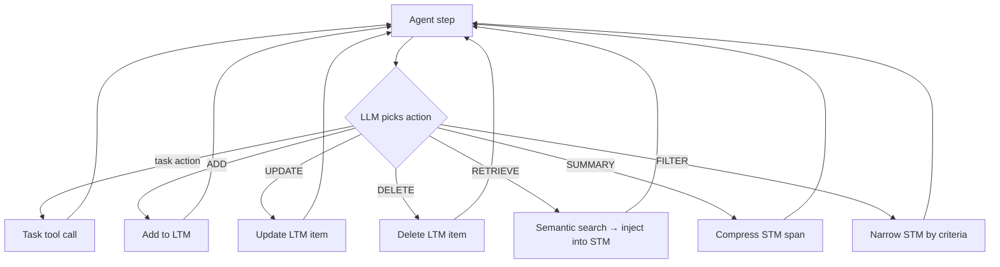

# Agentic Memory

**Also known as:** Memory Operations as Tools, AgeMem, Unified STM-LTM Tool Interface, 智能体记忆

**Category:** Memory  
**Status in practice:** emerging

## Intent

Expose memory management as first-class tool actions (ADD, UPDATE, DELETE, RETRIEVE, SUMMARY, FILTER) the LLM chooses at every step, trained end-to-end so short-term and long-term memory live under one learned policy.

## Context

A long-running agent accumulates conversation history, intermediate results, and learned facts that exceed any context window. Standard practice splits this into short-term memory (the live context) and long-term memory (an external store) managed by separate controllers: a summariser decides what gets compressed, a retrieval policy decides what gets pulled back, an eviction heuristic decides what gets dropped. Each controller is hand-tuned and the agent's actual reasoning has no visibility into or control over them.

## Problem

When memory management lives in auxiliary controllers (summarisers, evictors, retrievers) tuned by hand, the agent's policy and its memory policy are optimised separately and cannot co-adapt. The agent cannot decide 'I should remember this exchange in detail because it will matter in three turns' or 'this fact is now stale, delete it' — those decisions belong to heuristics it cannot see. End-to-end optimisation across the agent loop and the memory loop is impossible because the memory loop is not differentiable, not callable, and not part of the agent's action space.

## Forces

- Memory decisions are task-dependent; what to keep depends on what the agent is doing.
- Hand-tuned heuristics (summarise every N turns, evict when over budget) are local optima.
- End-to-end training requires memory operations to be part of the agent's action space.
- Sparse and discontinuous reward from memory operations makes naive RL unstable.

## Therefore

Therefore: expose ADD, UPDATE, DELETE, RETRIEVE, SUMMARY, and FILTER as named tools the LLM can call at any step, and train the agent end-to-end with a step-wise RL objective so the memory policy and the task policy co-adapt.

## Solution

Define six memory operations as first-class tools available to the agent at every step: ADD (write a new memory item with metadata), UPDATE (modify an existing item), DELETE (remove obsolete items), RETRIEVE (semantic search over long-term memory, results injected into context), SUMMARY (compress a dialogue span), FILTER (narrow short-term memory by criteria). Train the agent end-to-end via reinforcement learning with a step-wise objective that credits memory operations against eventual task reward — published work uses a step-wise GRPO variant to handle the sparse and discontinuous reward signal from memory actions. Short-term and long-term memory share one learned policy rather than separate controllers.

## Structure

```
Agent step --LLM picks action--> {task tool call | ADD | UPDATE | DELETE | RETRIEVE (search LTM -> inject into STM) | SUMMARY (compress STM span) | FILTER (narrow STM)} --> next agent step; end-to-end RL credits each memory action against final task reward
```

## Diagram



*Agentic Memory exposes ADD/UPDATE/DELETE/RETRIEVE/SUMMARY/FILTER as tools at every step; the LLM picks any of them as part of one learned policy.*

## Example scenario

A customer-support agent runs across multi-day cases. Under heuristic controllers, every 20 turns a summariser collapses the oldest window; a retrieval policy pulls related items on every turn whether or not they're needed. Under Agentic Memory, the agent learns from training that customer name and order id should ADD to long-term memory immediately, that intermediate troubleshooting steps can stay in short-term memory and be FILTERed out once resolved, and that on resumption it should RETRIEVE on the order id rather than the case id. Memory operations appear as named tool calls in the trace; the same RL signal that taught task-resolution also taught memory hygiene.

## Consequences

**Benefits**

- Memory and task policy co-adapt; the agent learns task-specific memory strategies.
- Outperforms hand-tuned baselines (Mem0, A-Mem, LangMem) on long-horizon tasks per published evaluations.
- Memory decisions are inspectable as named tool calls in the trace.
- Adding a new operation (e.g. PIN) is an action-space change, not a controller rewrite.

**Liabilities**

- Requires RL training infrastructure — not a drop-in for off-the-shelf models.
- Step-wise reward attribution to memory actions is subtle; naive RL is unstable.
- Larger action space means more exploration cost and longer training.
- The learned policy is task-distribution-specific; generalisation across very different tasks is unproven.

## Failure modes

- Reward hacking on memory actions — the step-wise credit rewards ADD or RETRIEVE calls themselves, so the trained agent fills memory with items that never help the task.
- Unstable training — a naive RL setup cannot tie a sparse final reward back to an early DELETE or SUMMARY, and the memory policy oscillates instead of converging.
- Distribution lock-in — the learned memory policy fits the training tasks and makes poor keep-or-delete choices on a different kind of task.
- Out-of-band writes — a helper process edits memory outside the six tools, and the trace no longer explains why an item exists.

## What this pattern constrains

Memory state may only be modified through the named tool actions (ADD/UPDATE/DELETE/RETRIEVE/SUMMARY/FILTER); auxiliary heuristic controllers cannot mutate memory out-of-band, so every memory change is attributable to a single LLM action in the trace.

## Applicability

**Use when**

- The agent runs over long horizons (days, weeks) and hand-tuned memory heuristics have plateaued.
- Task reward is well-defined and an RL training loop is available.
- Memory decisions are task-dependent in ways generic policies miss.
- The team can afford end-to-end training and the larger action-space exploration.

**Do not use when**

- Short-horizon agents where a single context window plus simple summarisation suffices.
- No RL infrastructure; an off-the-shelf model with heuristic controllers will be cheaper.
- Sparse, deferred, or noisy task rewards that step-wise credit assignment cannot disentangle.
- A small set of well-understood memory rules already meets the SLO.

## Components

- Memory action vocabulary — the six named operations with typed arguments and return shapes
- Long-term store — vector index or hybrid store that ADD/UPDATE/DELETE/RETRIEVE operate against
- Short-term context — the live working memory that SUMMARY and FILTER compress and narrow
- Step-wise reward shaper — credits memory operations against eventual task reward (e.g. step-wise GRPO)
- Trace logger — records every memory action so the policy is debuggable and auditable

## Tools

- Vector store for LTM (Pinecone, Weaviate, pgvector-class)
- RL trainer — TRL, OpenRLHF, or in-house with support for step-wise reward attribution
- LLM serving — must support tool calls with structured arguments per turn

## Evaluation metrics

- Long-horizon task success rate vs. heuristic-controller baselines on ALFWorld, SciWorld, BabyAI, PDDL, HotpotQA-class benchmarks
- Memory operation distribution — how often each of the six ops is invoked, by task type
- Memory cost per task — total memory ops × per-op cost, against task reward
- Stale-item rate — fraction of LTM items not RETRIEVEd within N turns (dead memory)
- Train-time variance — RL stability across seeds, given the discontinuous memory reward

## Known uses

- **[AgeMem (Alibaba Group + Wuhan University, 2026)](https://arxiv.org/abs/2601.01885)** _available_
- **[A-MEM (Agentic Memory for LLM Agents)](https://arxiv.org/abs/2502.12110)** _available_

## Related patterns

- _alternative-to_ **MemGPT-Style Paging**
- _composes-with_ **Semantic Memory**
- _composes-with_ **Episodic Memory**
- _composes-with_ **Vector Memory**
- _complements_ **Episodic Summaries**
- _complements_ **Test-Time Memorization (Titans)**

## References

- [Agentic Memory: Learning Unified Long-Term and Short-Term Memory Management for Large Language Model Agents](https://arxiv.org/abs/2601.01885) — Alibaba Group, Wuhan University, 2026
- [A-MEM: Agentic Memory for LLM Agents](https://arxiv.org/abs/2502.12110) — 2025
- [超越代表作Mem0！阿里&武大提出智能体记忆新范式Agentic Memory](https://zhuanlan.zhihu.com/p/1995156749519431207)
