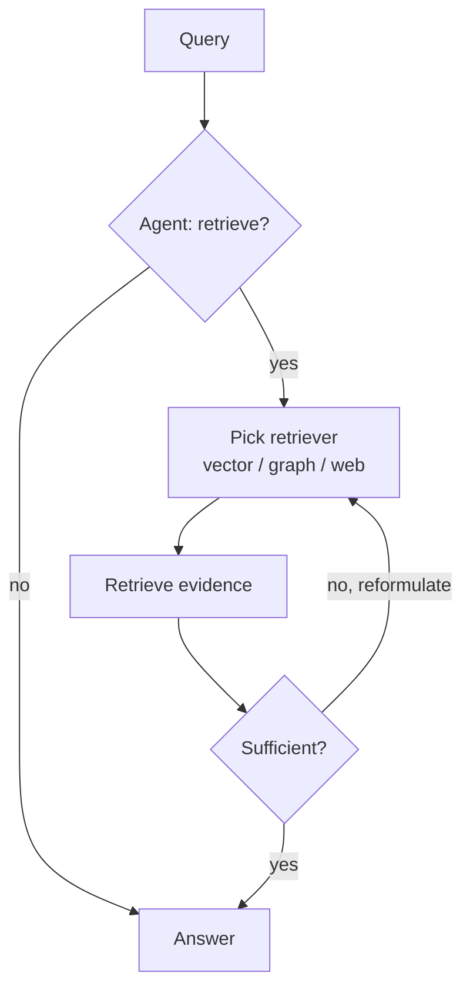

# Agentic RAG

**Also known as:** Iterative RAG

**Category:** Retrieval & RAG  
**Status in practice:** mature

## Intent

Replace static retrieve-then-generate with autonomous agents that plan, choose sources, retrieve iteratively, reflect, and re-query.

## Context

A team is building a retrieval-augmented system to answer user questions over a corpus, but the questions are not all of one kind. Some are multi-hop, where the answer depends on facts from two or three different documents combined. Some are ambiguous, where the question itself does not pin down what is being asked. And the corpus or the user's information need is evolving over time. A single retrieve-once, generate-once pipeline cannot serve all of these reliably.

## Problem

Naive retrieval-augmented generation runs one retrieval per question and feeds the top chunks straight into the generator. It cannot decide whether retrieval is even needed for a given question, cannot choose between several available sources, cannot tell when it has gathered enough evidence to stop, and has no path to recover when the retrieval comes back with poor or irrelevant chunks. Easy questions get pointless retrieval calls, multi-hop questions get partial answers, and bad retrievals quietly corrupt the output.

## Forces

- Agentic loops cost more than single-shot retrieval.
- Source selection requires capability descriptions.
- Loop bounds must prevent runaway retrieval.

## Therefore

Therefore: expose retrieval as a tool the agent chooses, reformulates, and bounds, so that retrieval becomes a planning decision rather than a fixed pipeline step.

## Solution

Treat retrieval as a tool. The agent decides whether to retrieve, formulates and reformulates the query, picks among multiple retrievers (vector, graph, keyword, web), evaluates retrieved evidence, and re-queries on insufficient results. Composes naturally with reflection, planning, and tool-use patterns.

## Structure

```
Query --> Planning agent --no retrieval needed--> Generator --> Answer | --retrieve--> Pick retriever (vector / graph / keyword / web) --> Retrieve evidence --> Evidence evaluator --insufficient--> reformulate --> Pick retriever (within step budget) | --sufficient--> Generator --> Answer
```

## Diagram



## Example scenario

A consulting agent is asked, 'Compare our 2023 and 2024 revenue by region.' Naive RAG would do one search and pass whatever it found to the model. Agentic RAG instead runs in a loop: it queries the 2023 figures, decides it also needs 2024 figures, queries those, notices the EMEA numbers are missing, queries again with a more specific phrase, then produces the comparison from a complete set.

## Consequences

**Benefits**

- Handles multi-hop and adaptive queries.
- Source diversity (multi-store retrieval) becomes feasible.

**Liabilities**

- Cost and latency rise with loop iterations.
- Loop quality depends on agent self-evaluation.

## Failure modes

- Premature stop — the agent judges thin evidence as enough, stops retrieving, and answers a multi-hop question with half the facts.
- Retrieval loop — the agent keeps reformulating and re-querying without new evidence until the step budget runs out.
- Wrong source pick — the agent's description of the retrievers is vague, so it searches the vector store for a question only the web or graph can answer.
- Needless retrieval — the agent retrieves for questions it could answer directly, adding cost and latency for no gain.

## What this pattern constrains

Retrieval is one tool among many; the agent decides invocation, but each retrieval is bounded by the step budget.

## Applicability

**Use when**

- A single retrieve-then-generate pass is insufficient for the task's information needs.
- Multiple retrievers (vector, graph, keyword, web) exist and the right one varies per query.
- The agent benefits from reflecting on retrieved evidence and re-querying when results are poor.

**Do not use when**

- Static one-shot RAG already meets quality targets at lower cost and latency.
- Latency budgets cannot afford iterative retrieval rounds.
- There is only one retriever and no meaningful query reformulation possible.

## Components

- Planning agent — decides whether to retrieve, picks a retriever, reformulates the query, and judges sufficiency
- Retriever pool — multiple backends (vector, graph, keyword, web) exposed as tools the agent can select between
- Evidence evaluator — scores accumulated chunks against the open question and signals continue-or-stop
- Step-budget controller — caps loop iterations so retrieval cannot run away
- Generator LLM — produces the final answer once evidence is judged sufficient

## Tools

- Vector index — semantic retrieval backend invoked by the agent
- Web search API — fallback retriever for queries the local corpus cannot answer
- LLM API — drives planning, query reformulation, and final generation

## Evaluation metrics

- Multi-hop answer accuracy — fraction of cross-document questions resolved correctly compared with single-shot RAG
- Average retrieval rounds per query — how often the loop actually fires, sanity check on budget controller
- Re-query rate after evaluator rejection — share of retrievals graded insufficient, signalling retriever quality
- p95 end-to-end latency — cost of the loop relative to one-shot retrieval
- Tool-call cost per resolved query — combined LLM and retriever spend per answered question

## Known uses

- **Self-RAG, CRAG implementations** _available_
- **[LangGraph Agentic RAG tutorials](https://langchain-ai.github.io/langgraph/tutorials/rag/langgraph_agentic_rag/)** _available_
- **[Perplexity](https://www.perplexity.ai/)** _available_
- **[ChatGPT Search](https://chat.openai.com/)** _available_
- **[Glean](https://www.glean.com/)** _available_
- **[Notion AI](https://www.notion.so/product/ai)** _available_
- **[Sparrot](https://marco-nissen.com/sparrot/)** _available_ — The agent retrieves over its own Markdown corpus (and external sources) inside a reasoning loop rather than via a one-shot fetch-then-answer step.

## Related patterns

- _generalises_ **Naive RAG**
- _uses_ **ReAct**
- _uses_ **Reflection**
- _uses_ **Tool Use** — Retrieval is exposed as a tool the agent decides to invoke.
- _composes-with_ **Cross-Encoder Reranking** — Reranking is a near-universal RAG companion.
- _generalises_ **Self-RAG**
- _generalises_ **CRAG**
- _generalises_ **Co-Located Memory Surfacing**
- _alternative-to_ **Modular RAG**
- _alternative-to_ **Over-Search and Under-Search**
- _specialises_ **Hierarchical Retrieval**
- _complements_ **CDC-Driven Vector Sync**
- _uses_ **Vectorless Reasoning-Based Retrieval** — An agentic RAG loop can drive a tree navigator as its retrieval tool instead of a vector search tool.
- _complements_ **Tenant-Scoped Tool Binding** — Retrieval must carry the tenant id before it reaches the index.
- _complements_ **Canonical-Entity Grounding** — Retrieval finds context; resolution pins exact identity.
- _complements_ **Semantic Response Cache** — A similarity hit returns the stored answer before the iterative plan-retrieve-reflect loop is entered, saving its repeated model calls.
- _alternative-to_ **Table-Augmented Generation** — Agentic RAG loops an agent over retrievers as tools; TAG instead compiles the question into one executable query whose execution layer itself invokes the model.

## References

- [Agentic Retrieval-Augmented Generation: A Survey on Agentic RAG](https://arxiv.org/abs/2501.09136) — Singh, Ehtesham, Kumar, Khoei, 2025
