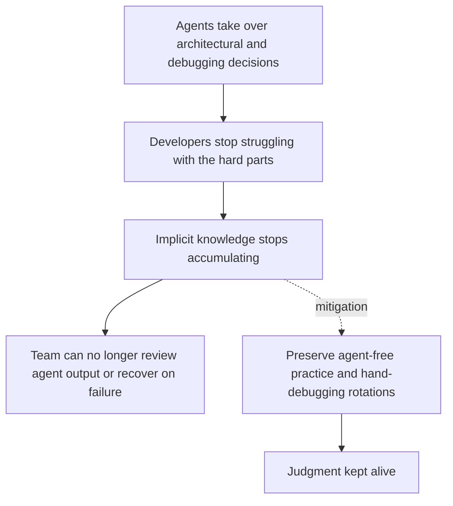

# Agentic Skill Atrophy

**Also known as:** Utilsiktet Kunnskap Loss, Developer Skill Erosion, Skill Atrophy

**Category:** Anti-Patterns  
**Status in practice:** deprecated

## Intent

Anti-pattern: let agents take over routine architectural and debugging decisions in code until developers no longer form the implicit knowledge that lets them review the agent's output or recover when it fails.

## Context

A team adopts agentic coding tooling for everyday work — feature implementation, bug fixes, refactors. The agents are fast and competent for routine work. Over months, the team's daily practice shifts from writing code to prompting agents and skimming diffs.

## Problem

Developers form judgment by struggling with architectural choices, debugging failure modes by hand, and accumulating the implicit feel for system weaknesses that the Norwegian source names 'utilsiktet kunnskap' (unintentional knowledge). When agents handle those decisions, the struggle stops and the implicit knowledge stops accumulating. After enough months, the team can no longer reliably review what the agent produces — they accept plausible-looking diffs because they lack the buried experience to spot wrong-shape solutions — and cannot recover the system when the agent fails or is unavailable. The Danish source names the same mechanism specifically for junior developers shipping code they themselves cannot explain.

## Forces

- Agentic tooling rewards short-term throughput; skill maintenance is a long-term cost with no immediate metric.
- Junior developers in particular accelerate fastest with agents and accumulate the least foundational competence.
- Review discipline degrades silently — a team that no longer struggles also no longer notices what it has stopped learning.

## Therefore

Therefore: deliberately preserve hands-on struggle on a portion of the work (debugging by hand, designing without agent assistance, code-reading-without-explaining-tools), and relocate review rigor onto explicit artifacts (context files, deterministic constraints, continuous verification) so judgment does not silently erode.

## Solution

Don't let the team's hands stop. Preserve agent-free time on architecturally important work; rotate juniors through debugging-by-hand and design-without-agent sessions. Pair this with rigor-relocation: name the artifacts where the team's discipline now lives (a context file the agent reads, lint and structural-test constraints the agent cannot override, continuous verification that compares output against original intent). Use eval-as-contract and decision-log to keep judgment externalised and reviewable even as individual practitioners' implicit knowledge shrinks. Treat skill atrophy as the team-shape counterpart of review-bottleneck-migration: the review side fails not just because of volume but because reviewers lose the implicit knowledge they once had.

## Structure

```
Anti-pattern: Agent takes over design and debugging -> team stops struggling with hard choices -> implicit knowledge stops forming -> weak review and no recovery. Corrected: Agent work + protected agent-free practice + externalised rigor (context file, lint, evals, decision log) -> reviewable output and retained skill.
```

## Diagram



*Agentic Skill Atrophy failure-mode pathway.*

## Example scenario

A team adopts an agentic coding tool and lets juniors use it for every task. After eight months, throughput is up 30% but a production incident reveals that no one on the team can explain why the agent chose an event-sourced design for a service that does not need it — they all just approved the PR. The senior who would have caught the mismatch has spent those eight months reviewing agent diffs rather than designing systems, and her implicit feel for service-shape choices has dulled. The fix is to carve out agent-free design and debugging time, externalise the team's design judgment into a decision-log and a CLAUDE.md context file the agent reads, and add eval-as-contract gates the agent cannot override.

## Consequences

**Benefits**

- Short-term: handing routine design and debugging to the agent frees developer time and speeds up delivery right away.
- Naming it lets a team plan agent-free practice and rotate juniors through hand debugging on purpose.

**Liabilities**

- Reviewers accept plausible-looking diffs they cannot evaluate, propagating wrong-shape designs.
- Team loses recovery capability when the agent fails, regresses, or becomes unavailable.
- Junior developers ship code they themselves cannot explain, hardening into a permanent skill gap.

## Failure modes

- Rubber-stamp review — reviewers approve plausible-looking diffs because they no longer have the experience to spot a wrong-shape design.
- No fallback — the agent fails or is unavailable, and nobody on the team can debug the system by hand.
- Unexplained code — junior developers ship code they cannot explain, and the gap becomes permanent.
- Slow erosion — the loss happens over months, so no single sprint shows a problem until recovery is needed.

## What this pattern constrains

No useful constraint; the missing constraint is deliberate preservation of hands-on practice and externalised review rigor.

## Applicability

**Use when**

- Never. Cite when reviewing a team's adoption plan for agentic coding tools.
- Demand explicit agent-free practice time and externalised review artifacts (context file, constraints, continuous verification).
- Track review-quality and recovery-capability metrics over time, not only throughput.

**Do not use when**

- Any team where agentic tools are adopted with no plan for preserving hands-on practice.
- Any team whose juniors ship agent-produced code they cannot explain.
- Any setting where review-quality and recovery-capability metrics are not tracked.

## Components

- Trigger condition — what causes the agentic skill atrophy pattern to manifest
- Affected surface — the part of the system where the failure shows up
- Detection signal — what an operator would observe when this is happening

## Tools

- Observability — logs, traces, and metrics that surface the pattern
- Eval harness — runs that quantify exposure to the pattern

## Evaluation metrics

- Diff-explain rate — share of merged agent-authored PRs where the submitting developer can verbally explain the design rationale on cold review
- Time-to-recover-without-agent — minutes to fix a representative production bug with agent assistance disabled
- Review-defect catch rate — share of seeded design defects caught by human reviewers across a held-out PR set
- Hands-on-practice ratio — share of engineering hours spent on agent-free work over a rolling four-week window
- Junior recovery-capability trajectory — measured progression of junior developers on agent-free debugging tasks over six months

## Known uses

- **[kode24.no — Hvordan AI endrer koding: Disiplinen som kreves i det nye paradigmet](https://www.kode24.no/artikkel/det-ser-hensynlost-ut-men-det-er-fremtiden/260376)** _available_ — Norwegian source coining 'utilsiktet kunnskap' as the lost faculty.
- **[consile.dk — Agentic Engineering (Agentbaseret softwareudvikling)](https://consile.dk/ai/ordbog/agentic-engineering-agentbaseret-softwareudvikling)** _available_ — Danish source naming skill atrophy as a recurring failure mode in junior developers.

## Related patterns

- _alternative-to_ **Rigor Relocation** — the fix is to relocate discipline onto explicit artifacts, not to abandon agents
- _alternative-to_ **Decision Log** — externalised judgment that survives individual practitioners' atrophy
- _alternative-to_ **Eval as Contract**
- _complements_ **Perma-Beta**
- _complements_ **Hidden Validation-Work Amplification**
- _complements_ **Constrained Adaptability**
- _complements_ **Context-Driven Architecture Drift** — Atrophy erodes the team's ability to spot wrong-shape diffs; this drift produces them — together the agent makes architectural mistakes and the team stops catching them.
- _complements_ **Understanding-Capacity Gap** — Skill atrophy erodes the individual capacity to review agent output over time; this gap is the team-level mismatch where output is scaled past whatever review capacity remains, so the two reinforce each other.

## References

- [Hvordan AI endrer koding: Disiplinen som kreves i det nye paradigmet](https://www.kode24.no/artikkel/det-ser-hensynlost-ut-men-det-er-fremtiden/260376) — 2026
- [Agentic Engineering (Agentbaseret softwareudvikling)](https://consile.dk/ai/ordbog/agentic-engineering-agentbaseret-softwareudvikling) — 2026
