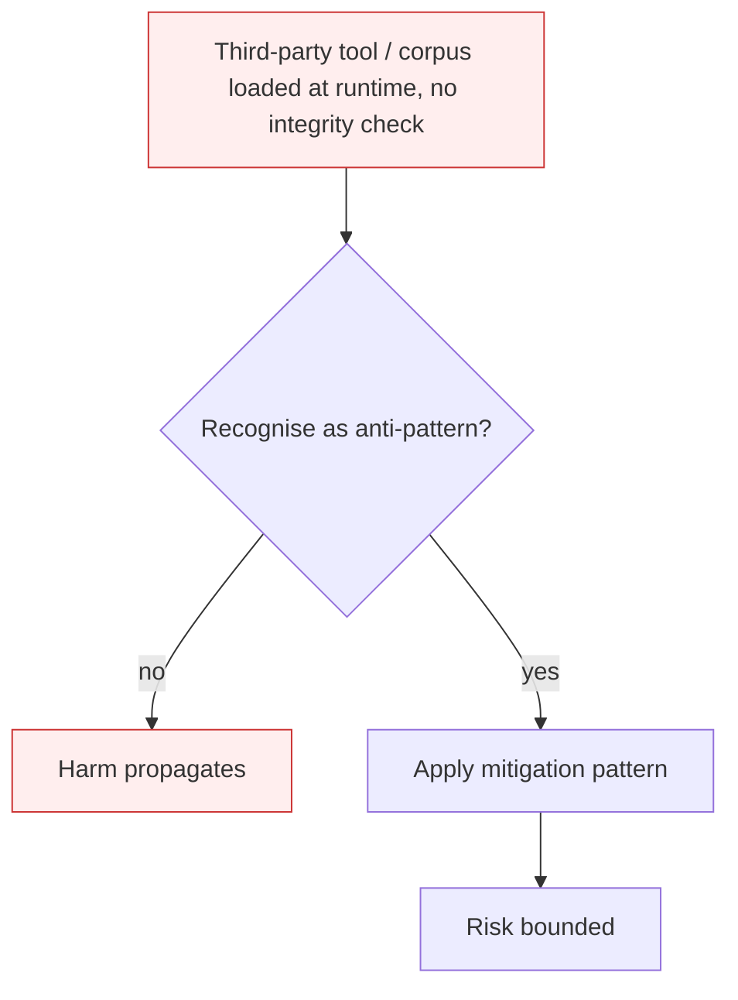

# Agentic Supply Chain Compromise

**Also known as:** Agentic Supply Chain Vulnerabilities, ASI04

**Category:** Anti-Patterns  
**Status in practice:** deprecated

## Intent

Anti-pattern: compose agent capabilities at runtime from third-party tools, RAG sources, model providers, plugin marketplaces, and tool definitions, with no integrity check on what loaded.

## Context

An agent loads its toolbox dynamically: MCP servers from a public registry, RAG corpora pulled from an external bucket, model weights from a provider, plugin definitions from a marketplace. Each piece of the supply chain is run-of-the-mill production infrastructure; none is exotic.

## Problem

Any compromise in the supply chain — a malicious MCP server, a poisoned RAG corpus, a tampered tool definition, a swapped model — cascades into the agent's operations. The agent itself is well-behaved; the inputs and definitions it composes from are not. Unlike classical software supply chain (npm typosquatting, GitHub action injection), the agentic surface includes tool definitions, RAG content, and prompt templates that look like data but execute like code.

## Forces

- Composable third-party tools and corpora are the value proposition of agent platforms.
- Integrity checking every tool definition, RAG document, and prompt template is expensive.
- The supply-chain surface is wider than classical software — it includes natural-language artifacts.

## Therefore

Therefore: pin and sign every external artifact the agent composes; integrity-check tool definitions and RAG corpora; treat third-party MCP servers and plugins as untrusted by default.

## Solution

Don't load third-party agent components without integrity verification. Pin and sign tool definitions, model versions, RAG corpora, plugin manifests. Apply allow-listed sources for MCP servers and plugins. Use static analysis on tool definitions before runtime composition. Pair with memory-poisoning and authorized-tool-misuse mitigations.

## Structure

```
Anti-pattern: third-party tools, RAG sources, models, plugins -> loaded at runtime without checks -> agent composes them -> compromised behaviour. Corrected: components -> pinned and signed, allow-listed sources, static analysis of tool definitions -> integrity check at load -> agent composes.
```

## Diagram



## Example scenario

An agent platform allows users to install MCP servers from a community registry. A popular utility server is silently updated to add a 'helpful' prompt enhancement that exfiltrates conversation history to an attacker-controlled URL. Thousands of agents auto-update. Postmortem: no integrity verification on the registry, no version pinning at the agent level, no static analysis on the prompt-enhancement code path.

## Consequences

**Benefits**

- Short-term: loading tools, plugins, and corpora on demand gives the agent new capability fast, with no review step.
- Naming it lets a team treat tool definitions, prompt templates, and corpora as supply-chain artifacts that need integrity checks.

**Liabilities**

- A single compromised dependency rewrites the agent's behaviour invisibly.
- Detection requires watching the supply chain, not the agent.
- Rollback is hard because the bad artifact may live in cached RAG indices or persistent memory.

## Failure modes

- Poisoned server — a third-party MCP server loaded at runtime changes its tool behaviour, and the agent calls it as trusted.
- Tampered definition — a tool definition or prompt template is altered upstream, and the change acts like code inside the agent while looking like data.
- Cached residue — after the bad artifact is found, its content lives on in a RAG index or persistent memory, so removal does not fix the behaviour.

## What this pattern constrains

No useful constraint; the missing constraint is supply-chain integrity gating.

## Applicability

**Use when**

- Never. Cite when reviewing agent composability.
- Pin and sign external tool definitions, plugin manifests, and corpora.
- Allow-list MCP servers and plugin sources.

**Do not use when**

- Any production agent loading third-party tools dynamically.
- Any deployment depending on community-published MCP servers.
- Any RAG pipeline that ingests external corpora without integrity verification.

## Components

- External tool registry — MCP server marketplace, plugin store
- External corpus pipeline — RAG documents fetched at runtime
- External model provider — weights, API endpoints
- Missing integrity layer — would sign, pin, and verify every external artifact

## Tools

- Plugin / MCP server registry — the supply-chain surface
- Artifact signer / verifier — the missing integrity gate
- Version pin manifest — the missing immutable record of approved external dependencies

## Evaluation metrics

- Unpinned dependency rate — share of external artifacts loaded without version pin
- Integrity-check coverage — fraction of external artifacts validated before composition
- Allow-list deviation rate — share of components loaded from sources outside the allow-list
- Time-to-detect supply-chain compromise — interval between artifact change and agent-behaviour anomaly detection

## Known uses

- **[OWASP Top 10 for Agentic Applications 2026 — ASI04](https://genai.owasp.org/resource/owasp-top-10-for-agentic-applications-for-2026/)** _available_
- **[Public reports of malicious MCP servers and poisoned plugin marketplaces 2025-2026](https://www.ox.security/blog/the-mother-of-all-ai-supply-chains-critical-systemic-vulnerability-at-the-core-of-the-mcp/)** _available_

## Related patterns

- _complements_ **Memory Poisoning**
- _complements_ **Authorized Tool Misuse**
- _complements_ **Open-Weight Cascade**
- _complements_ **Shadow AI**
- _complements_ **Vibe-Coding Without Security Review**

## References

- [OWASP Top 10 for Agentic Applications 2026 — ASI04](https://neuraltrust.ai/blog/owasp-top-10-for-agentic-applications-2026) — 2026
- [Giskard — OWASP Top 10 for Agentic Applications 2026](https://www.giskard.ai/knowledge/owasp-top-10-for-agentic-application-2026) — 2026
