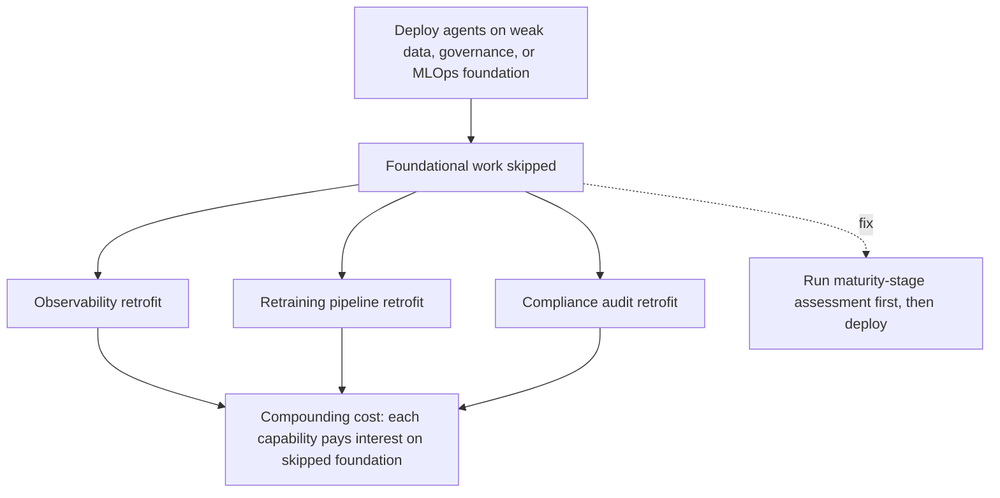

# Agentic Debt

**Also known as:** Agentisk Skuld, AI Maturity Debt, Foundational AI Debt

**Category:** Anti-Patterns  
**Status in practice:** deprecated

## Intent

Anti-pattern: deploy agents on top of an unconsolidated data foundation, weak governance, or missing MLOps infrastructure, so every subsequent capability — observability, retraining, compliance retrofit — pays compounding interest on the skipped foundational work.

## Context

An organisation under competitive pressure decides to skip directly to agentic systems before completing the prior maturity stages (data consolidation, automation, classical the model, MLOps). The pilot demonstrates value, the executive sponsor is satisfied, and the agent ships. The data, governance, and observability infrastructure that would normally have been built in the earlier stages is now missing under a live agent.

## Problem

Every later capability the agent needs — production monitoring, retraining when the model drifts, compliance audit trails, cross-team observability — costs multiples of what it would have cost to build the foundation first. The Swedish HiQ coinage 'agentisk skuld' names this as a distinct failure shape: not the demo-to-production cliff (a one-time deployment failure) but a recurring interest payment on every agent deployment afterwards. The team builds the missing data pipeline retroactively for agent #1, again for agent #2 with different requirements, and again for agent #3, paying the same foundational work three times in less-coherent forms. Industry reporting independently corroborates this as 'the model sprawl' (OutSystems: 94% of organisations cite sprawl as increasing technical debt) and 'hidden technical debt of agentic engineering' (The New Stack).

## Forces

- Competitive FOMO ('rädsla att missa något') pushes organisations to skip stages.
- Pilot success is celebrated before the foundational debt comes due.
- Each subsequent agent deployment re-pays the same foundational cost in a different shape, so the total bill is invisible from any single project's budget.

## Therefore

Therefore: complete the prior maturity stages (data consolidation, automation, classical the model, MLOps) before deploying agents — or at minimum, name the debt explicitly, budget for its repayment, and refuse to deploy further agents until the foundation is built.

## Solution

Don't skip foundational stages under FOMO. Run the maturity-stage assessment first: data lineage and quality, automation infrastructure, classical-ML observability and retraining pipelines, MLOps for deployment and rollback. Only then deploy agents. If the organisation has already taken on agentic debt, name it, quantify it, and stage repayment: build the missing foundation as an explicit programme before launching additional agents. Use eval-as-contract, decision-log, and cost-observability as the minimum survival kit. Distinguish from demo-to-production-cliff: the cliff is a one-time deployment failure on a single agent; agentic debt is the compounding cost paid on every subsequent agent deployment.

## Structure

```
Anti-pattern: Weak data + governance + MLOps foundation -> agent #1, #2, #3 deployed -> each rebuilds missing foundation -> compounding cost. Corrected: Maturity-stage assessment -> build data lineage, observability, MLOps -> deploy agents (or stage debt repayment first).
```

## Diagram



*Agentic Debt failure-mode pathway.*

## Example scenario

A retail group ships an agentic customer-service product to keep pace with a competitor. The pilot works and rolls out. Six months later, the data team builds a customer-event pipeline retroactively to give the agent the order history it needs. Three months after that, a second agent for logistics needs a similar but differently-shaped pipeline, and the team builds it again. A third agent for finance needs MLOps for model rollback, also built from scratch. The CTO audits and finds the organisation has paid three foundational bills instead of one — that gap is the agentic debt. The fix is a foundation-first programme: consolidate data, build shared MLOps, freeze further agent rollouts until the foundation is in place.

## Consequences

**Benefits**

- Short-term: skipping the foundation work lets the first agent launch quickly under pressure to keep up.
- Naming it lets a team quantify the debt and stage repayment before launching more agents.

**Liabilities**

- Each subsequent agent deployment costs multiples of the first as the missing foundation is rebuilt retroactively in different shapes.
- Observability, retraining, and compliance retrofits become permanent line items rather than one-time investments.
- The total debt is invisible from any single project's budget; only an organisation-level audit surfaces it.

## Failure modes

- Repeat foundation work — the data pipeline is rebuilt for agent one, again for agent two, and again for agent three, each in a different shape.
- Permanent retrofit — monitoring, retraining, and audit trails stay as recurring costs instead of being built once.
- Hidden total — each project budget looks fine, while the combined debt is only visible in an organisation-level audit.
- Drift with no pipeline — the model drifts and there is no retraining or rollback path to respond.

## What this pattern constrains

No useful constraint; the missing constraint is a mandatory maturity-stage gate before agent deployment.

## Applicability

**Use when**

- Never. Cite when an organisation proposes agent deployment without completing prior maturity stages.
- Demand a maturity-stage assessment (data, automation, classical model, MLOps) before sign-off.
- If debt has already accrued, name it, quantify it, and stage repayment before the next agent.

**Do not use when**

- Any organisation deploying agents without data consolidation, automation infrastructure, or MLOps.
- Any agent programme driven primarily by FOMO ('rädsla att missa något').
- Any setting where successive agent projects rebuild the same missing foundation in different shapes.

## Components

- Trigger condition — what causes the agentic debt pattern to manifest
- Affected surface — the part of the system where the failure shows up
- Detection signal — what an operator would observe when this is happening

## Tools

- Observability — logs, traces, and metrics that surface the pattern
- Eval harness — runs that quantify exposure to the pattern

## Evaluation metrics

- Foundation-coverage score — share of prior maturity stages (data, automation, classical model, MLOps) demonstrably in place before an agent ships
- Retroactive-foundation cost ratio — cost of building foundational capability after agent deployment divided by the cost of building it before
- Per-agent overhead trajectory — observability/retraining/compliance cost per agent across deployments #1, #2, #3 (should fall; under agentic debt, it rises)
- Sprawl indicator — count of distinct agent deployments depending on incompatible data pipelines
- FOMO-attribution share — fraction of agent deployments attributed in postmortems to competitive pressure rather than capability fit

## Known uses

- **[HiQ — Från data till agens: Navigera AI-mognadens väg mot agentiska system](https://hiq.se/insight/fran-data-till-agens-navigera-ai-mognadens-vag-mot-agentiska-system/)** _available_ — Swedish coinage of 'agentisk skuld' (agentic debt) as the maturity-stage-skip failure mode.
- **[The New Stack — The Hidden Technical Debt of Agentic Engineering](https://thenewstack.io/hidden-agentic-technical-debt/)** _available_ — English-language corroboration naming hidden infrastructure debt in agentic systems.
- **[OutSystems 2026 Agentic AI Research — Sprawl and Technical Debt](https://www.prnewswire.com/apac/news-releases/agentic-ai-goes-mainstream-in-the-enterprise-but-94-raise-concern-about-sprawl-outsystems-research-finds-302739251.html)** _available_ — 94% of organisations cite agentic AI sprawl as increasing technical debt.

## Related patterns

- _complements_ **Demo-to-Production Cliff** — the cliff is the one-time deployment failure; agentic debt is the compounding cost across every subsequent deployment
- _complements_ **Automating a Broken Process** — automating broken processes is one shape of foundational debt
- _complements_ **Perma-Beta**
- _alternative-to_ **Eval as Contract**
- _alternative-to_ **Decision Log**

## References

- [Från data till agens: Navigera AI-mognadens väg mot agentiska system](https://hiq.se/insight/fran-data-till-agens-navigera-ai-mognadens-vag-mot-agentiska-system/) — 2026
- [The Hidden Technical Debt of Agentic Engineering](https://thenewstack.io/hidden-agentic-technical-debt/) — 2025
- [Agentic AI Goes Mainstream in the Enterprise, but 94% Raise Concern About Sprawl, OutSystems Research Finds](https://www.prnewswire.com/apac/news-releases/agentic-ai-goes-mainstream-in-the-enterprise-but-94-raise-concern-about-sprawl-outsystems-research-finds-302739251.html) — 2026
