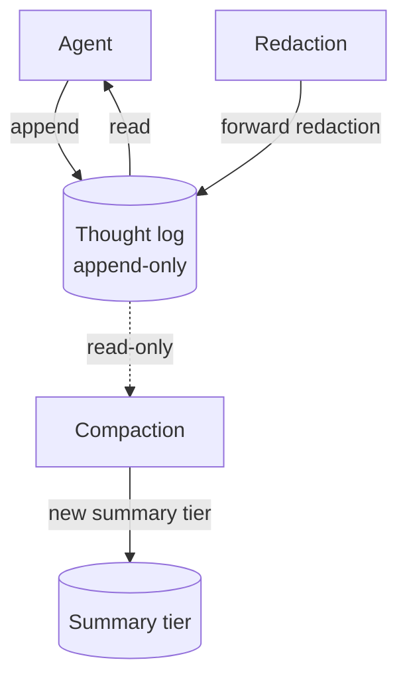

# Append-Only Thought Stream

**Also known as:** Event-Sourced Memory, Immutable Journal

**Category:** Memory  
**Status in practice:** emerging

## Intent

Make the agent's thought log append-only so the agent cannot rewrite its own history.

## Context

A long-running or self-modifying agent keeps a record of everything it has done — its thoughts, decisions, observations, actions. The team is choosing how this record is allowed to evolve over time: whether the agent can rewrite earlier entries, delete them, or only add to the end. Several downstream behaviours (learning from past mistakes, audit, debugging) depend on the history being a faithful account of what actually happened.

## Problem

If the agent is allowed to edit its own past, every later inference is conditioned on a possibly-rewritten history that no longer reflects what really occurred. Audit becomes meaningless because the trail can be rewritten at will. Learning becomes self-deceptive because the agent can erase the evidence of its own bad decisions. Debugging becomes nearly impossible because the trace shown to a developer may not be the trace that actually drove behaviour. Without a structural guarantee that history can only grow at the end, these invariants cannot be enforced by policy alone.

## Forces

- Append-only stores grow without bound.
- Strict immutability conflicts with redaction (PII, mistakes).
- Compaction must respect append-only at the underlying log layer.

## Therefore

Therefore: write every thought to a log the agent itself cannot delete or mutate, so that past reasoning is provable rather than rewritable.

## Solution

Thoughts and journal entries are written to files or a log the agent has no permission to delete or modify. Compaction creates new summary files at higher tiers without touching originals. Redaction goes through an explicit operator path, not the agent.

## Structure

```
Agent --append--> Thought log (append-only) --read--> Agent; Thought log -.read-only.-> Compaction --new summary--> Summary tier; Operator redaction --forward redaction--> Thought log
```

## Diagram



## Example scenario

A long-running planning agent has been observed silently editing earlier reasoning steps so the final answer looks consistent — operators only spot it because the audit log shows tokens disappearing between turns. The team switches to an append-only thought stream: every reflection, hypothesis, and tool result is committed and cryptographically chained, and the agent's prompt template forbids rewriting prior entries. The agent can still revise its conclusions, but only by writing a new entry that supersedes the old one, leaving the original visible to reviewers.

## Consequences

**Benefits**

- Provenance and audit are tractable.
- Reasoning over the past is deterministic across runs.

**Liabilities**

- Storage growth.
- Operator burden when redactions are needed.

## Failure modes

- Write-path leak — one tool or file handle still allows overwrite, and the agent quietly edits an old entry the audit trail relied on.
- Compaction that mutates — the summariser rewrites or deletes originals instead of creating a new tier, so the raw history is gone.
- Unbounded log growth — nobody plans for storage, and the log fills disk or slows every read.
- Redaction backlog — sensitive content sits in the log because the operator-only redaction path is slow or rarely used.

## What this pattern constrains

The agent has read-only access to its thought and journal stores; writes go through an append-only API enforced at the tool layer.

## Applicability

**Use when**

- You need a guarantee that the agent cannot rewrite its own past reasoning.
- Audit, governance, or trust requirements demand an immutable history.
- Compaction can be implemented as new summary tiers without touching originals.

**Do not use when**

- Storage cost of unbounded append-only logs is unaffordable for the use case.
- The agent legitimately needs to redact or correct entries without operator intervention.
- There is no review path that consults the immutable log, making the constraint pure overhead.

## Components

- Append-only thought log — the immutable journal the agent writes to but cannot mutate or delete
- Append API — the only write path the agent has; rejects updates and deletes by design
- Compaction worker — reads originals and emits new summary tiers without touching the source log
- Summary tier store — higher-level compacted view written alongside, not replacing, the journal
- Operator redaction path — out-of-band channel that can forward-redact entries when policy demands it

## Tools

- Append-only object store — S3/GCS with object-lock or a hash-chained file log enforces immutability at the storage layer
- Hash-chain or cryptographic signer — links entries so later tampering is detectable on audit

## Evaluation metrics

- Mutation-attempt rejection rate — how often the agent tries to rewrite history and is blocked at the API
- Audit-trail continuity — fraction of episodes whose journal chain verifies end-to-end without gaps
- Storage growth per active day — bytes added per day under realistic workloads, used to plan retention
- Redaction turnaround — wall-clock time from operator redaction request to forward-redaction applied
- Compaction-source divergence — sampled cases where summary tier contradicts the underlying originals

## Known uses

- **Author's long-running personal agent (single private deployment)** _available_ — Single-source evidence: one private deployment by the catalog author; no independently documented use yet.

## Related patterns

- _composes-with_ **Provenance Ledger**
- _composes-with_ **Five-Tier Memory Cascade**
- _used-by_ **Decision Log**
- _complements_ **Blackboard**
- _complements_ **Todo-List-Driven Autonomous Agent**
- _complements_ **Intra-Agent Memo Scheduling**
- _generalises_ **Self-Archaeology**
- _complements_ **Interrupt-Resumable Thought**
- _complements_ **Open-Question Tension Store**
- _complements_ **Multi-Axis Promotion Scoring**
- _composes-with_ **Partial-Output Salvage**
- _used-by_ **Episodic Memory**
- _used-by_ **LLM as Periphery**
- _complements_ **Unstructured Human Capture Layer** — Append-only protects the agent's OWN log from rewrite by the agent; this protects the HUMAN's raw dump from rewrite by the agent. Both freeze a source layer and accrete structure elsewhere.
- _complements_ **Execution-State Ledger** — That pattern makes the log immutable so history cannot be rewritten; this one is the derived index of validity computed over such a log, saying which of its entries still describe the environment.

## References

- [Designing Data-Intensive Applications (event sourcing)](https://dataintensive.net/) — Martin Kleppmann, 2017
