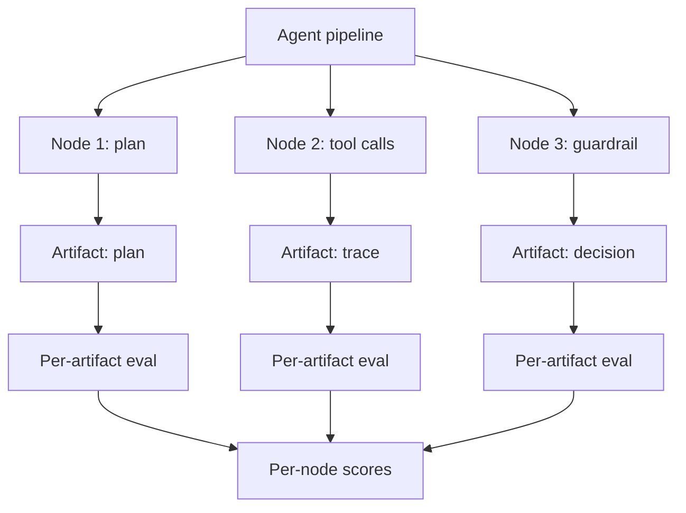

# Intermediate Artifact Evaluation

**Also known as:** Per-Pipeline-Node Eval, Mid-Pipeline Artifact Eval

**Category:** Governance & Observability  
**Status in practice:** emerging

## Intent

Evaluate intermediate artifacts (plans, tool-call traces, guardrail reactions) not only final outputs; isolates failure to a specific pipeline node.

## Context

A team evaluates agent quality by measuring final output success. Final-output eval cannot tell which pipeline node failed when the output is wrong. Debugging requires manual trace inspection.

## Problem

Final-output-only eval is coarse — it indicates something failed but not where. When pipelines have many nodes (plan, tools, guardrails, reflection), the team cannot improve any specific node without per-node signal. Differs from eval-harness (full-run eval) and eval-as-contract (boundary contract).

## Forces

- Per-artifact eval requires instrumenting each pipeline node to emit reviewable artifacts.
- More eval points means more eval cost (LLM-as-judge calls, human review time).
- Some intermediate artifacts are not naturally evaluable in isolation.

## Therefore

Therefore: instrument the agent to emit intermediate artifacts at each pipeline node and evaluate each artifact independently — plan quality, tool-call appropriateness, guardrail reaction correctness — not only final output.

## Solution

Each pipeline node emits a named artifact (plan, tool-call trace, guardrail decision, reflection output). Eval suite has per-artifact rubrics. Per-artifact pass/fail rates inform which node to improve. Pair with eval-harness, eval-as-contract, llm-as-judge, agent-evaluator, dual-evaluation-offline-online.

## Structure

```
Agent pipeline --> Node (plan | tool calls | guardrail | reflection) --> Named, schema-defined artifact --> Per-artifact rubric eval --> Per-node scores --> Score dashboard --> fix lowest-scoring node
```

## Diagram



## Example scenario

A research agent's eval: pre-pattern, only 'did the report answer the question?' is measured (78% pass). Post-pattern: planning artifact, tool-call trace, citation-attribution, final report all eval'd. Planning 88%, tools 92%, citations 65%, report 78%. Citations is the worst-scoring node; improvement work targets that node first instead of guessing.

## Consequences

**Benefits**

- Failure attribution to a specific pipeline node.
- Targeted improvement work — fix the worst-scoring node first.
- Catch regressions per-node, not just at the final-output level.

**Liabilities**

- More eval cost (per-node, not per-run).
- Some artifacts hard to evaluate in isolation.
- Per-node rubric drift if not maintained.

## Failure modes

- Context-free artifact — a tool-call trace is judged on its own, without the plan that called for it, and correct calls are marked wrong.
- Rubric rot — the plan schema changes but its rubric does not, so per-node pass rates drift away from what the node now does.
- Unnamed node output — one node emits no named artifact, and failures inside it still show up only in the final-output score.
- Per-node cost load — every node is judged on every run, and eval spend grows with pipeline depth until coverage is cut.

## What this pattern constrains

Pipeline nodes must emit named, schema-defined artifacts; eval rubrics exist per artifact class.

## Applicability

**Use when**

- Multi-node pipelines where failure attribution matters.
- Engineering capacity for per-node instrumentation and rubrics.
- Improvement work benefits from targeted node-level signal.

**Do not use when**

- Single-step agents — no per-node distinction.
- Eval cost budget cannot afford per-node measurement.
- Per-node rubric maintenance is not sustainable.

## Components

- Pipeline instrumentation — emits artifacts at each node
- Artifact schemas — per-node
- Per-artifact rubrics — eval criteria per artifact class
- Score dashboard — per-node pass rates

## Tools

- Pipeline node instrumentation
- Per-artifact rubrics
- Per-node score dashboard

## Evaluation metrics

- Per-node pass rate
- Worst-node identification — drives improvement work
- Per-node regression detection

## Known uses

- **[r_kaga (Zenn): 2025年の年始に読み直したいAIエージェントの設計原則とか実装パターン集](https://zenn.dev/r_kaga/articles/e0c096d03b5781)** _available_

## Related patterns

- _complements_ **Eval Harness**
- _complements_ **Eval as Contract**
- _complements_ **LLM-as-Judge**
- _complements_ **Agent Evaluator**
- _complements_ **Dual Evaluation (Offline + Online)**
- _complements_ **Checklist Partial-Credit Scoring** — Intermediate artifact evaluation localises which pipeline node failed; this produces a graded task-progress score that is comparable across agent versions on the same tasks.

## References

- [2025年の年始に読み直したいAIエージェントの設計原則とか実装パターン集](https://zenn.dev/r_kaga/articles/e0c096d03b5781) — 2026
