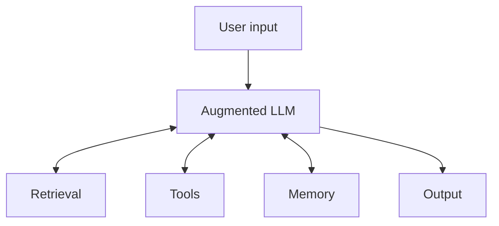

# Augmented LLM

**Also known as:** Augmented Model, LLM + Tools + Memory, Foundational Agent Block

**Category:** Tool Use & Environment  
**Status in practice:** mature

## Intent

Build the foundational agent block as an LLM augmented with retrieval, tools, and memory that the model actively chooses to use, rather than a bare-model call.

## Context

A team is building any non-trivial agentic system: a support assistant, a coding agent, a research agent, an internal workflow runner. They need a uniform building block so that higher-level patterns (chaining, routing, orchestrator-worker setups, multi-agent loops) can compose it without reinventing the basics each time.

## Problem

A bare large language model call cannot look up fresh facts, change state in any external system, or remember anything between turns. If each higher-level pattern wires up retrieval, tool calling, and memory in its own ad-hoc way, the building blocks stop being interoperable: a routing layer cannot drop in a worker that was built against a different memory shape, and observability has to be re-implemented per integration.

## Forces

- Each augmentation (retrieval, tools, memory) is independently useful but composes badly if not tailored to the specific use case.
- The model must decide when to retrieve, when to call a tool, and what to remember — pushing this decision out of the prompt into surrounding code defeats the augmentation.
- Adding all three augmentations naively bloats every prompt; capabilities should be exposed only where they pay off.

## Therefore

Therefore: treat the augmented LLM (model + retrieval + tools + memory) as the indivisible building block, and let the model itself decide when to invoke each augmentation, so that every higher-level pattern can compose this unit without re-implementing the basics.

## Solution

Wire the model with three capabilities and expose each via a model-driven interface: (1) retrieval queries the model can issue against external corpora; (2) tool calls the model can emit and whose results stream back; (3) memory the model can read from and write to across turns. The model — not the surrounding code — decides which augmentation to invoke at each step. Other workflow patterns (prompt-chaining, routing, orchestrator-workers, etc.) compose instances of this block, not bare model calls.

## Structure

```
User input → Augmented LLM { Model ⇄ Retrieval, Model ⇄ Tools, Model ⇄ Memory } → Output. The block is the unit of composition for every higher-level workflow pattern.
```

## Diagram



*The augmented LLM as the indivisible foundational building block.*

## Example scenario

A support agent is built as one augmented LLM: it can call a tool to look up the customer's order, retrieve a knowledge-base article via vector search, and read/write a session memory of the conversation so far. Every higher-level workflow (routing tickets, escalating to a human, parallel ranking of suggested replies) composes instances of this block rather than rewiring the model with capabilities each time.

## Consequences

**Benefits**

- One indivisible building block; every higher-level workflow composes it without re-implementing basics.
- Capabilities are model-driven, so the model adapts which augmentation to use per request.
- Provider-agnostic — the augmentation surface (retrieval, tools, memory) is independent of which model serves the block.

**Liabilities**

- Easy to underspecify when each augmentation should fire; without guidance the model may retrieve when it should call a tool, or skip memory writes.
- Cost compounds when every block calls all three augmentations on every request.
- Debugging touches three subsystems at once; observability must cover all augmentation paths.

## Failure modes

- Wrong augmentation — without guidance on when each one fires, the model retrieves documents when it should call a tool, or skips a memory write it later needs.
- Augmentation on every call — each block runs retrieval, tools, and memory on every request, and cost grows with no gain in answer quality.
- Hardcoded bypass — surrounding code decides which capability to call, so the block stops being swappable and the model can no longer choose.
- Blind subsystem — tracing covers tool calls but not retrieval or memory, so a bad answer cannot be traced back to the step that caused it.

## What this pattern constrains

Higher-level patterns must compose this block, not raw model calls; capability use is decided by the model, not hardcoded in surrounding code.

## Applicability

**Use when**

- You are building any agent system and need a consistent building block.
- The model should decide when to retrieve, call tools, or use memory — not surrounding code.
- Higher-level workflows (chaining, routing, orchestration) need a uniform unit to compose.

**Do not use when**

- A bare model call (no tools, no retrieval, no memory) is genuinely sufficient — keep it simple.
- Each augmentation is owned by a different team and cannot be co-evolved as one block.

## Components

- LLM — chooses which augmentation to invoke at each step
- Retrieval Subsystem — fetches passages from external corpora when the model issues a query
- Tool Adapter — executes tool calls the model emits and streams typed results back
- Memory Store — read and written by the model across turns
- Augmentation Router — dispatches the model's chosen capability to retrieval, tools, or memory

## Tools

- Retrieval backend (vector store or BM25) — serves passages for model-issued queries
- Tool runtime — executes typed tool calls and returns structured results
- Memory key-value store — persists state the model reads and writes across turns

## Evaluation metrics

- Augmentation-selection precision — how often the model picks retrieval, tools, or memory appropriately
- Grounded-answer rate — fraction of responses backed by retrieved or tool-produced evidence
- Memory read-write consistency — share of writes later read back without contradiction
- End-to-end task success — headline quality across composed augmentations
- p95 step latency — time per augmented step including retrieval, tool, or memory hops

## Known uses

- **[Anthropic Claude with tool use and retrieval](https://www.anthropic.com/research/building-effective-agents)** _available_ — Anthropic positions the augmented LLM as the foundational block for all agentic systems.
- **[OpenAI Assistants API](https://platform.openai.com/docs/assistants/overview)** _available_ — Combines model + tools (function calls, code interpreter, file search) + threads (memory) as a single primitive.

## Related patterns

- _uses_ **Tool Use**
- _uses_ **Naive RAG**
- _uses_ **Short-Term Thread Memory**
- _used-by_ **Prompt Chaining**
- _used-by_ **Routing**
- _used-by_ **Orchestrator-Workers**
- _specialises_ **ReAct**
- _generalises_ **Talker-Reasoner**
- _alternative-to_ **Multi-Agent on Sequential Workloads**
- _complements_ **MRKL Systems (Modular Neuro-Symbolic)**
- _complements_ **Business + LLM Microservice Split**
- _complements_ **FTI LLM Pipeline Split**
- _complements_ **Crawler Dispatcher**

## References

- [Building Effective Agents](https://www.anthropic.com/research/building-effective-agents) — Anthropic, 2024
