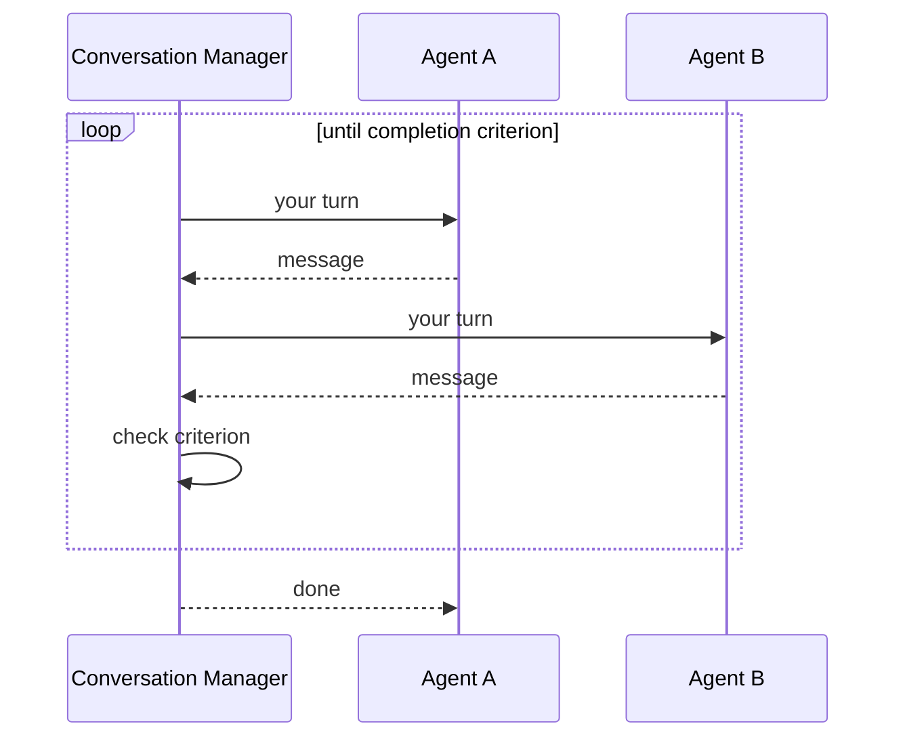

# Conversational Multi-Agent

**Also known as:** AutoGen Conversation, Two-Agent Conversation

**Category:** Multi-Agent  
**Status in practice:** emerging

## Intent

Have agents converse turn by turn until a completion criterion fires; agent roles drive the conversation forward.

## Context

A team is building an agent system whose task is naturally shaped like a conversation between two or more specialists: a coder agent and a reviewer agent revising a patch together, a teacher agent and a student agent working through an explanation, a writer agent and an editor agent. The work converges through back-and-forth rather than through a single agent's monologue.

## Problem

A single-agent loop has nowhere to put the dialogue: there is no opposing voice to push back, and inner-monologue self-critique tends to agree with itself. A rigid orchestration pipeline that fixes the step order in advance over-prescribes the flow and removes the conversational dynamics that make the pairing valuable in the first place. Without a structure for turn-taking, the team is forced to choose between a flat solo loop and a brittle hard-coded sequence.

## Forces

- Turn allocation across agents.
- Termination criterion definition.
- Conversation can drift without supervision.

## Therefore

Therefore: let role-defined agents speak turn by turn under a manager that picks the next speaker and watches for a termination criterion, so that dialogue-shaped collaboration is representable without over-prescribing the flow.

## Solution

Define agents with system prompts and allowed actions. Implement a conversation manager that selects which agent speaks next (round-robin, condition-based, model-decided). Each agent reads the conversation and emits a turn. Continue until termination criterion (task complete, max turns, explicit handoff to user).

## Structure

```
Task --> Conversation manager --select speaker--> Agent A (reads chat, emits turn) --> Manager --select speaker--> Agent B (reads chat, emits turn) --> Manager --check criterion--> [loop | done: task complete, max turns, or handoff to user]
```

## Diagram



## Example scenario

A finance team wants an agent that drafts an internal memo, has a 'reviewer' poke holes in it, and revises until the reviewer signs off. A linear pipeline can't represent the back-and-forth, and a free-form group chat is too loose. They use an AutoGen-style conversational setup: a writer agent and a reviewer agent take turns until the reviewer emits an explicit approval token. Each turn drives the next; the loop ends when the role-defined criterion fires.

## Consequences

**Benefits**

- Natural way to model peer collaboration.
- Each agent has a clean role definition.

**Liabilities**

- Conversation drift is real.
- Hard to reason about correctness of the multi-agent flow.

## Failure modes

- Conversation drift — the agents wander onto a side topic, keep agreeing with each other, and spend turns without moving the task forward.
- Termination never fires — the completion criterion is vague, so the chat runs until the max-turn cap and returns whatever the last message said.
- Role leak — an agent starts acting outside its allowed actions, for example a reviewer rewriting the code, and the role split stops meaning anything.
- Untraceable result — a wrong answer comes out of a long transcript, and nobody can say which turn introduced the error.

## What this pattern constrains

Each agent's outputs must conform to its role's allowed action set; agents may not act outside their role's vocabulary.

## Applicability

**Use when**

- The task naturally maps to dialogue between roles (e.g. user-proxy and assistant, planner and executor).
- A conversation manager can pick the next speaker by rule, condition, or model decision.
- Termination criteria (task complete, max turns, explicit handoff) are easy to express.

**Do not use when**

- A single-agent loop already captures the work without dialogue overhead.
- Strict orchestration (fixed step order) is required and conversational drift is unacceptable.
- Termination is hard to detect, risking runaway turn counts.

## Components

- Conversation manager — picks the next speaker by round-robin, condition, or model decision
- Role-defined agent — speaker bound to a system prompt and an allowed action set
- Shared transcript — append-only record of turns that every selected speaker reads from
- Termination predicate — completion check (task done, max turns, explicit user handoff)

## Tools

- LLM API — invoked once per turn for the selected speaker
- AutoGen runtime — provides agent definitions and conversation-manager scaffolding
- Turn-count tracker — guards against runaway dialogues by capping rounds

## Evaluation metrics

- Turns to termination — distribution of rounds before the completion predicate fires
- Drift incidents per conversation — turns where an agent acts outside its declared action set
- Task-completion rate vs single-agent baseline — does the dialogue actually help
- Runaway-conversation rate — share of runs hitting the turn cap without completing
- Per-conversation token cost — total spend across both agents and the manager

## Known uses

- **[Microsoft AutoGen](https://microsoft.github.io/autogen/)** _available_

## Related patterns

- _complements_ **Role Assignment**
- _alternative-to_ **Supervisor**
- _alternative-to_ **CAMEL Role-Playing**
- _alternative-to_ **Actor-Model Agents**
- _complements_ **Group-Chat Manager**

## References

- [AutoGen: Enabling Next-Gen LLM Applications via Multi-Agent Conversation](https://arxiv.org/abs/2308.08155) — Wu, Bansal, Zhang, Wu, Zhang, Zhu, Li, Jiang, Zhang, Wang, 2023
