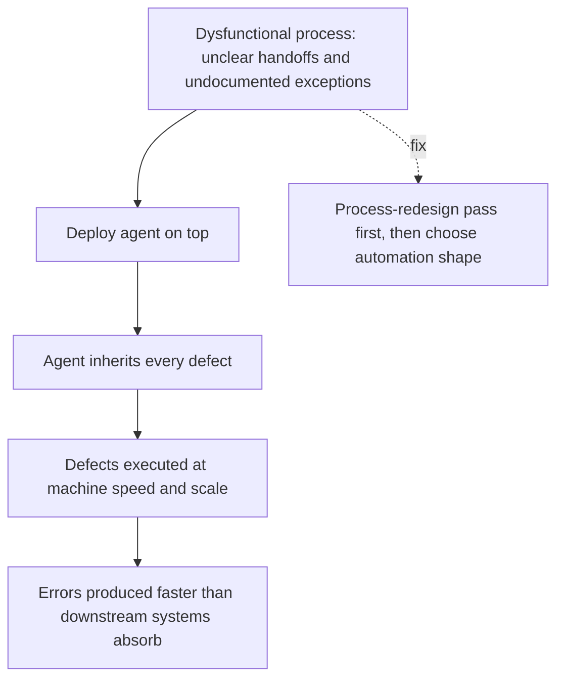

# Automating a Broken Process

**Also known as:** Agentifying Dysfunction, Automation Without Redesign

**Category:** Anti-Patterns  
**Status in practice:** deprecated

## Intent

Anti-pattern: deploy agents on top of a workflow that is already dysfunctional, so the dysfunction is amplified at machine speed instead of resolved.

## Context

An organisation identifies a slow, error-prone, or under-staffed business process and decides to bring in agents to handle it. The reasoning is throughput: if humans struggle with the process, agents will move faster and cheaper. The decision skips the prior step of asking whether the process itself is well-designed.

## Problem

If the underlying process has unclear handoffs, ambiguous decision rules, undocumented exceptions, or contradictory policies, the agent inherits all of those defects and executes them at machine speed and scale. Errors that a human would catch by hesitation or by asking a colleague are now produced in seconds, sometimes faster than downstream systems can absorb. The team measures cycle-time reduction and declares success, while error rate, rework, and customer escalations climb. Both Nordic sources name the same shape independently: techsy.io warns that 'an agent will automate a broken process faster but will not fix it', and HiQ frames the maturity-stage skip ('precision, speed, scalability') as efficiency-first agent adoption on top of broken workflows.

## Forces

- Agents promise throughput; redesigning a process promises only delay.
- Stakeholders see automation as a substitute for the harder organisational work of clarifying rules and ownership.
- Cycle-time metrics improve immediately even when error rate and rework climb in the background.

## Therefore

Therefore: before deploying agents on a process, redesign the process for clarity (handoffs, decision rules, exception paths) and decide whether the right move is an agent, a deterministic workflow tool, or no automation at all.

## Solution

Don't agentify dysfunction. Run a process-redesign pass first — name the handoffs, document the decision rules, surface the exceptions. Then decide what shape of automation fits: a linear deterministic flow may fit Zapier or workflow tooling; only genuinely judgment-bearing steps warrant an agent. See demo-to-production-cliff for the operational gates that catch dysfunction-amplification once an agent is live, and rigor-relocation for where review discipline should land when humans step out of the inner loop.

## Structure

```
Anti-pattern: Dysfunctional process -> agent on top -> defects executed at machine speed -> rework and escalations. Corrected: Process -> redesign pass (handoffs, decision rules, exceptions) -> pick fitting automation (workflow tool or agent) -> deploy.
```

## Diagram



*Automating a Broken Process failure-mode pathway.*

## Example scenario

A claims-processing team deploys an agent to triage incoming claims, hoping to cut a four-day backlog. Cycle time drops from four days to forty minutes within a week, and leadership celebrates. Two months later, the customer-complaints team is drowning: the agent has been routing edge-case claims to the wrong queue, because the routing rules were never documented and the agent learned them from inconsistent historical examples. Postmortem: the human process tolerated the ambiguity by hesitation and informal escalation. The agent did not hesitate. The fix is a process-redesign pass — explicit routing rules, named exception path, documented handoffs — before re-enabling automation.

## Consequences

**Benefits**

- Short-term: putting an agent on the existing process skips the slow redesign work and shows quick cycle-time gains.
- Naming it lets a team require a process-redesign pass before agent deployment.

**Liabilities**

- Error rate, rework, and customer escalations rise at machine speed while cycle-time metrics still improve.
- Downstream systems are flooded faster than they can absorb the agent's output.
- Postmortem blames the agent; the root cause is the unredesigned process beneath it.

## Failure modes

- Fast errors — the agent follows ambiguous decision rules and produces wrong outcomes in seconds instead of hours.
- Downstream flood — the agent emits work faster than the next system or team can absorb it.
- Misleading success — cycle-time drops and the rollout is declared a win while rework and escalations climb.
- Wrong postmortem — the review blames the agent, and the broken handoffs and policies beneath it stay in place.

## What this pattern constrains

No useful constraint; the missing constraint is a mandatory process-redesign pass before agent deployment.

## Applicability

**Use when**

- Never. Cite when reviewing an agent-deployment proposal that has not run a process-redesign pass.
- Demand a documented handoff/decision-rule/exception map before sign-off.
- Stage the redesign as an explicit deliverable, not as an implicit assumption.

**Do not use when**

- Any process whose handoffs, decision rules, or exception paths are undocumented.
- Any deployment driven primarily by cycle-time or headcount-reduction targets.
- Any setting where stakeholders treat agent adoption as a substitute for organisational clarity.

## Components

- Trigger condition — what causes the automating a broken process pattern to manifest
- Affected surface — the part of the system where the failure shows up
- Detection signal — what an operator would observe when this is happening

## Tools

- Observability — logs, traces, and metrics that surface the pattern
- Eval harness — runs that quantify exposure to the pattern

## Evaluation metrics

- Error-rate delta post-agent — change in error rate per 1000 transactions between pre-agent and post-agent baselines
- Rework rate — share of agent-produced outputs that downstream humans or systems have to redo
- Escalation-rate trajectory — count of customer or downstream escalations per week after agent rollout
- Process-redesign-pass coverage — fraction of agent deployments preceded by a documented process redesign
- Cycle-time-vs-quality gap — divergence between the cycle-time improvement and the quality regression

## Known uses

- **[techsy.io — AI-Agenter for Bedrifter: Hva Fungerer i 2026](https://techsy.io/no/blogg/ai-agenter-for-bedrifter)** _available_ — Norwegian SMB-focused blog naming the broken-process failure mode explicitly.
- **[HiQ — Från data till agens: Navigera AI-mognadens väg mot agentiska system](https://hiq.se/insight/fran-data-till-agens-navigera-ai-mognadens-vag-mot-agentiska-system/)** _available_ — Swedish maturity-stage framing naming the efficiency-first skip.

## Related patterns

- _complements_ **Demo-to-Production Cliff** — operational gates that catch dysfunction once live; this anti-pattern is the upstream architectural choice
- _complements_ **Agentic Debt** — agentic debt is the financial-shape consequence of automating broken processes on weak foundations
- _complements_ **Perma-Beta** — the cultural after-effect when the broken process never gets fixed
- _alternative-to_ **Rigor Relocation** — deliberate placement of discipline as part of the redesign
- _complements_ **Demo-Production Cliff (Multi-Agent)**
- _complements_ **Hidden Validation-Work Amplification**
- _complements_ **Multi-Agent on Sequential Workloads**
- _complements_ **Context-Driven Architecture Drift** — Both amplify a defect through an agent — that one a dysfunctional workflow, this one a brownfield codebase's un-encoded architecture conventions.

## References

- [AI-Agenter for Bedrifter: Hva Fungerer i 2026](https://techsy.io/no/blogg/ai-agenter-for-bedrifter) — 2026
- [Från data till agens: Navigera AI-mognadens väg mot agentiska system](https://hiq.se/insight/fran-data-till-agens-navigera-ai-mognadens-vag-mot-agentiska-system/) — 2026
