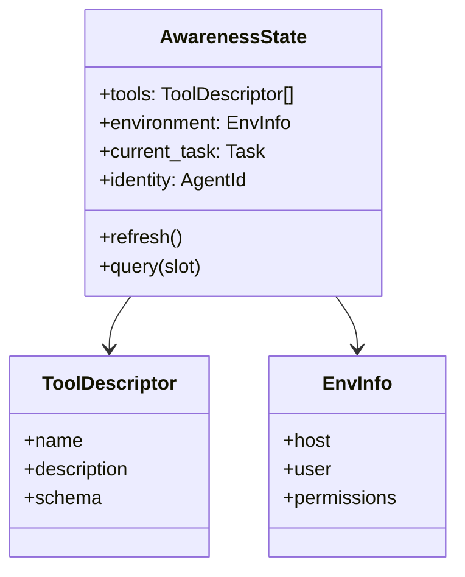

# Awareness

**Also known as:** Situational Awareness, Capability Self-Knowledge

**Category:** Cognition & Introspection  
**Status in practice:** emerging

## Intent

Maintain the agent's explicit knowledge of its own tools, capabilities, environment, and current context as queryable state.

## Context

A team is building an agent that operates across multiple sessions and whose set of available tools, permissions, and roles changes at runtime. The agent needs to reason about what it can actually do right now — which tools are wired in, which are disabled, who the current user is, which permissions apply — rather than relying on whatever the original system prompt happened to mention. Without an explicit place where this information lives, capability is buried implicitly in prompt text and stale the moment anything changes.

## Problem

An agent that has no reliable picture of its own current capabilities fails in two predictable directions. It promises to invoke tools it does not actually have, fabricating plausible function calls that error out at dispatch. Or it forgets that it does have a particular tool and falls back on weaker workarounds when the right capability was available all along. Both failure modes are invisible to the model because nothing in its context tells it what is really wired up at this moment.

## Forces

- Awareness state grows with capability.
- Stale awareness misleads.
- Self-description is itself a prompt-engineering effort.

## Therefore

Therefore: keep the agent's tools, environment, task, and identity as queryable state injected into each turn, so that the agent reasons from what it actually has rather than from what it imagines.

## Solution

Persist explicit state about: available tools (with descriptions), the environment (what host, what user, what permissions), the current task, and the agent's own identity. Refresh on capability changes. Inject relevant slices of awareness into each turn's context.

## Structure

```
Capability or environment change --refresh--> Awareness state {tools, environment, current task, identity} --query(slot)--> relevant slice --inject--> turn context --> Agent action --check against state--> dispatch or mismatch flag
```

## Diagram



## Example scenario

A field-service agent occasionally promises to 'check the parts inventory' even though that tool was disabled in the latest deploy, then apologises when the call fails. The root cause is that the agent has no reliable picture of what it actually has. The team adds an Awareness module that exposes tool names, descriptions, and current health as queryable state the agent reads each turn. Now when the inventory tool is offline, the agent sees that fact in its own context and offers an alternative instead of fabricating one.

## Consequences

**Benefits**

- Reduces hallucinated tool calls.
- Grounds the agent in its own context.

**Liabilities**

- Awareness state is a maintenance burden.
- Excess awareness wastes context tokens.

## Failure modes

- Stale tool list — a tool is removed or renamed but the awareness state is not refreshed, and the agent keeps calling a function that no longer exists.
- Forgotten capability — the relevant slice of awareness is left out of the turn, and the agent falls back on a weak workaround while the right tool sits unused.
- Context bloat — the whole awareness state is injected every turn, crowding out task content with tool and environment descriptions.
- Unflagged mismatch — the agent makes a self-reference or tool call that disagrees with the awareness state, and nothing checks or logs it.

## What this pattern constrains

Tool calls and self-references must match the awareness state; mismatches are flagged.

## Applicability

**Use when**

- The agent regularly hallucinates tools it does not have or forgets tools it does.
- Tool palette, environment, or permissions change at runtime and the agent must reflect the current state.
- Downstream behaviour depends on the agent reasoning explicitly about what it can and cannot do.

**Do not use when**

- Tools and environment are static and the system prompt already lists them adequately.
- Awareness state would consume more tokens per turn than the failures it prevents.
- There is no refresh path on capability changes and stale awareness would mislead worse than absence.

## Components

- Awareness State — queryable record of tools, environment, task, and identity
- Tool Descriptor — name, description, schema, and current health for each wired-in tool
- Environment Info — host, current user, and active permission set
- Refresh Hook — re-reads the state on capability changes so it does not go stale
- Per-turn Injector — splices the relevant awareness slice into each prompt

## Tools

- Structured JSON store — persists the awareness record between turns
- Tool-registry API — source of truth for the available tool palette and health

## Evaluation metrics

- Hallucinated tool-call rate — calls to tools not present in current awareness state
- Missed-capability rate — turns where the agent fell back on a workaround while the real tool was live
- Awareness-refresh latency — gap between a capability change and its visibility in the prompt
- Awareness token cost per turn — overhead the injected slice adds to each call

## Known uses

- **Avramovic Awareness pattern** _available_
- **[Sparrot](https://marco-nissen.com/sparrot/)** _available_ — The agent maintains explicit, queryable state about its own tools, context, mode, affect, presence and recent moves (rather than re-deriving them from chat history); a meta-observer module reads that state during each tick.

## Related patterns

- _complements_ **Tool Use**
- _complements_ **Tool Discovery**
- _complements_ **Liminal-State Detection**
- _complements_ **Embodied-Proxy Handoff**
- _complements_ **Co-Located Memory Surfacing**
- _alternative-to_ **Memo-As-Source Confusion**
- _generalises_ **Now-Anchoring**
- _complements_ **Preoccupation Tracking**
- _complements_ **Emotional State Persistence**
- _complements_ **World-Model Separation**
- _complements_ **Subject-First Agent Architecture (ENA Stateful Core)**
- _generalises_ **Reflexive Metacognitive Agent**

## References

- [zeljkoavramovic/agentic-design-patterns](https://github.com/zeljkoavramovic/agentic-design-patterns)
