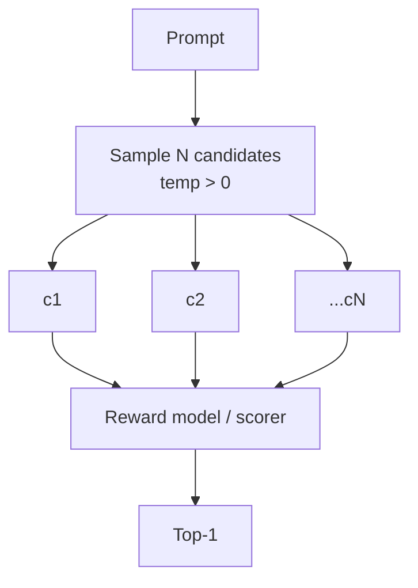

# Best-of-N Sampling

**Also known as:** BoN, Reranking, BoNBoN Alignment

**Category:** Verification & Reflection  
**Status in practice:** emerging

## Intent

Sample N candidate outputs and select the highest-ranked by a reward model or scorer.

## Context

A team runs a large language model on a task where the quality of any single output varies noticeably from sample to sample, such as a code-review summary, a translation, or a customer reply. They have a way to rank candidate outputs against each other, either a trained reward model that scores responses or a rule-based scorer that approximates one. Inference cost is high enough to matter but not so high that running the model a few extra times for the same prompt is prohibitive.

## Problem

A single sample drawn from the model at low temperature is often acceptable but rarely the best the model can produce, and on any given prompt the team has no way to tell whether they got a good draw or a mediocre one. Increasing temperature on a single sample raises variance without raising the floor: sometimes the result is better and sometimes worse, and the team ships whichever one happens to come out. Without a selection step that compares several candidates, the model's own decoding choice is the only filter on quality.

## Forces

- N candidates cost N inferences.
- Reward-model quality bounds achievable improvement.
- Diversity across candidates is needed; identical samples defeat the pattern.

## Therefore

Therefore: draw N diverse samples in parallel and let a separate scorer pick the winner, so that selection pressure rather than a single greedy decode determines what ships.

## Solution

Generate N candidates with non-zero temperature. Score each with a reward model or rule-based scorer. Return the top-1 (or top-K). BoNBoN alignment fine-tunes a model to mimic the BoN distribution directly, eliminating per-inference sampling cost.

## Structure

```
Prompt -> sample N candidates (temperature > 0) -> reward model / rule-based scorer scores each -> return top-1 (or top-K) unchanged from the candidate set
```

## Diagram



## Example scenario

A code-review assistant generates a one-paragraph summary for each pull request, and roughly one in five reads awkwardly. The team enables Best-of-N: for each PR, the model samples five candidate summaries with temperature 0.7, and a small reward model trained on past human-edited summaries picks the highest-rated one to display. Token cost goes up about five times for that step, but the rate of summaries that reviewers feel compelled to rewrite drops sharply.

## Consequences

**Benefits**

- Quality lift without retraining the base model.
- Trade-off knob: increase N for more quality, fewer for less cost.

**Liabilities**

- Cost scales with N.
- Reward hacking: candidates can game a flawed scorer.

## Failure modes

- Scorer gaming — candidates win by matching what a flawed reward model likes, and the top-1 is the one that exploits the scorer rather than the best answer.
- Cost blow-up — N is raised to chase quality, and inference cost grows with every extra sample for small gains.
- Low-diversity pool — temperature is set too low, the N candidates are near copies, and selection has nothing real to choose between.
- Quiet synthesis — someone merges the best parts of several candidates, and the output no longer comes from the set the scorer actually checked.

## What this pattern constrains

The chosen output must be from the candidate set; no synthesis across candidates.

## Applicability

**Use when**

- A scorer or reward model exists that ranks candidates better than the generator picks them.
- Quality lift from selecting the best of N samples justifies the N-fold inference cost.
- Sampling temperature can be raised enough to produce meaningfully diverse candidates.

**Do not use when**

- No reliable scorer is available to pick among candidates.
- Inference cost or latency cannot absorb a multiplicative sampling factor.
- Candidates collapse to near-duplicates regardless of temperature, so the best-of-N gain is illusory.

## Components

- Generator — base LLM sampling N candidates at non-zero temperature
- Reward model or scorer — ranks candidates against each other to pick the winner
- Selector — top-1 (or top-K) extractor that returns the chosen candidate
- Diversity controller — temperature and sampling parameters that keep candidates from collapsing

## Tools

- LLM API — N parallel inference calls with non-zero temperature
- Reward-model endpoint — trained ranker or rule-based scorer over the candidate set
- Fine-tuning pipeline — only for the BoNBoN variant that amortises BoN into the weights

## Evaluation metrics

- Win-rate over single-sample baseline — does best-of-N pick beat the greedy decode
- Candidate diversity — pairwise dissimilarity across the N samples (collapse warning if low)
- Reward-model agreement with held-out human preference — bound on achievable lift
- Quality lift per extra inference call — slope of quality versus N, finds the elbow
- Reward-hacking incidence — fraction of selected candidates that score high but fail downstream

## Known uses

- **RLHF training pipelines** _available_
- **[Sparrot](https://marco-nissen.com/sparrot/)** _available_ — The eval path samples N candidates for selected tasks, scores them via internal reward models, and returns the best — distinct from running the whole loop N times.

## Related patterns

- _alternative-to_ **Self-Consistency**
- _alternative-to_ **Evaluator-Optimizer**
- _specialises_ **Parallelization**
- _specialises_ **Test-Time Compute Scaling**
- _used-by_ **Process Reward Model**
- _used-by_ **ReST-EM**
- _complements_ **Automatic Workflow Search**
- _alternative-to_ **Voting-Based Cooperation**
- _alternative-to_ **Parallel-Voice Proposer**
- _specialises_ **Adaptive Branching Tree Search**
- _complements_ **Multi-Path Plan Generator**
- _complements_ **Generate-and-Test Strategy**
- _alternative-to_ **Trajectory-Summary Test-Time Scaling** — Best-of-N ranks raw candidate outputs and picks one; here the ranked unit is a compressed trajectory summary, and reuse can re-roll from it.

## References

- [BoNBoN Alignment for Large Language Models and the Sweetness of Best-of-n Sampling](https://arxiv.org/abs/2406.00832) — Gui, Gârbacea, Veitch, 2024
