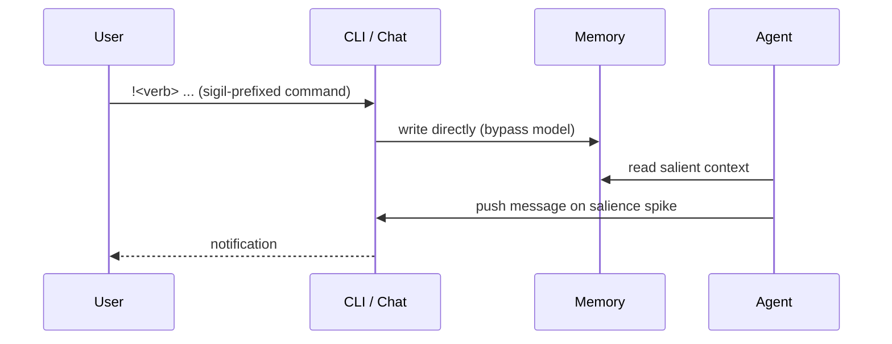

# Bidirectional Impulse Channel

**Also known as:** Two-Way Chat, User-and-Agent-Initiated Communication

**Category:** Streaming & UX  
**Status in practice:** experimental

## Intent

Let the user inject impulses into the agent and let the agent push messages to the user, both through one channel.

## Context

A team is running an agent that does not sit idle between user turns. It might be a personal assistant running a continuous reasoning loop, a monitoring agent watching a system, or any process that has internal activity the user would sometimes want to interrupt or hear about. The user is at a chat or command-line surface, occasionally typing, occasionally absent for hours.

## Problem

A pure request-and-response chat interface fits this poorly: the agent has nothing to say when nothing is asked, and the user has no way to inject a correction without phrasing it as a new question for the model to interpret. A pure notification firehose in the other direction is worse, because it trains the user to mute the channel within a day. The team has to choose between an agent that goes silent until prompted and an agent that becomes background noise, with no obvious middle ground.

## Forces

- Push hygiene: too many messages train users to ignore the channel.
- Inverse: starvation when the agent waits forever.
- Authority: not every user-typed line should be a command.

## Therefore

Therefore: pair sigil-prefixed user commands that bypass the model with salience-gated agent pushes on one channel, so that both sides can interrupt without spamming the other.

## Solution

A single CLI/chat surface where the user can send sigil-prefixed commands (e.g. `!<verb> ...`) that bypass the model and write directly to memory, while the agent can push messages when salience clears a threshold (insight, stuck focus, contradiction, goal complete). Hygiene rule: at most one unsolicited message per window.

## Structure

```
User --!<verb> command--> Channel --direct write (bypass model)--> Memory; Agent reads Memory -> scores salience (insight, stuck focus, contradiction, goal complete) --over threshold, max one per window--> Channel -> User
```

## Diagram



## Example scenario

A user has asked their personal agent to monitor a slow scientific computation overnight and 'tell me when it's interesting'. Pure request/response would force the user to keep polling; pure push notifications wake them for trivia. They build a bidirectional impulse channel: the agent can send messages at any time, but the user can also reach in mid-run with 'stop watching the temperature, watch the residual'. The agent picks up the impulse on its next tick and changes what it pushes.

## Consequences

**Benefits**

- User feels the agent is alive without being noisy.
- Direct memory edits are auditable and reversible.

**Liabilities**

- Salience threshold tuning is empirical.
- Direct memory edits bypass the LLM and can encode wrong rules.

## Failure modes

- Wrong rule written straight to memory — a hasty `!` command skips the model and stores a bad rule, and the agent follows it until someone notices.
- Threshold set too low — the agent pushes on minor events, the one-per-window cap is always used up, and the user starts to mute the channel.
- Threshold set too high — real contradictions and stuck focus never clear the bar, so the agent falls back to silence until prompted.
- Sigil collision — ordinary user text that starts with `!` is treated as a command and lands in memory instead of reaching the model.

## What this pattern constrains

The agent may push at most one unsolicited message per window; user commands beginning with `!` bypass the model entirely.

## Applicability

**Use when**

- The agent runs long enough that pure request-response chat misses the point.
- Users want to inject commands or facts that bypass the model and write directly to memory.
- Salience signals exist that justify agent-initiated push messages without spamming the user.

**Do not use when**

- Interactions are bounded turn-pairs with no need for a back-channel.
- Push notifications are always intrusive in the deployment context (e.g. shared work surface).
- There is no salience function and the agent would push noise.

## Components

- Shared channel — single CLI or chat surface carrying both user impulses and agent pushes
- Sigil parser — recognises commands beginning with the prefix (e.g. `!`) and routes them around the model
- Memory store — direct write target for sigil commands and read source for salience-gated pushes
- Salience gate — scores agent-side candidate messages and blocks pushes below threshold
- Push hygiene limiter — caps unsolicited agent messages to at most one per window

## Tools

- REPL or chat transport — terminal or chat surface that stays open between turns
- Persistent memory file — durable store the sigil parser writes to without invoking the model

## Evaluation metrics

- Unsolicited-message rate per window — checks the hygiene cap actually holds in production
- Sigil-command share of user turns — how often users bypass the model versus prompt it
- Mute or close-channel rate — proxy for whether agent pushes are landing as signal or noise
- Impulse-to-effect latency — gap between a sigil write and the next agent tick that reads it
- Reversal rate on direct memory edits — fraction of `!`-writes the user later undoes

## Known uses

- **Author's long-running personal agent (single private deployment)** _available_ — Single-source evidence: one private deployment by the catalog author; no independently documented use yet.

## Related patterns

- _uses_ **Salience-Triggered Output**
- _complements_ **Streaming Typed Events**
- _complements_ **Embodied-Proxy Handoff**
- _complements_ **Channel-Decoupled Agent Core** — That pattern carries request and push within one channel; this spans many channels, and a bidirectional channel is one adapter the core can drive.

## References

- [Proactive Conversational Agents with Inner Thoughts](https://arxiv.org/abs/2501.00383) — Liu, Fang, Shi, Wu, Igarashi, Chen, 2024
