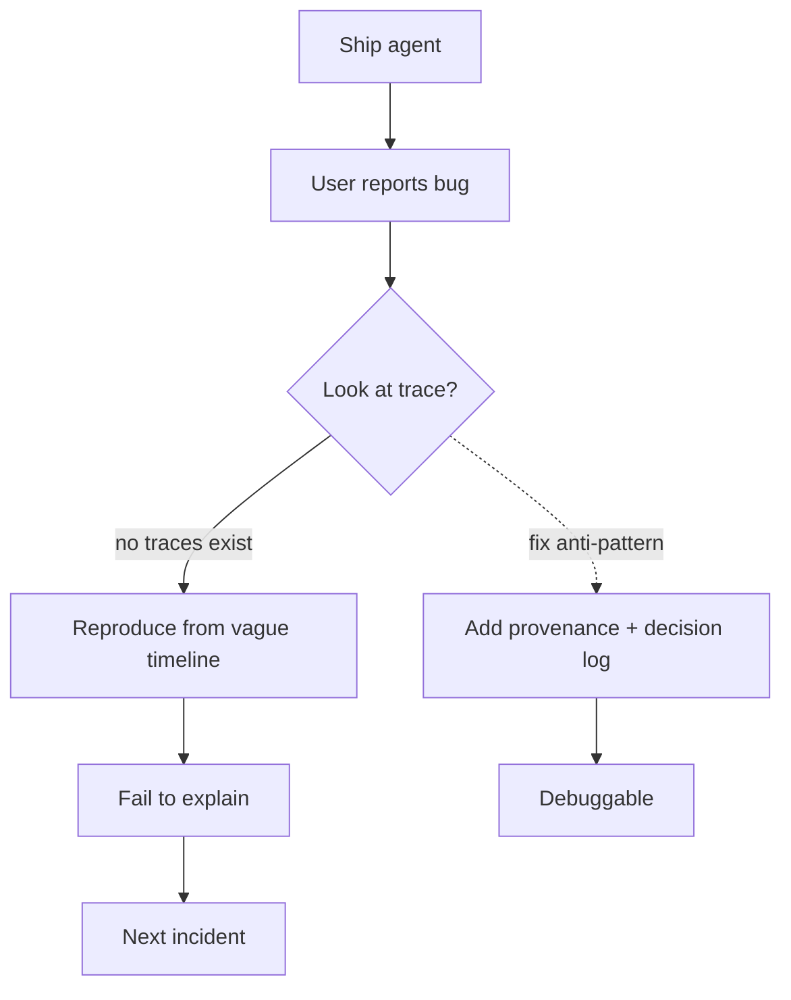

# Black-Box Opaqueness

**Also known as:** Opaque Agent, No-Trace Agent

**Category:** Anti-Patterns  
**Status in practice:** deprecated

## Intent

Anti-pattern: ship an agent without traces, decision logs, or provenance, then debug from user reports.

## Context

A team is shipping an LLM-based agent under schedule pressure, often using a framework that emits no traces by default. Observability — recording each model call, each tool invocation, and the decision that led to it — is treated as something to add later once the product proves itself. The agent goes to production with no run logs, no decision log, and no record of which inputs led to which outputs.

## Problem

When the agent eventually does something wrong, and it will, the team has no record of what the agent saw, what it decided, or which tool it called with which arguments. Debugging collapses into trying to reproduce a user's vague timeline from memory, and most incidents are never explained at all. The team ends up retrofitting traces during an outage, which is the most expensive moment to add them.

## Forces

- Observability has a cost (storage, dev time).
- Frameworks differ in trace quality.
- Privacy and trace coverage tension.

## Therefore

Therefore: instrument the agent with traces, decision logs, and provenance from the first deploy, so that every misbehaviour leaves an inspectable record instead of forcing reproduction from user reports.

## Solution

Don't. Add traces, decision logs, and provenance from day one. See provenance-ledger, decision-log, lineage-tracking.

## Structure

```
Anti-pattern: agent ships without traces -> failure -> user report -> guesswork reproduction -> unexplained incident. Corrected: agent -> traces, decision log, provenance on every action -> failure -> replay from records -> root cause.
```

## Diagram



## Example scenario

A startup ships a customer-facing agent in a hurry with no traces, no decision logs, and no tool-call provenance. A week later a user complains the agent issued a duplicate refund. The team has nothing to look at — they spend two days trying to reproduce the bug from the user's vague timeline and never definitively explain it. This is the Black-Box Opaqueness anti-pattern: the absence of observability is itself the failure, and recovery requires retrofitting traces to every step before the next incident.

## Consequences

**Benefits**

- Short-term: skipping traces and logs gets the agent shipped faster and avoids storage and tooling work.
- Naming it lets a team make observability a ship requirement instead of an afterthought.

**Liabilities**

- Debugging time stretches to weeks.
- Compliance posture is unanswerable.
- Stakeholder trust erodes.

## Failure modes

- Unexplained incident — the agent does something wrong, and the team has no record of what it saw, decided, or called.
- Debugging from memory — engineers try to rebuild the run from a user's vague account, and most incidents stay unexplained.
- Outage retrofit — traces are bolted on during an incident, at the most costly moment, and still miss the run that failed.

## What this pattern constrains

Avoiding it means observability is not optional: an agent must not ship without traces, decision logs, and provenance attached to every action, and debugging must never depend on user reports alone.

## Applicability

**Use when**

- Cite this entry when a team proposes shipping an agent whose only failure signal is user reports.
- You are already here if production incidents cannot be replayed from traces or decision logs.
- Exit via provenance-ledger, decision-log, and lineage-tracking before launch, not after the first incident.

**Do not use when**

- Always do not use. There is no scenario where shipping a black-box agent is the right design.
- Even prototypes benefit from minimal traces — opacity is not the cheap option, it is the expensive option deferred.

## Components

- Un-instrumented agent loop — runs in production with no trace emitter
- Default framework configuration — ships with tracing disabled or absent
- Stakeholder pipeline — receives user bug reports as the only signal of misbehaviour
- Retroactive logging effort — added during an outage at peak cost

## Tools

- Tracing backend — the missing observability sink that would record each model and tool call
- Decision log — the missing record that would tie inputs to outputs
- Provenance ledger — the missing layer that would let an incident be reconstructed

## Evaluation metrics

- Trace coverage percentage — fraction of production requests with an inspectable trace; near zero flags the anti-pattern
- Mean time to explain an incident — stretches into days or weeks when traces are missing
- Unexplained-incident rate — fraction of user reports closed without a known root cause
- Reproduction success rate — share of reported bugs the team can reproduce from existing data

## Known uses

- **Default state of un-instrumented LangChain projects circa 2023** _available_

## Related patterns

- _alternative-to_ **Provenance Ledger**
- _alternative-to_ **Decision Log**
- _alternative-to_ **Lineage Tracking**
- _complements_ **Agent Confession as Forensics** — Absence of traces is the enabling condition; substituting a confession for them is this failure.
- _complements_ **Accountability Laundering via Algorithm** — Thin traces and missing decision logs are what let an organisation point to a model score instead of a reasoned human endorsement; opacity is the enabling condition for laundering.
- _complements_ **Agent Tool-Invocation Data Black-Box** — Black-box-opaqueness is missing traces of the agent's reasoning and decisions; this is missing disclosure of where the user's data flows through tools — a data-flow transparency gap, not a reasoning one.

## References

- [ai-standards/ai-design-patterns (Black-Box Opaqueness)](https://github.com/ai-standards/ai-design-patterns)
