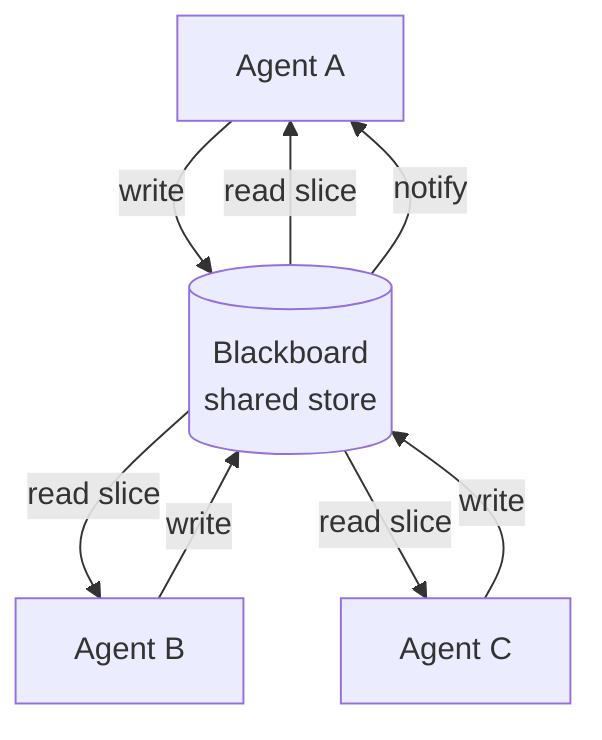

# Blackboard

**Also known as:** Shared Workspace, Collaboration Whiteboard

**Category:** Multi-Agent  
**Status in practice:** experimental

## Intent

Give multiple agents a shared, queryable workspace they can read from and write to as they collaborate.

## Context

Several specialised agents are working on a shared artefact — a document being annotated by a layout-extractor, table-parser, citation-resolver, and summariser; a code review where multiple analysers contribute findings — and each needs to see what the others have already produced before deciding what to do next. The agents are not in a fixed pipeline; the order of useful contributions depends on what is already on the page.

## Problem

If the agents work in isolation, they cannot build on each other's findings and duplicate or miss work. If they message each other point to point, every new agent forces edits to every other agent that should hear from it, and the protocol grows into a brittle web. If they share an unstructured mutable workspace without discipline, concurrent writes race and overwrite useful intermediate state. The team needs a coordination shape that is more flexible than a strict pipeline but more disciplined than free shared memory.

## Forces

- Concurrent writes need conflict resolution.
- Blackboard contents grow; pruning is needed.
- Read latency: pulling vs subscribing.

## Therefore

Therefore: give the agents one inspectable shared workspace they read from and write to under structured keys, so that coordination becomes 'contribute what you can' without any agent knowing about another directly.

## Solution

Establish a shared store (file, database, in-memory). Each agent reads the relevant slice and writes its contribution under structured keys. Optional event notification when keys change. Conflict resolution is policy-driven (last-write-wins, version-vector, append-only).

## Structure

```
Agents A, B, C --write(structured key)--> Blackboard (shared store, conflict policy) --read slice / notify on change--> Agents A, B, C --> contribute next step
```

## Diagram



## Example scenario

A document-processing pipeline has a layout-extractor agent, a table-parser, a citation-resolver, and a summariser, each strong on its own but needing each other's intermediate outputs. Wiring direct messages between every pair becomes a brittle protocol. They adopt a Blackboard: each agent posts its findings to a shared workspace and subscribes to relevant updates, with a controller deciding who runs next. Coordination becomes 'read what's on the board, contribute what you can'.

## Consequences

**Benefits**

- Loose coupling: agents do not know about each other directly.
- Inspectable shared state.

**Liabilities**

- Race conditions under concurrent writes.
- Blackboard bloat without pruning.

## Failure modes

- Write race — two agents update the same key at once under last-write-wins, and one agent's finding is silently lost.
- Blackboard bloat — nothing prunes old entries, so each agent reads an ever larger slice full of stale intermediate state.
- Unstructured keys — agents write free-form notes instead of structured keys, and other agents cannot find or trust what they need.
- Back-channel calls — an agent calls a peer directly to save time, and that interaction never appears on the shared, inspectable store.

## What this pattern constrains

Cross-agent communication happens only via the blackboard; out-of-band agent-to-agent calls are forbidden.

## Applicability

**Use when**

- Multiple agents collaborate and need a shared workspace they can read from and write to.
- Explicit point-to-point messaging would require an over-engineered protocol for the coordination shape.
- Conflict resolution policy (last-write-wins, version-vector, append-only) is acceptable for the workload.

**Do not use when**

- Agents already coordinate fine through direct messages or function calls.
- Shared mutable state without strict discipline would race in ways the chosen policy cannot handle.
- Workload requires strict transactional semantics the blackboard does not provide.

## Components

- Shared blackboard — inspectable workspace holding contributions under structured keys
- Specialist agent — reader-writer that contributes when the board state matches its trigger
- Controller — optional scheduler that decides which agent runs next given the board state
- Conflict-resolution policy — last-write-wins, version-vector, or append-only discipline
- Notification channel — change events that wake interested agents on relevant key updates

## Tools

- Shared memory store — file, database, or in-memory KV that backs the workspace
- Pub/sub or watcher — delivers key-change events to subscribed agents
- LLM API — invoked by each specialist when its slice of the board changes

## Evaluation metrics

- Write-conflict rate — concurrent writes that the conflict policy had to reconcile
- Board bloat rate — keys accumulated per task without pruning
- Contribution-uptake share — fraction of postings that another agent actually reads and uses
- Idle-agent rate — agents subscribed to keys that never fire, indicating wasted wiring
- Read latency — time from key write to interested agent observing the change

## Known uses

- **Classical AI blackboard architectures** _available_
- **Multi-agent code review with shared scratchpad** _available_

## Related patterns

- _complements_ **Swarm**
- _alternative-to_ **Supervisor**
- _complements_ **Append-Only Thought Stream**
- _composes-with_ **Graph of Thoughts**
- _used-by_ **SOP-Encoded Multi-Agent Workflow**
- _alternative-to_ **Topic-Based Routing**
- _alternative-to_ **Cellular-Automata Agents**
- _generalises_ **Stigmergic Coordination**
- _alternative-to_ **Distributed Constraint Optimization**
- _complements_ **Partial Global Planning**

## References

- [Blackboard Systems (Engelmore, Morgan)](https://archive.org/details/blackboardsystem0000unse) — 1988
