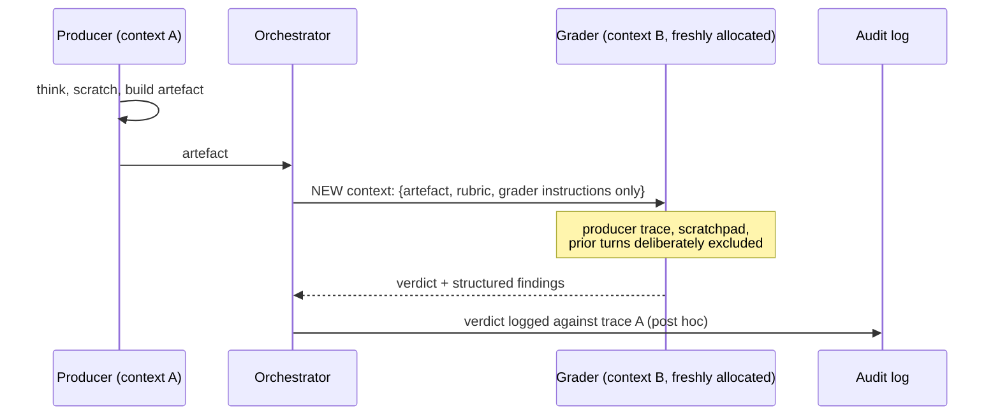

# Blind Grader with Isolated Context

**Also known as:** Fresh-Eyes Evaluator, Trace-Blind Judge, Outcomes-Style Verification, Context-Isolated Grader

**Category:** Verification & Reflection  
**Status in practice:** emerging

## Intent

Run an evaluator in a separately-allocated context window with access only to the artifact and the rubric, never the producing agent's reasoning trace, so the grader cannot be primed by the producer's framing.

## Context

A team builds an agent workflow in which a producer agent runs a long chain of reasoning and tool calls to construct some artefact (a plan, a patch, a written answer, a sequence of tool calls) and then a downstream evaluator is asked to judge whether the artefact is correct. The natural implementation hands the evaluator the producer's full reasoning trace alongside the artefact, on the assumption that more context produces a better judgement. The evaluator may be a separate prompt or even a separate model.

## Problem

When the evaluator can see the producer's full reasoning trace, it tends to inherit the producer's framing and rationalise the artefact rather than evaluate it on its own merits. The producer's chain of thought makes mistaken choices look deliberate, and the evaluator ends up agreeing with the very priming that caused the mistake. The errors a fresh, uninformed reader would notice immediately are exactly the ones the trace-aware evaluator misses. Routing to a different model family is expensive and does not reliably break the priming, because the framing leaks through the trace itself rather than through any shared weights.

## Forces

- Reasoning traces carry useful context but also carry priming that biases evaluation.
- Some failures are only visible from outside the producer's framing.
- Fully retraining or routing to a different model is expensive and may not actually break the priming.
- Rubrics must be precise enough to apply without the producer's reasoning as context.
- Logs and trajectories must still be auditable, even if the grader does not see them.

## Therefore

Therefore: allocate a fresh context window for the grader and pass it only the artefact and the rubric — never the producing agent's reasoning trace, scratchpad, or tool-call history — so the grader evaluates the work from the outside and the same model can catch what its own reflection cannot.

## Solution

When the producer finishes, the orchestrator allocates a new context window (a new conversation, a new agent invocation, a new prompt instance) and constructs a grader call that contains only the artefact and the rubric. The producing agent's reasoning chain, scratchpad, and prior turns are deliberately excluded. The grader is instructed to judge against the rubric on its own terms and to flag what is missing or wrong. The grader's output is logged against the artefact and against the producer's trace for audit, but the grader itself was blind to the trace at decision time. The same model may be used as both producer and grader — context isolation is the load-bearing element, not a different model.

## Structure

```
Producer (full reasoning trace in context A) -> artefact + rubric -> NEW context window B containing only {artefact, rubric, grader instructions} -> grader verdict -> verdict logged against trace A (post hoc, not inside the grader's context).
```

## Diagram



*The grader runs in a freshly allocated context with only the artefact and rubric; the producer's framing cannot leak in.*

## Example scenario

A coding agent produces a fix for a flaky integration test. A naive critic reading the producer's reasoning agrees the fix is sound. The team instead routes the patch to a blind grader: a fresh context window containing only the patch diff and a rubric asking 'does this change the test's intent?' and 'does it suppress the underlying race?'. The blind grader flags that the patch widens a timeout and suppresses the race instead of fixing it — a verdict the trace-aware critic missed because the producer's reasoning made the widening sound deliberate.

## Consequences

**Benefits**

- Catches a class of failures that same-context critique systematically misses.
- Works with the same model — no second-vendor cost or routing complexity required.
- Rubric becomes a first-class artefact, since the grader has nothing else to lean on.
- Clean audit story: producer trace and grader verdict are independently attributable.

**Liabilities**

- Grader cannot use legitimate context from the producer's reasoning, so some judgements need information the rubric must explicitly carry.
- Rubric authoring becomes the bottleneck — a vague rubric in an isolated context is worse than a tight rubric with trace context.
- Extra context allocation costs tokens and latency per check.
- Discipline is required: leaking even a summary of the producer's trace into the grader's context defeats the pattern.

## Failure modes

- Trace leak — a short summary of the producer's reasoning slips into the grader prompt, and the grader inherits the framing the isolation was meant to block.
- Vague rubric — the grader has no trace context and only a loose rubric, so it passes or fails on surface features.
- Missing context — a judgement depends on a fact only the producer's trace held, the rubric does not carry it, and the grader marks a correct artefact as wrong.
- Shared session reuse — the orchestrator reuses the producer's conversation for grading to save tokens, and the grader is no longer blind.

## What this pattern constrains

The grader's context window must contain only the artefact, the rubric, and grader instructions; the producing agent's reasoning trace, scratchpad, prior turns, and tool-call history must be excluded; summaries of the producer's reasoning must not be injected into the grader context.

## Applicability

**Use when**

- Producer self-critique has a known echo-chamber failure mode on the task.
- A precise rubric can be written that does not require the producer's reasoning.
- The artefact is self-contained enough to grade on its own.

**Do not use when**

- Grading legitimately requires the producer's intent or prior context that the artefact does not capture.
- Latency and token budgets cannot absorb a separate isolated context per check.
- No precise rubric is available — a vague rubric in an isolated context is worse than a trace-aware critic.

## Components

- Producer agent — runs in context A with full reasoning trace and scratchpad
- Orchestrator — copies the artefact across the context boundary and dispatches the grader
- Blind grader — runs in freshly allocated context B with only the artefact, rubric, and instructions
- Rubric — hand-authored criteria the grader must judge against without trace context
- Audit log — joins producer trace A and grader verdict B post hoc, never inside grader context

## Tools

- LLM API — at least two distinct invocations with strictly separated context windows
- Context-isolation primitive — new conversation, subprocess, or fresh agent invocation that excludes prior turns
- Rubric store — versioned criteria document loaded by the grader call

## Evaluation metrics

- Catch-rate uplift over trace-aware critic — failures only the blind grader surfaces
- Grader-producer agreement gap — divergence between same-context self-critique and blind verdict
- Rubric coverage — fraction of known failure classes the rubric actually scopes
- Context-leak audit pass rate — sample inspections confirming no producer trace reached the grader
- Token overhead per graded artefact — extra cost the isolated context adds versus inline review

## Known uses

- **[Anthropic Claude Managed Agents — Outcomes feature](https://platform.claude.com/cookbook/managed-agents-cma-verify-with-outcome-grader)** _available_ — Outcome grader runs in an isolated context with the artefact and rubric, not the producing trace.

## Related patterns

- _specialises_ **LLM-as-Judge** — Specialises LLM-as-judge with strict context isolation from the producer's trace.
- _alternative-to_ **Agent-as-a-Judge** — Agent-as-judge evaluates trajectories; blind grader deliberately excludes the trajectory.
- _alternative-to_ **Same-Model Self-Critique** — Same-model self-critique is the failure mode; blind grader is the structural fix using a fresh context.
- _complements_ **Evaluator-Optimizer** — Evaluator-optimizer loops refine and score; blind grader supplies the score from outside the producer's frame.
- _complements_ **Frozen Rubric Reflection** — Frozen-rubric scopes self-reflection; blind grader adds context isolation as a structural element.
- _alternative-to_ **Sandbagging**
- _alternative-to_ **Alignment Faking**
- _complements_ **Simulate Before Actuate**
- _alternative-to_ **Verifier-Aware Reward Hacking** — The blind grader is the direct corrective: running the evaluator in a separately-allocated context the producer cannot read or prime removes the very access that makes grader reconnaissance possible.
- _alternative-to_ **Prior-Estimate Anchoring** — The structural corrective, but isolation from the producer's reasoning trace is necessary and not sufficient: a grader that never sees the trace is still anchored by the loop's own bookkeeping, so the isolated context has to exclude harness metadata as well.
- _complements_ **Judge-Channel Injection** — The blind grader isolates the judge from the producer's reasoning trace, but the injection rides in the artifact the grader must still read, so the isolation is orthogonal to this failure and insufficient against it.
- _complements_ **Checklist Partial-Credit Scoring** — Isolating the grader's context keeps the checkpoint judge from being primed by the producing agent's framing of its own progress.
- _complements_ **Chance-Corrected Judge Validation** — Isolation controls what the grader may see; this measures whether what the grader produces from that view matches human labels.

## References

- [Verify with outcome grader (Anthropic Cookbook, Claude Managed Agents)](https://platform.claude.com/cookbook/managed-agents-cma-verify-with-outcome-grader) — 2026
- [Anthropic updates Claude Managed Agents with three new features](https://9to5mac.com/2026/05/07/anthropic-updates-claude-managed-agents-with-three-new-features/) — 2026
