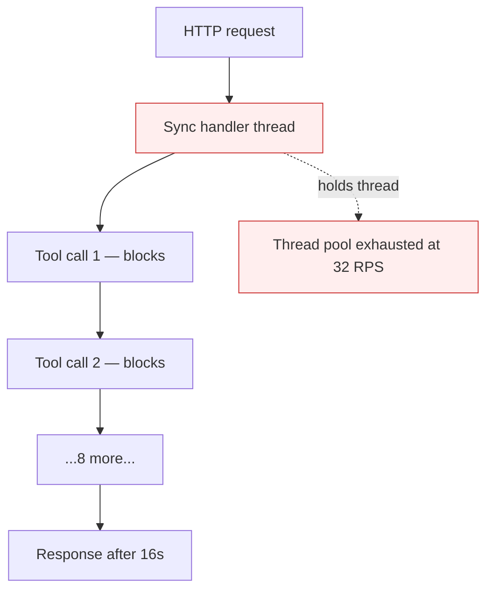

# Blocking Sync Calls in Agent Loop

**Also known as:** Sync Tool Calls in HTTP Handler, Event-Loop-Blocking Agent

**Category:** Anti-Patterns  
**Status in practice:** deprecated

## Intent

Anti-pattern: run synchronous, blocking I/O inside the agent loop or HTTP handler, capping concurrency at the number of OS threads.

## Context

An agent is exposed via an HTTP endpoint. Inside the request handler, the agent runs its plan-act loop synchronously, awaiting each model call and tool call serially on the request thread. Works perfectly in development with one user.

## Problem

Throughput collapses past 10–20 concurrent requests because the runtime cannot release the thread while awaiting upstream I/O. Memory grows linearly with concurrency. Worse on Python ASGI servers when the agent loop blocks the event loop, freezing all in-flight requests. The failure mode is invisible in dev (one user) and only appears under realistic load.

## Forces

- Async code is harder to write and harder to debug than sync.
- Many agent SDKs default to sync APIs in their examples.
- Sync feels safer because the call returns when 'done'.

## Therefore

Therefore: agent loops must use async I/O end-to-end, model calls must be awaited not blocked, and long-running plans must be executable off the request thread (background worker, durable queue).

## Solution

Use async tool clients and async model SDKs throughout the agent loop. Move long-running agent execution off the request thread to a worker process or durable workflow runtime. Where sync is unavoidable, isolate it in a thread pool that does not share threads with the request handler. Pair with stateless-reducer-agent so the agent can be paused, persisted and resumed across workers.

## Structure

```
Anti-pattern: Request handler -> agent loop -> blocking model/tool I/O -> thread held -> concurrency capped by thread count. Corrected: Request handler -> enqueue -> worker or durable workflow -> async model and tool clients (sync isolated in separate pool).
```

## Diagram



## Example scenario

An agent is wrapped in a Flask endpoint. The agent loop runs 8 tool calls per request, each averaging 2s. Per-request wall time: 16s of blocked thread. With 4 worker processes and 8 threads each, the system serves 32 concurrent requests before queueing. At 100 RPS the queue depth grows unboundedly; user requests time out. Fix is full async + worker offload, not horizontal scale.

## Consequences

**Benefits**

- Short-term: synchronous SDK calls are simpler to write and work fine with one user in development.
- Naming it lets a team load-test for it and require non-blocking I/O across the agent path.

**Liabilities**

- Throughput cliff at 10–20 concurrent runs even on hardware that should handle thousands.
- Hidden per-request memory growth from blocked threads holding allocations.
- Cost blows up because you scale horizontally to compensate for blocked threads.

## Failure modes

- Throughput cliff — the service handles one user fine in development and stalls at 10–20 concurrent runs under real load.
- Frozen event loop — a blocking call inside an async server halts every in-flight request at once.
- Memory creep — blocked threads hold their allocations, so memory grows with each concurrent request.
- Scale-out spend — the team adds more machines to make up for blocked threads instead of fixing the I/O.

## What this pattern constrains

No useful constraint; the missing constraint is non-blocking I/O end-to-end in the agent path.

## Applicability

**Use when**

- Never. Cite when reviewing agent HTTP handlers.
- Use async tool/model clients throughout.
- Offload long-running plans to a worker pool with durable state.

**Do not use when**

- Any agent whose plan-act loop runs on a request thread.
- Any agent built on a sync framework with no off-thread execution path.
- Any agent whose model calls block the event loop.

## Components

- Sync HTTP handler — holds a thread for entire agent run
- Synchronous tool client — blocks the thread on each I/O
- Fixed-size thread pool — caps concurrency at small number
- Missing worker offload — would move agent off request thread

## Tools

- Detection signal — monitors or audits that surface this anti-pattern in the wild
- Mitigation pattern infrastructure — the positive pattern that resolves this anti-pattern
- Incident-response playbook — what to do when the anti-pattern fires

## Evaluation metrics

- Incident rate — occurrences per period
- Mean time to detection — how long the anti-pattern runs unobserved
- Cost / damage per incident — measurable impact of each occurrence

## Known uses

- **[Production agentic workflow 2026 failure taxonomy (digitalapplied.com)](https://www.digitalapplied.com/blog/agentic-workflow-anti-patterns-orchestration-mistakes-2026)** _available_
- **[Qiita: AIエージェント開発と見過ごされるリソース](https://qiita.com/cvusk/items/8d86fc25f7220759ee66)** _available_

## Related patterns

- _complements_ **Stateless Reducer Agent**
- _alternative-to_ **Event-Driven Agent**
- _complements_ **Durable Workflow Snapshot**
- _complements_ **Orchestrator as Bottleneck**
- _complements_ **Agent Resumption**
- _complements_ **Infrastructure Burst Bottleneck (Agent Scale-Out)**
- _alternative-to_ **Async Tool Handle** — The blocking call is the anti-pattern this avoids: instead of holding a synchronous connection open through the slow work, the start tool returns a handle and the agent polls.

## References

- [Agentic Workflow Anti-Patterns: Orchestration Mistakes (2026)](https://www.digitalapplied.com/blog/agentic-workflow-anti-patterns-orchestration-mistakes-2026) — 2026
- [AIエージェント開発と見過ごされるリソース](https://qiita.com/cvusk/items/8d86fc25f7220759ee66) — 2026
