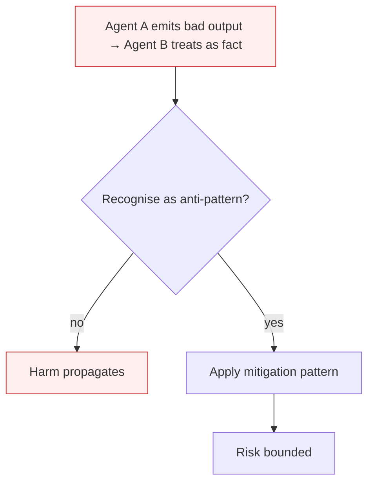

# Cascading Agent Failures

**Also known as:** Kaskadierende Ausfälle, ASI08, Multi-Agent Cascade

**Category:** Anti-Patterns  
**Status in practice:** deprecated

## Intent

Anti-pattern: build a multi-agent system where one agent's failure or hallucination propagates as input to peers, until the whole system has drifted.

## Context

A multi-agent system has agents that consume each other's outputs — a researcher feeds a writer, a writer feeds an editor, a critic feeds a planner. Each agent treats its inbound messages as if they were trustworthy peer outputs. There is no circuit-breaker between agents.

## Problem

A localised failure — a hallucinated fact, a corrupted memory write, a tool error misinterpreted as success — propagates through the message graph. Each downstream agent integrates the failure into its own reasoning and emits a confidently-wrong output that the next agent in turn treats as input. The system fails as a unit, not as individual agents; classical per-agent retries do not help because the inputs are themselves poisoned.

## Forces

- Multi-agent systems gain throughput by delegating; eliminating inter-agent trust eliminates the gain.
- Failures in one agent are silent at the message layer — bad outputs look syntactically valid.
- Synchronous fan-out amplifies single failures into multi-agent failures within one trace.

## Therefore

Therefore: introduce circuit-breakers, output validation, and confidence signalling at agent boundaries; cap propagation depth; fall back to single-agent or human paths when a downstream check fails.

## Solution

Don't. Apply per-edge validation between agents — type checks, schema validation, confidence thresholds. Use external-critic or agent-as-judge on intermediate messages, not just final output. Cap retry-fan-out so one root failure cannot recursively spawn more agents. See unbounded-subagent-spawn and unbounded-loop for related shapes.

## Structure

```
Anti-pattern: agent A fails or hallucinates -> message to agent B -> B integrates and emits wrong output -> agent C -> whole system drifts. Corrected: agent A -> per-edge validation (schema, type, confidence, critic) -> agent B -> capped retry fan-out.
```

## Diagram



## Example scenario

A research-pipeline of researcher → drafter → editor agents produces a customer-facing report. The researcher hallucinates a citation. The drafter integrates it with confident phrasing. The editor polishes the prose and adds three more references that 'support' the hallucinated one. The report ships. Postmortem: no inter-agent validation; the editor's job was prose, but the failure was factual, and no edge in the graph was responsible for catching it.

## Consequences

**Benefits**

- Short-term: passing messages straight between agents is simple and makes the multi-agent system fast to build.
- Naming it lets a team place validation on every edge, not only on the final output.

**Liabilities**

- A single bad upstream output corrupts every downstream agent that touches it.
- Per-agent uptime is irrelevant; system uptime is the product of trust hops.
- Forensics requires walking the message graph, not reading a single agent's logs.

## Failure modes

- Confident relay — one agent hallucinates a fact, and each downstream agent builds on it and passes on a more confident wrong answer.
- Error read as success — a tool error is taken as success by one agent, and peers act on a result that never existed.
- Retry fan-out — retries on poisoned input spawn more agents, which spread the same bad input further through the system.

## What this pattern constrains

No useful constraint; the missing constraint is per-edge validation.

## Applicability

**Use when**

- Never. Cite when reviewing multi-agent topology.
- Add per-edge validation, confidence thresholds, and circuit-breakers between agents.
- Bound retry depth so root failures cannot recursively expand the agent graph.

**Do not use when**

- Any multi-agent system where outputs are consumed by other agents without validation.
- Systems where downstream agents have side effects that depend on upstream correctness.
- Long-running pipelines where one bad message can pollute downstream memory.

## Components

- Agent message graph — defines who-feeds-whom in the multi-agent system
- Inter-agent message channel — carries outputs from one agent's tool surface to the next agent's input
- Per-agent retry layer — local resilience that does not see cross-agent corruption
- Missing edge validator — would check message validity at each agent-to-agent boundary

## Tools

- Multi-agent orchestrator — runs the agent graph (AutoGen, CrewAI, LangGraph)
- Edge validator — the missing pre-handoff check on each inter-agent message
- Confidence signal — the missing metadata that would let downstream agents discount low-confidence input

## Evaluation metrics

- Cascade depth — number of agents that integrated a single root failure before any catch
- Edge-validation coverage — fraction of inter-agent edges that run a structural or semantic check
- Mean blast radius per upstream failure — average count of corrupted downstream messages
- Per-agent vs system uptime gap — how much worse the system MTBF is than per-agent MTBF

## Known uses

- **[OWASP Top 10 for Agentic Applications 2026 — ASI08](https://genai.owasp.org/resource/owasp-top-10-for-agentic-applications-for-2026/)** _available_
- **Reported AutoGen / CrewAI multi-agent runs where a hallucinated researcher claim propagates to a polished, confidently-wrong final report** _available_

## Related patterns

- _complements_ **Unbounded Subagent Spawn**
- _complements_ **Unbounded Loop**
- _alternative-to_ **Agent-as-a-Judge**
- _alternative-to_ **Subagent Isolation**
- _complements_ **Memory Poisoning**
- _complements_ **Insecure Inter-Agent Channel**
- _complements_ **Agent Bullwhip Effect** — Cascading failures propagate one agent's error to peers; the bullwhip amplifies a legitimate demand signal through the agents' own ordering policy, not an error.
- _complements_ **Ghost Delegation** — Cascading failures propagate an error across agents; ghost delegation fires no error at all, the handoff disappears so nothing triggers recovery.
- _complements_ **Hidden Distributed Monolith (Multi-Agent)** — No failure isolation means one agent's failure is not contained — a direct consequence of the hidden coupling this anti-pattern names.

## References

- [OWASP Top 10 for Agentic Applications 2026 — ASI08](https://neuraltrust.ai/blog/owasp-top-10-for-agentic-applications-2026) — 2026
- [heise online — Kaskadierende Ausfälle in agentischen Systemen](https://www.heise.de/hintergrund/KI-Sicherheitsrisiken-OWASP-Top-10-for-Agentic-AI-Applications-11280779.html) — 2026
