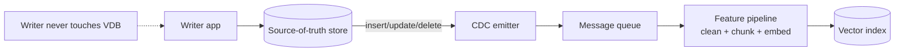

# CDC-Driven Vector Sync

**Also known as:** Change-Data-Capture RAG Sync, Event-Driven Vector Index Update

**Category:** Retrieval & RAG  
**Status in practice:** mature

## Intent

Treat the source-of-truth document store as the only writer; keep the vector index in sync by emitting change-data-capture events onto a queue that the feature pipeline consumes.

## Context

A RAG system reads from a vector index built over a corpus that lives in a source-of-truth store (database, document system, content platform). The corpus changes continuously — inserts, updates, deletes. The vector index must stay in sync or retrieval returns stale or missing material.

## Problem

Periodic batch rebuilds of the vector index are expensive, lag the source, and waste compute re-embedding unchanged documents. Dual-writing (the writer updates both the source and the vector index) is brittle: a crash between writes leaves the two stores inconsistent, and the writer code must understand the embedding pipeline. Without an event-driven path from source-of-truth changes to vector-index updates, embeddings drift silently from the corpus and retrieval quality degrades.

## Forces

- The source-of-truth store should be the only writer (single writer principle).
- Dual-writes from the application leak embedding-pipeline knowledge into the writer.
- Batch rebuilds waste compute and lag the source.
- CDC events provide ordered insert/update/delete signal.

## Therefore

Therefore: have the source-of-truth store emit CDC events for every insert/update/delete onto a message queue, and have the feature pipeline consume those events to keep the vector index in sync.

## Solution

Enable change-data-capture on the source-of-truth store (MongoDB change streams, PostgreSQL logical replication, Kafka Connect, Debezium). Publish each change as an event to a queue (Kafka, RabbitMQ, SNS). The feature pipeline subscribes: on insert, embed and upsert; on update, re-embed and overwrite; on delete, remove from the vector index. The writer code knows nothing about embeddings. The pipeline can be paused, redeployed, or backfilled from queue history.

## Structure

```
Writer app --> Source-of-truth store --insert/update/delete--> CDC emitter --> Message queue --> Feature pipeline (clean, chunk, embed) --upsert / overwrite / remove--> Vector index; writer never touches the vector index
```

## Diagram



## Example scenario

A knowledge-base platform stores articles in MongoDB. The vector index over the article corpus must stay current as the editorial team adds, edits, and retires articles. The team enables MongoDB change streams; each change publishes to RabbitMQ. A Bytewax feature pipeline consumes, cleans, chunks, embeds, and upserts into Qdrant. Editors see new articles in RAG within seconds; the editorial system writes only to MongoDB.

## Consequences

**Benefits**

- Single writer to the source; embeddings follow as an asynchronous derived view.
- Vector index drift bounded by queue lag, not by rebuild cadence.
- Feature pipeline is independently scalable, debuggable, and replayable.

**Liabilities**

- CDC infrastructure to operate (Debezium, Kafka Connect, change streams).
- Eventually-consistent retrieval — the gap between source write and vector update is non-zero.
- Schema changes on the source need coordinated migrations in the embedding pipeline.

## Failure modes

- Missed delete — the pipeline handles inserts and updates but drops a delete event, and retrieval keeps returning a document that no longer exists.
- Queue lag at the wrong moment — a burst of writes backs up the queue, and the agent answers from old embeddings while the source has already changed.
- Uncoordinated schema change — the source adds or renames a field, the pipeline still parses the old shape, and embeddings go stale or fail.
- Dual-write creep — a writer adds a direct vector-index update for speed, and the two paths disagree after the next crash.

## What this pattern constrains

Vector indices over a changing corpus must not be kept in sync by dual-writes from application code; CDC events from the source-of-truth store drive embedding updates.

## Applicability

**Use when**

- Vector index must reflect a corpus that changes continuously.
- Source-of-truth store supports CDC (change streams, logical replication, Debezium).
- Eventual consistency on retrieval (seconds-to-minutes lag) is acceptable.

**Do not use when**

- Corpus is static or changes in big batches that justify periodic rebuilds.
- Source store has no CDC mechanism and adding one is infeasible.
- Retrieval must be strongly consistent with writes (rare for RAG).

## Components

- Source-of-truth store — single writer
- CDC emitter — change-data-capture stream
- Message queue — durable buffer for events
- Feature pipeline consumer — embeds and upserts

## Tools

- CDC technology (Debezium, MongoDB change streams, Postgres logical replication)
- Message broker (Kafka, RabbitMQ, SNS)
- Vector DB (Qdrant, Pinecone, Weaviate)

## Evaluation metrics

- Sync lag — time from source write to vector index visibility
- Drop-rate on DLQ — events the pipeline could not process
- Embedding-refresh efficiency — share of work avoided vs full rebuild

## Known uses

- **[LLM Engineer's Handbook (Iusztin, Labonne) — LLM Twin CDC pipeline (lesson 3)](https://www.comet.com/site/blog/llm-twin-3-change-data-capture/)** _available_
- **[Debezium + Kafka Connect on Postgres/MySQL for RAG sync](https://debezium.io/documentation/reference/stable/architecture.html)** _available_
- **[MongoDB change streams + RabbitMQ for embedding sync](https://www.mongodb.com/docs/manual/changestreams/)** _available_

## Related patterns

- _composes-with_ **Streaming Feature Pipeline**
- _composes-with_ **FTI LLM Pipeline Split**
- _complements_ **Event-Driven Agent**
- _uses_ **Vector Memory**
- _complements_ **Agentic RAG**
- _complements_ **Silent External-Source Rot** — CDC sync keeps a corpus fresh from a source-of-truth so the stale-feed flavour of rot does not arise; the canary still guards extraction over whatever corpus the agent reads.

## References

- [LLM Engineer's Handbook](https://www.packtpub.com/en-us/product/llm-engineers-handbook-9781836200079) — Paul Iusztin, Maxime Labonne, 2024
- [Change Data Capture for LLM-Powered Applications (LLM Twin lesson 3)](https://www.comet.com/site/blog/llm-twin-3-change-data-capture/)
