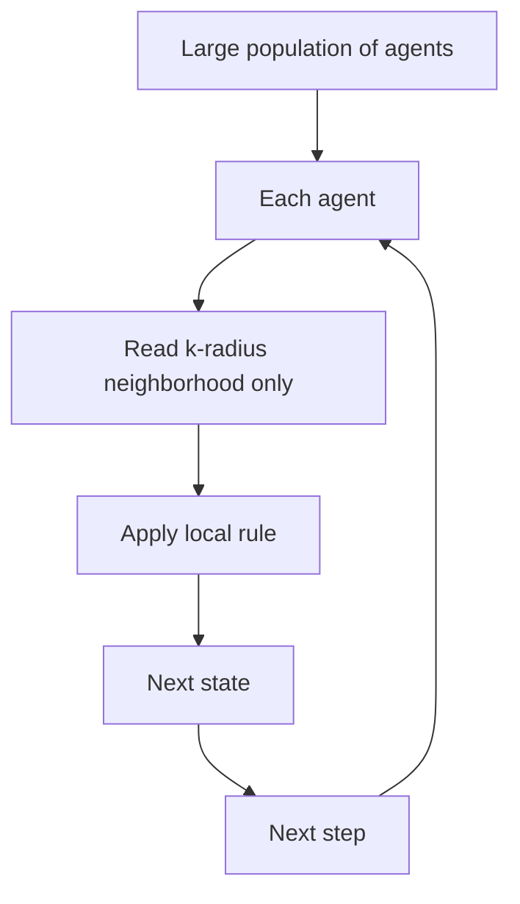

# Cellular-Automata Agents

**Also known as:** Local-Rule Swarm, Cellular Automaton Pattern

**Category:** Multi-Agent  
**Status in practice:** experimental

## Intent

A swarm where each agent applies simple local rules to its immediate neighborhood; macro behavior emerges without a central orchestrator and without global information access.

## Context

A team has a problem space (large grid, large graph, large population of entities) where state evolves over many steps. Centralized orchestration does not scale; agents with global state become a bottleneck. The problem has spatial or relational locality.

## Problem

Centralized agent designs do not scale to large grids/populations because every step requires global information. Distributed designs that allow agents to query arbitrary peers introduce coordination overhead that dominates the computation. The pattern of 'simple local rules → complex emergent macro behavior' from cellular automata is not standardly applied to agent design.

## Forces

- Strict local-only information access constrains what agents can compute.
- Emergent macro behavior is hard to predict from rules alone — must be tested in simulation.
- Designing the local rule set is the engineering work; tuning it is iterative.

## Therefore

Therefore: constrain each agent to read only its declared neighborhood and apply a deterministic local rule per step; the macro behavior is whatever emerges, not what is specified globally.

## Solution

Each agent has (state, neighborhood_radius=k, local_rule). At each step, agent reads only the k-radius neighborhood and applies the local rule to produce next state. No global state, no peer queries beyond the radius. Macro behavior is observed in simulation, not specified. Distinct from decentralized-agent-network (which allows arbitrary peer queries) and swarm (which is broader). Pair with decentralized-agent-network, swarm.

## Structure

```
Each step: every agent --read k-radius neighbourhood only--> apply local rule --> next state --> next step; macro behaviour observed in simulation, never specified centrally
```

## Diagram



## Example scenario

A large-document analysis problem: each agent corresponds to a paragraph, neighborhood is the surrounding ±3 paragraphs. Local rule: 'if neighborhood mentions topic X and my paragraph doesn't, mark me as candidate-to-extend'. Over 10 iterations, coherent topic clusters emerge from local-only rules without any central topic planner.

## Consequences

**Benefits**

- Scales to massive populations because per-agent cost is constant in local-radius, not global.
- Local rules are simple to express and test in isolation.
- Macro behavior emerges as a property of rule set + topology, not central design.

**Liabilities**

- Macro behavior is hard to predict and may not match design intent.
- Strict local-only access constrains the class of problems solvable.
- Tuning rules to produce desired macro behavior is iterative and unstable.

## Failure modes

- Unintended macro behaviour — the local rules look sensible one cell at a time, but the population settles into a pattern nobody designed for.
- Unstable tuning — a small change to one rule flips the emergent behaviour, and each tuning round undoes the last.
- Problem too global — the task needs information from far across the grid, and agents limited to their neighbourhood cannot solve it.
- Radius creep — someone widens the neighbourhood or adds a global query to fix a case, and the scaling benefit of local-only access is gone.

## What this pattern constrains

Each agent may read only its declared neighborhood; global queries and arbitrary peer access are forbidden.

## Applicability

**Use when**

- Large grid/graph problems with spatial or relational locality.
- Per-agent cost must be bounded independent of population size.
- Emergent macro behavior is acceptable as outcome metric.

**Do not use when**

- Problem requires global information per step.
- Agents need to negotiate arbitrary peer agreements (use blackboard or swarm).
- Macro behavior must be tightly specified.

## Components

- Agent grid/graph — population with topology
- Neighborhood reader — bounded-radius local state access
- Local rule — deterministic per-agent state transition
- Step scheduler — coordinates synchronous or asynchronous updates
- Macro observer — measures emergent behavior in simulation

## Tools

- Agent grid/graph topology
- Per-agent local-rule executor
- Step scheduler — sync or async

## Evaluation metrics

- Per-step computation cost (constant in radius)
- Macro-behavior convergence rate
- Rule-set fitness — emergent-behavior score

## Known uses

- **[Joakim Vivas: 17 Patrones de Arquitecturas Agénticas de IA (pattern #17)](https://www.joakimvivas.com/tech/17-patrones-arquitecturas-agenticas-ia/)** _available_

## Related patterns

- _specialises_ **Swarm**
- _alternative-to_ **Decentralized Agent Network**
- _alternative-to_ **Blackboard**
- _complements_ **Decentralized Swarm Handoff**
- _complements_ **Actor-Model Agents**

## References

- [17 Patrones de Arquitecturas Agénticas de IA y su Rol en Sistemas de Gran Escala](https://www.joakimvivas.com/tech/17-patrones-arquitecturas-agenticas-ia/) — 2026
