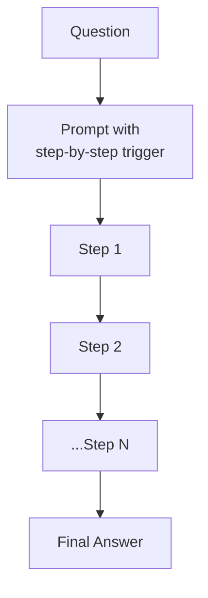

# Chain of Thought

**Also known as:** CoT, Step-by-Step Prompting

**Category:** Reasoning  
**Status in practice:** mature

## Intent

Elicit multi-step reasoning by prompting the model to produce intermediate steps before its final answer.

## Context

A team is using a large language model on a task whose answer is not a single fact lookup but the end point of a short reasoning trail: a multi-step arithmetic word problem, a logical deduction with several premises, or a question that requires combining two or three facts the model already knows in isolation. These are tasks that a person working them out on paper would normally pause to write a few intermediate lines for before stating the final answer.

## Problem

When the prompt shows the model only example pairs of (question, final answer) and asks for the next final answer directly, the model tends to skip straight to a single output token. Because the correct answer depends on a chain of intermediate inferences that have to be carried in working memory, jumping to the answer in one step produces confidently wrong results on anything beyond the simplest case. The reasoning never becomes a token the model can attend to, so it has no opportunity to use what it actually knows one step at a time.

## Forces

- Longer outputs cost more.
- Wrong reasoning chains can produce confidently wrong answers.
- Few-shot exemplars are dataset-specific; zero-shot triggers generalise but lose accuracy.

## Therefore

Therefore: prompt the model to produce intermediate steps before its final answer, so that reasoning becomes visible and parseable rather than collapsing into the final token.

## Solution

Prompt the model with exemplars showing intermediate reasoning, or use a zero-shot trigger ('Let's think step by step') before answering. The reasoning trace is visible and parseable.

## Structure

```
Question --> prompt with step-by-step exemplars or zero-shot trigger --> Model --> Step 1 --> Step 2 --> ... --> Step N --> Final answer (trace visible and parseable)
```

## Diagram



## Example scenario

A maths-tutoring assistant keeps blurting wrong answers to multi-step word problems because it tries to jump straight from 'Maria has...' to a single number. The team adds Chain-of-Thought prompting with a few worked exemplars, asking the model to write out each intermediate quantity before stating the final answer. Accuracy on the same problem set improves substantially because the answer now depends on reasoning steps the model can attend to one at a time, instead of being collapsed into a single output token.

## Consequences

**Benefits**

- Substantial accuracy gains on reasoning benchmarks.
- Reasoning trace is inspectable for debugging.

**Liabilities**

- Single linear trace; no branching or self-correction.
- Cost scales with trace length.

## Failure modes

- Early wrong step — an error in step 2 carries through the whole linear trace, and the final answer follows it with confidence.
- Plausible but disconnected trace — the reasoning reads well, yet the final answer does not actually follow from the steps.
- Trace bloat — the model writes long reasoning on simple questions, raising cost and latency with no gain.
- Parsing failure — the final answer is buried in the trace with no clear marker, and downstream code extracts the wrong value.

## What this pattern constrains

The model is required to emit reasoning before the final answer; one-shot answer-only generation is forbidden by prompt design.

## Applicability

**Use when**

- The task requires multi-step reasoning that single-shot answers fail at.
- Either exemplars with reasoning traces or a zero-shot trigger ('think step by step') are easy to add.
- The reasoning trace is useful as a debug or audit artefact.

**Do not use when**

- The task is direct lookup or pattern completion where reasoning steps add no quality.
- Latency or token budget cannot absorb the longer outputs.
- A reasoning model is in use that already runs internal chain-of-thought (use extended-thinking instead).

## Components

- LLM — generator of the reasoning trace and final answer
- Prompt template — few-shot exemplars or a zero-shot trigger phrase
- Output parser — separates intermediate steps from the final answer when needed

## Tools

- LLM API — primary inference with a token budget large enough to fit the reasoning trace

## Evaluation metrics

- Accuracy lift over a zero-shot baseline — does CoT help on this task class
- Reasoning-step presence rate — fraction of outputs that actually emit intermediate steps
- Faithfulness gap — divergence between the stated reasoning and the final answer, sample-audited
- p95 token cost per response — overhead the trace adds vs zero-shot

## Known uses

- **[OpenAI Reasoning prompts](https://platform.openai.com/docs/guides/reasoning)** _available_
- **Most production agents (CoT inside system prompts)** _available_

## Related patterns

- _complements_ **Self-Consistency**
- _generalises_ **Tree of Thoughts**
- _alternative-to_ **Least-to-Most Prompting**
- _complements_ **Extended Thinking**
- _generalises_ **Zero-Shot Chain-of-Thought**
- _used-by_ **Scratchpad**
- _used-by_ **STaR Bootstrapping**
- _alternative-to_ **Latent-Space Reasoning** — Latent-space reasoning keeps the chain in continuous hidden states instead of decoding each step to text tokens.
- _alternative-to_ **Attentive Reasoning Queries** — ARQs replace free-form chain-of-thought with a prescribed, attention-anchoring query sequence.

## References

- [Chain-of-Thought Prompting Elicits Reasoning in Large Language Models](https://arxiv.org/abs/2201.11903) — Wei, Wang, Schuurmans, Bosma, Ichter, Xia, Chi, Le, Zhou, 2022
- [Large Language Models are Zero-Shot Reasoners](https://arxiv.org/abs/2205.11916) — Kojima, Gu, Reid, Matsuo, Iwasawa, 2022
