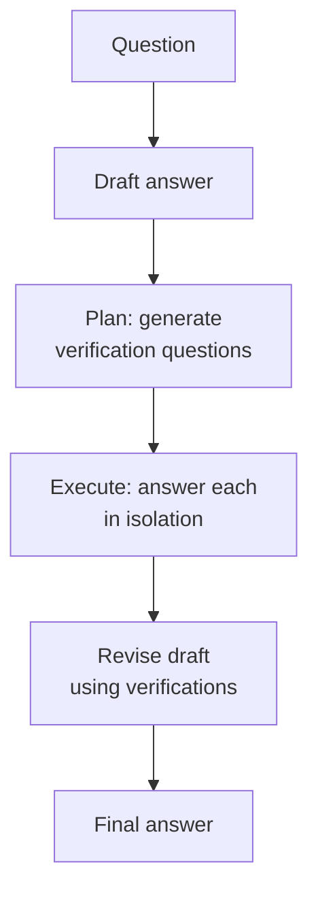

# Chain of Verification

**Also known as:** CoVe, Factored Verification, Verify Before Answering

**Category:** Reasoning  
**Status in practice:** emerging

## Intent

Reduce hallucination by drafting an answer, generating independent verification questions, answering them in isolation, and revising.

## Context

A team is using a large language model to produce long-form factual writing: a biography of a person, a summary that names specific entities and dates, or a recommendation that cites particular products, papers, or sources. The output reads fluently and confidently, but a careful reader inspecting individual sentences finds claims that are subtly or completely wrong — a wrong birth year, an invented citation, a made-up product feature, a confidently asserted fact that does not exist.

## Problem

When the same model is then asked to check its own draft within the same conversation, it sees the draft text in its context window. Its follow-up answers are pulled towards agreeing with what was just written, so the same wrong claims get reaffirmed instead of caught. Simply telling the model 'now check this for errors' does not work, because the draft itself biases the verifier, and the hallucinations slip through into the final output.

## Forces

- Verification questions must be independently answerable.
- Joint verification (all questions in one prompt) underperforms factored.
- Verification cost scales with question count.

## Therefore

Therefore: draft, plan independent verification questions, answer them in isolation, then revise, so that hallucinations surface where they can be corrected before the answer is finalised.

## Solution

Four-step pipeline. Draft: produce initial answer. Plan: generate verification questions covering claims in the draft. Execute: answer each question in isolation, without seeing the original draft. Revise: rewrite the draft using the verification answers.

## Structure

```
Question --> Draft answer --> Plan verification questions from draft claims --> Execute: answer each question in isolation (draft not in context) --> Revise draft using verification answers --> Final answer
```

## Diagram



## Example scenario

A research agent confidently lists five 'recent papers' on a niche topic, two of which don't exist. Asking the model to check its own draft in the same conversation just produces equally confident reaffirmations. The team applies Chain-of-Verification: after the draft, the system generates verification questions about each citation, answers each one in a fresh context with no view of the draft, and revises. Fabricated citations get exposed because the verifier never saw the wrong claim to begin with.

## Consequences

**Benefits**

- Substantial hallucination reduction without retrieval.
- Composes with retrieval naturally (retrieve evidence per question).

**Liabilities**

- 4x baseline cost.
- Verification quality depends on question coverage.

## Failure modes

- Draft leakage — verification questions are answered in the same context as the draft, and the answers echo its errors.
- Coverage gap — the planned questions miss the claim that was wrong, so the revision keeps it.
- Overcorrection — a mistaken verification answer replaces a correct claim in the draft during revision.
- Cost blowout — the four steps run on every query, including ones simple enough not to need checking.

## What this pattern constrains

Verification answers are produced without the draft in context; coupled verification is not permitted.

## Applicability

**Use when**

- The model hallucinates claims when it self-verifies in the same context as the draft.
- Verification questions can be answered in isolation without seeing the draft.
- A revise step can integrate the verification answers back into the final output.

**Do not use when**

- The task has no factual claims to verify (pure stylistic or generative tasks).
- Latency budget cannot absorb four sequential model calls per output.
- Verification questions cannot be answered cheaply or independently.

## Components

- Drafter LLM call — produces the initial answer that will be checked
- Verification-question planner — derives independent check questions covering claims in the draft
- Isolated verifier LLM call — answers each verification question in a fresh context without the draft
- Reviser LLM call — rewrites the draft using the verification answers
- Claim index — mapping from draft sentences to the verification questions that cover them

## Tools

- LLM API — at least four sequential calls per output across draft, plan, verify, and revise
- Retrieval or search tool — optional per-question evidence lookup when answering verification questions

## Evaluation metrics

- Hallucination rate before vs after revise — drop in unsupported claims attributable to the loop
- Verification-question coverage — fraction of draft claims that map to at least one verification question
- Verifier independence check — rate at which isolated answers diverge from draft assertions when the draft is wrong
- Cost multiplier vs single-shot — measured tokens-per-answer relative to the unverified baseline
- Revise edit distance — how much the revise step actually changes the draft

## Known uses

- **Meta AI implementation** _available_

## Related patterns

- _specialises_ **Reflection**
- _complements_ **Self-Consistency**
- _composes-with_ **Naive RAG**
- _alternative-to_ **Tool-Augmented Self-Correction**
- _complements_ **Hypothesis Tracking**
- _complements_ **Canonical-Entity Grounding** — Identifiers are verified against the authoritative store before use.

## References

- [Chain-of-Verification Reduces Hallucination in Large Language Models](https://arxiv.org/abs/2309.11495) — Dhuliawala, Komeili, Xu, Raileanu, Li, Celikyilmaz, Weston, 2023
- [Confirmation Bias: A Ubiquitous Phenomenon in Many Guises](https://doi.org/10.1037/1089-2680.2.2.175) — Raymond S. Nickerson, 1998
