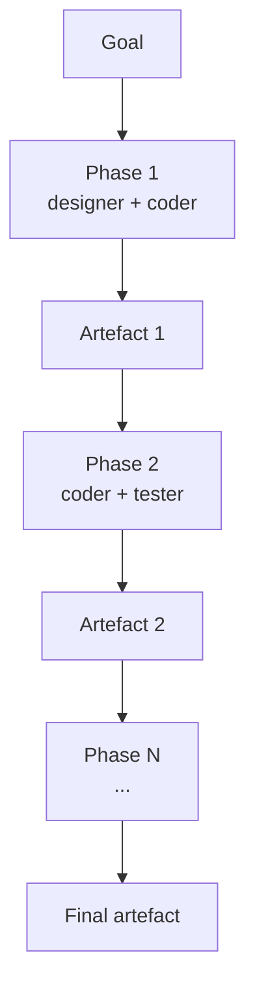

# Chat Chain

**Also known as:** Phased Multi-Agent Pipeline, Sequential Role-Pair Chats, Communicative Phase Chain

**Category:** Multi-Agent  
**Status in practice:** emerging

## Intent

Decompose a long, multi-disciplinary task into ordered phases; within each phase, run a paired-role chat between two agents until the phase artefact is signed off; pass the artefact to the next phase.

## Context

A team is using agents to carry out a long task — build a small program, prepare a regulatory brief, produce a multi-section report — that naturally breaks into several disciplines that have to happen in order: requirements, design, implementation, testing, documentation. The whole task is too long to fit in one agent's loop, and each discipline benefits from focused two-agent dialogue rather than a solo monologue.

## Problem

A single agent loop loses focus halfway through, forgetting the early requirements by the time it is writing tests. A broadcast multi-agent chat where every agent sees every message tangles design discussion with code review and blows up context windows. Flat prompt-chaining — one prompt feeds the next — cannot host the multi-turn back-and-forth a discipline like design review needs. The team needs structure across the disciplines but flexibility inside each one.

## Forces

- Each discipline benefits from focused two-agent dialogue.
- Context windows blow up if every agent sees every chat.
- Phase-to-phase hand-off needs a clean artefact contract.
- Termination of a phase has to be explicit, not vibes-based.

## Therefore

Therefore: arrange the work as an ordered chain of phases where each phase is a paired-role chat with a completion predicate and a typed artefact handoff, so that micro-flexibility inside a phase coexists with macro-discipline across phases.

## Solution

Define an ordered chain of phases. Each phase has (a) a defined input artefact, (b) two role-paired agents (e.g. designer + coder, coder + tester), (c) a phase-specific completion predicate, (d) a defined output artefact. Within a phase, the two agents converse multi-turn; the completion predicate ends the phase; the artefact moves to the next phase. The chain is the macro-control; the chat is the micro-control.

## Structure

```
Phase_1 (Role_A <-> Role_B) -> artefact_1 -> Phase_2 (Role_B <-> Role_C) -> artefact_2 -> ... -> final_artefact.
```

## Diagram



## Example scenario

A team is using an agent system to ship a small internal tool. A single agent loop forgets the requirements by the time it's writing tests, and a free-for-all multi-agent chat tangles design discussions with code review. They structure the work as a Chat-Chain: phase 1 is two agents pairing on requirements until a spec is signed off, phase 2 is two agents pairing on design against that spec, phase 3 is implementation, and so on. Each phase's signed-off artefact becomes the only context that crosses into the next.

## Consequences

**Benefits**

- Clear macro-progression with chat-level flexibility inside each phase.
- Keeps each phase's context tight; only the artefact crosses the boundary.
- Auditable artefact trail per phase.

**Liabilities**

- Designing the chain (phases + completion predicates) is the architecture problem.
- Sequential by construction; parallelism inside a phase requires extra design.
- Wrong phase decomposition forces agents into awkward role pairings.

## Failure modes

- Weak completion predicate — a phase signs off an artefact that only looks finished, and the next phase builds on a broken base.
- Wrong phase split — the chain pairs roles that do not fit the work, so agents in a phase argue about things they cannot decide.
- Phase skipping — an agent jumps ahead to code while still in design, and the artefact trail no longer matches what was done.
- Lost early requirement — a detail from phase one is not written into the artefact, so later phases never see it.

## What this pattern constrains

Agents may not skip phases or address agents outside the current phase; phase output must satisfy the completion predicate before transition.

## Applicability

**Use when**

- The work decomposes naturally into ordered phases, each with a paired role and an artefact.
- Phase-specific completion predicates can be expressed clearly enough to gate handoff.
- A single agent loop loses focus and broadcast multi-agent chat tangles context.

**Do not use when**

- The task does not split into phases with clean artefact handoffs.
- Completion predicates are too vague to gate phase transitions reliably.
- Two-role conversations would just slow down a competent single-agent solution.

## Components

- Phase controller — sequences phases and gates each transition on the completion predicate
- Role-paired agents — two specialists (e.g. designer-coder, coder-tester) inside a single phase
- Phase artefact — typed handoff document that crosses the boundary to the next phase
- Completion predicate — phase-specific stop hook that signs the artefact off
- Artefact registry — auditable trail of all signed artefacts across phases

## Tools

- LLM API — invoked for every turn inside each paired-role chat
- ChatDev framework — provides phase definitions, role pairings, and artefact contracts
- Artefact store — versioned storage for each phase output
- Predicate evaluator — checks artefact conformance before allowing phase transition

## Evaluation metrics

- Phase-completion rate — share of phases that satisfy the predicate without manual override
- Turns per phase — distribution of dialogue length inside each paired-role chat
- Artefact rejection rate — handoffs blocked by predicate for schema or content failure
- End-to-end success vs single-agent baseline — does the chained structure beat one big prompt
- Cross-phase rework rate — later phases that have to send the artefact back upstream

## Known uses

- **[ChatDev](https://github.com/OpenBMB/ChatDev)** _available_ — Software-development chain: design → coding → testing → documentation, each as a paired-role chat.

## Related patterns

- _generalises_ **Prompt Chaining** — Prompt chaining is a single-agent special case.
- _complements_ **SOP-Encoded Multi-Agent Workflow**
- _alternative-to_ **Supervisor**
- _uses_ **Pipes and Filters**
- _uses_ **Stop Hook** — Phase completion predicate is a stop hook scoped to a phase.

## References

- [ChatDev: Communicative Agents for Software Development](https://arxiv.org/abs/2307.07924) — Qian et al., 2023
