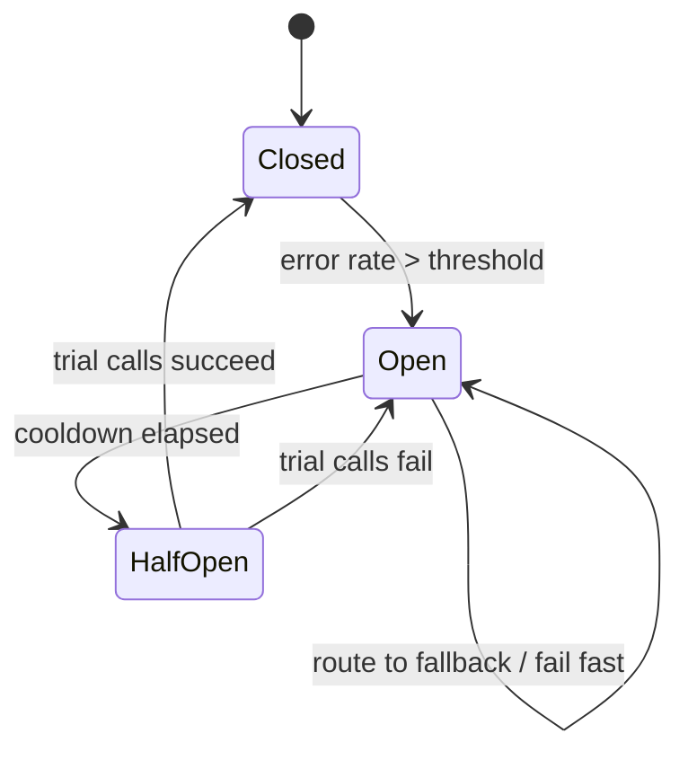

# Circuit Breaker

**Also known as:** Failure Trip, Rate-Limit Trip

**Category:** Routing & Composition  
**Status in practice:** mature

## Intent

Stop calling a failing dependency for a cooldown period after error rates exceed a threshold.

## Context

An agent calls external services as part of every request — third-party APIs, vector databases, model providers, internal microservices — and those dependencies fail from time to time through rate limiting, vendor outages, regional incidents, or transient bugs. The agent itself does not control when these failures happen, but it does control how it reacts when one of them starts returning errors. Retries are the natural first instinct because most transient errors clear on their own.

## Problem

When a dependency is genuinely down or rate-limited, naive retry logic hammers it with the same failing call over and over, burning token budget and wall-clock latency on responses that will never succeed. Worse, the retry storm can push a partially-degraded vendor past its rate limits and block legitimate traffic from other tenants, turning a small incident into a larger one. The team has no way to give the upstream a chance to recover without a coordinated decision to back off.

## Forces

- Threshold tuning trades fast detection for false trips.
- Cooldown duration trades availability for stability.
- Per-endpoint vs global breakers differ on blast radius.

## Therefore

Therefore: trip an open state when per-dependency error rate crosses a threshold and refuse calls until a cooldown probes recovery, so that a failing dependency is not hammered into a worse failure.

## Solution

Track per-dependency error rate over a window. When error rate exceeds a threshold, 'open' the breaker: route calls to fallback (or fail fast) for a cooldown. After cooldown, allow trial calls; close the breaker on success.

## Structure

```
Closed (calls flow, error-rate window counts) --error rate > threshold--> Open (no calls; fallback or fail fast) --cooldown elapsed--> HalfOpen (limited trial calls) --success--> Closed | --failure--> Open
```

## Diagram



## Example scenario

A tool-using agent calls a third-party enrichment API that suddenly starts returning 500s. Without protection it retries every call, burning token budget on failed responses and tripping the vendor's per-key rate limit. The team puts a Circuit Breaker in front of the tool: once the error rate over the last minute exceeds 30%, the breaker opens and short-circuits subsequent calls with a structured 'dependency unavailable' result for sixty seconds before probing again. Cost stops climbing and the agent can pivot to a fallback strategy.

## Consequences

**Benefits**

- Cost and latency under partial outages drop.
- Upstream dependencies recover without retry storms.

**Liabilities**

- False trips degrade availability when the error was transient.
- Tuning is empirical.

## Failure modes

- False trip — a short burst of transient errors opens the breaker, and a healthy dependency is cut off for the whole cooldown.
- Late trip — the threshold or window is too loose, so the retry storm runs long enough to hit the vendor's rate limits before the breaker opens.
- Flapping — trial calls in the half-open state succeed once, the breaker closes, full traffic returns, and it opens again in a loop.
- Wrong blast radius — one global breaker for many endpoints trips on a single bad endpoint and blocks all the others.

## What this pattern constrains

When the breaker is open, the dependency must not be called; only fallback paths may run.

## Applicability

**Use when**

- A dependency fails often enough that hammering it wastes cost or blocks legitimate traffic.
- Per-dependency error rates can be tracked over a meaningful window.
- A fallback or fail-fast path exists for use during the cooldown.

**Do not use when**

- Failures are correlated across all dependencies and there is no useful fallback to route to.
- The dependency is so cheap that wasted calls cost less than the breaker machinery.
- Cooldown semantics conflict with strict per-request SLAs (every request must be tried).

## Components

- Breaker state machine — Closed, Open, HalfOpen with transitions driven by error rate and cooldown
- Error-rate window — per-dependency counter of successes and failures over a sliding interval
- Trip threshold and cooldown — tuned parameters that decide when to open and when to probe
- Fallback path — fail-fast response or alternate handler invoked while the breaker is Open
- Trial-call gate — limited probe traffic in HalfOpen that decides whether to close again

## Tools

- Circuit-breaker library — Resilience4j, Polly, pybreaker, or an equivalent maintained implementation
- Metrics backend — per-dependency error and trip counters published for dashboards and alerts
- Config store or feature flag — runtime updates to thresholds and cooldowns without redeploy

## Evaluation metrics

- Trip rate per dependency per hour — how often the breaker opens, and against which upstreams
- False-trip rate — Open transitions that close again on the first HalfOpen probe (threshold too tight)
- Mean Open duration — how long a tripped dependency stays cut off before recovering
- Cost and latency saved while Open — calls suppressed times their unit cost and tail latency
- Cascading-failure incidents avoided — incident reviews where the breaker stopped a retry storm

## Known uses

- **Standard pattern in microservice frameworks; transferred to agent stacks** _available_
- **[Sparrot](https://marco-nissen.com/sparrot/)** _available_ — Sliding-window failure tracking on each LLM provider with cooldown on rate-limits; a separate breaker also closes tool loops that hit repeat / unknown / poll / ping-pong patterns.

## Related patterns

- _composes-with_ **Fallback Chain**
- _complements_ **Rate Limiting**
- _complements_ **Exception Handling and Recovery**
- _complements_ **Provider Fallback**
- _composes-with_ **Kill Switch**
- _used-by_ **Graceful Degradation**
- _generalises_ **Degenerate-Output Detection**
- _complements_ **Pre-Generative Loop Gate**
- _generalises_ **Typed Tool-Loop Failure Detector**
- _complements_ **Infrastructure Burst Bottleneck (Agent Scale-Out)**
- _alternative-to_ **Missing Idempotency on Agent Calls**
- _complements_ **Naive Retry Without Backoff**
- _complements_ **Agentic Behavior Tree**
- _complements_ **Session-Scoped Payment Authorization** — A circuit-breaker halts on an error signal; the session cap halts on cumulative spend.
- _alternative-to_ **Symptom-Remediation Thrashing** — A circuit breaker that trips after repeated failures is the corrective that stops a masking fix from re-firing indefinitely; thrashing is what happens without one.

## References

- [Release It! (Michael Nygard)](https://pragprog.com/titles/mnee2/release-it-second-edition/) — 2007
