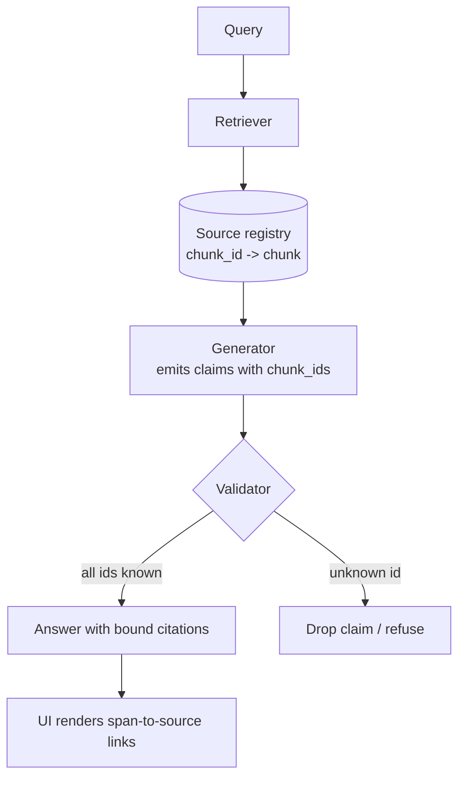

# Citation Attribution

**Also known as:** Source Attribution, Answer-to-Source Binding, Span-Level Citations

**Category:** Retrieval & RAG  
**Status in practice:** mature

## Intent

Track and surface, alongside a RAG-grounded answer, which retrieved chunks supported which claims, so the binding between answer span and source survives all the way to the user.

## Context

A team is shipping a retrieval-augmented system in a compliance, research, or customer-support setting where the user must be able to trace any claim in the answer back to the specific evidence that supports it. Unsupported claims are not an acceptable failure mode; the user needs to click from a sentence in the answer to the exact passage in a source document, and the team needs to be able to defend that link to an auditor.

## Problem

Just asking the model to 'include citations' is not enough. Citations that the model writes freely are ungrounded — they look real but may point to documents that were never retrieved or quote text that does not appear in the source. The binding from a span of the answer to a span of evidence has to be created by the retrieval pipeline and carried through generation and delivery; otherwise the citations cannot be trusted, and the whole audit story collapses.

## Forces

- The chunk-to-claim binding can be at document, chunk, or span level; finer granularity is more useful but harder.
- Models given retrieved context may still fabricate citations to documents that were not retrieved.
- Span-level alignment requires the model to emit either citation markers or structured outputs that the runtime resolves.
- Aggregating citations from multiple chunks behind one claim is common — single-source attribution is too narrow.
- Distinct from citation-streaming, which is the delivery shape; this is the binding itself.

## Therefore

Therefore: bind every claim in the answer to one or more retrieved-source ids during generation and validate the binding against the retrieval result before delivery, so that what reaches the user is span-anchored to evidence that was actually retrieved.

## Solution

During retrieval, assign each chunk a stable source-id and keep a registry of which ids were retrieved for this turn. During generation, either (a) prompt the model to emit citation markers (`[src-id]`) at the chosen granularity, then resolve and validate them against the registry, refusing any id that was not retrieved; or (b) use a structured-output schema that has a `claims` array with `text` and `supporting_chunk_ids` fields. At delivery, attach the resolved source records to the answer so the UI can render the binding. Pair with citation-streaming (delivery), naive-rag / contextual-retrieval (the upstream retrieval), and hallucinated-citations (the anti-pattern that ignores binding).

## Structure

```
Retriever → {chunk_id, content, source} registry → Generator (emits claims tagged with chunk_ids) → Validator (drops or refuses unknown ids) → Answer with bound citations.
```

## Diagram



## Example scenario

A legal-research assistant retrieves case excerpts and must produce an analysis where every claim cites the source case. The team assigns each retrieved chunk a stable `chunk_id` and prompts the model to emit a structured output: a list of claims, each with `text` and `supporting_chunk_ids`. A validator rejects any `chunk_id` not in this turn's retrieval registry. The UI renders each claim with footnote-style links to the cited cases. When the model is uncertain it returns fewer claims rather than fabricating citations; the citation-attribution binding is what the auditor checks.

## Consequences

**Benefits**

- Every claim is traceable to a retrieved chunk; unsupported claims are detectable.
- Auditors and users can verify provenance independently.
- The binding survives delivery, so UI components can render per-span source links.
- Hallucinated citations are blocked at validation time, not noticed at user-report time.

**Liabilities**

- Generation quality drops if the model is asked for tight span-level attribution and a coarser binding would suffice.
- Multi-chunk claims need aggregation logic — single-source binding is too narrow.
- Citation markers in prose can clutter UX; the delivery layer must render them well.
- Validation that rejects unknown ids must be paired with a fallback to avoid empty answers.

## Failure modes

- Fabricated source id — the model cites an id that was never retrieved, and without the registry check the fake citation reaches the user.
- Right id, wrong claim — the cited chunk was retrieved but does not support the claim it is attached to, and the id-only check passes it.
- Empty answer after validation — the validator drops every claim with an unknown id and no fallback exists, so the user gets nothing.
- Too narrow binding — a claim drawn from two chunks is tied to only one, and a reader checking that source finds half the support missing.

## What this pattern constrains

Every claim in the answer must be bound to at least one retrieved-source id from this turn's retrieval registry; citations to ids not in the registry must be rejected before delivery.

## Applicability

**Use when**

- Users must be able to trace each claim to a retrieved source.
- Compliance, research, or audit settings make unsupported claims unacceptable.
- The delivery UI can render per-claim or per-span source links.
- The retrieval pipeline already assigns stable source ids to chunks.

**Do not use when**

- Answers do not depend on retrieved evidence (no retrieval, no binding).
- The binding granularity required is finer than what the model and validator can deliver reliably.
- Citation markers in prose would degrade the UX more than they help.

## Components

- Retriever — assigns each returned chunk a stable source-id for this turn
- Source registry — per-turn map from chunk-id to chunk content used by both generator and validator
- Generator — emits claims tagged with supporting chunk-ids via citation markers or a structured schema
- Citation validator — rejects any claim that cites an id not in the current registry
- Delivery layer — attaches resolved source records to the answer so the UI can render span-to-source links

## Tools

- LLM with structured-output or citation-marker support — Anthropic Citations API, OpenAI Responses annotations, or schema-constrained decoding
- Document store — holds the source records referenced by chunk-id at render time

## Evaluation metrics

- Citation precision — fraction of emitted citations that point to a chunk genuinely supporting the claim, audited on a sample
- Citation recall — fraction of claims in the answer that received at least one bound citation
- Unknown-id rejection rate — share of citations the validator drops, signalling hallucinated source ids
- Span-alignment accuracy — for span-level binding, how often the cited span actually contains the cited text
- Empty-answer rate after validation — share of turns where validator rejections leave no citable claims, a fallback-design signal

## Known uses

- **[Anthropic Claude (Citations API)](https://platform.claude.com/docs/en/build-with-claude/citations)** _available_ — Claude's Citations feature returns per-claim citations bound to provided source documents.
- **[OpenAI Responses API (file_citation / url_citation annotations)](https://cookbook.openai.com/examples/responses_api/responses_example)** _available_ — OpenAI's Responses API emits citation annotations bound to retrieved files or URLs.
- **[Dify (automatic citations on knowledge retrieval)](https://docs.dify.ai/en/guides/workflow/node/llm)** _available_ — When an LLM node consumes context variables from knowledge retrieval, Dify automatically tracks citations.
- **[Perplexity / You.com / Phind](https://www.perplexity.ai/)** _available_ — Answer engines that show source links bound to claim spans as the headline UX.

## Related patterns

- _complements_ **Citation Streaming**
- _uses_ **Naive RAG**
- _uses_ **Contextual Retrieval**
- _alternative-to_ **Hallucinated Citations**
- _complements_ **Structured Output**
- _complements_ **Vectorless Reasoning-Based Retrieval** — Tree navigation returns page and section references that feed citation attribution directly.
- _complements_ **Canonical-Entity Grounding** — Grounds identifiers in master data the way attribution grounds prose in sources.
- _complements_ **Verify-Before-Cite Resolution Gate** — Attribution binds answer spans to chunks inside this turn's closed retrieval registry; this gate adds an external existence check for authorities the retrieval set may never have contained.

## References

- [Anthropic Claude — Citations](https://platform.claude.com/docs/en/build-with-claude/citations) — Anthropic
- [Dify — LLM node and citation tracking](https://docs.dify.ai/en/guides/workflow/node/llm) — LangGenius
