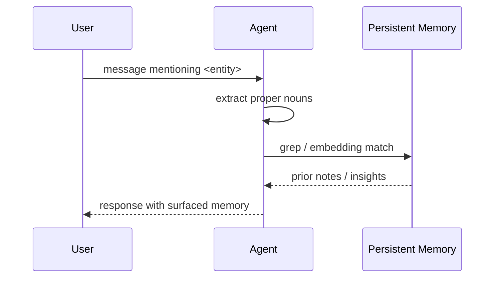

# Co-Located Memory Surfacing

**Also known as:** Proper-Noun Recall, Shared-Map Push

**Category:** Memory  
**Status in practice:** experimental

## Intent

Surface relevant persistent memories proactively when the human mentions a concrete entity the agent has prior knowledge of, so the human does not bear the burden of remembering to ask.

## Context

An agent has a searchable persistent memory store — thoughts, notes, insights, project files, prior session transcripts — and is in conversation with a human whose own memory of past sessions is fuzzy or absent. The agent can search its own memory in milliseconds; the human cannot search into the agent's memory at all. They share a goal but not a workspace.

## Problem

Because the human cannot see into the agent's memory, the burden of recognising 'this came up before' falls entirely on the human. If the human does not happen to name the right thing, the agent will not retrieve the relevant prior context, and the conversation proceeds as if those past sessions never happened. The shared map between human and agent only becomes truly shared if the agent proactively surfaces what it knows; if it waits to be asked, most of the relevant context is silently lost.

## Forces

- Searching memory is cheap; remembering to search is the hard part.
- Dumping all matches drowns the conversation; surfacing one or two helps.
- The agent must distinguish 'the human said it casually' from 'the human is opening this thread'.
- Surfacing should hook ('last time the topic came up the train of thought was…'), not lecture.

## Therefore

Therefore: on every user message, extract concrete named entities, match them against persistent memory, and surface at most one or two time-stamped fragments inline, so that the agent volunteers what it already knows without making the human ask.

## Solution

On every user message, extract concrete proper nouns and significant named phrases. Grep / embedding-match against the agent's persistent memory (thoughts, notes, insights, project files). If matches exist, surface ≤ 2 most relevant fragments inline in the reply — time-stamped, briefly framed — and let the human steer whether to pursue. Suppress the surface if it would feel like a lecture or if the human's use was clearly incidental.

## Structure

```
User message --extract proper nouns--> Entity list --grep / embedding match--> Persistent memory --top <=2 fragments (time-stamped)--> Reply with surfaced memory --> User steers whether to pursue
```

## Diagram



## Example scenario

A user starts a new chat with their assistant: 'I'm thinking about taking the Berlin job.' The assistant has six months of prior conversations on file, including the user's earlier reservations about relocating, but says nothing about them — because the user didn't search for them. The team adds Co-located Memory Surfacing: when the user names a concrete entity (Berlin job) the agent recognises, it proactively surfaces 'You mentioned in March that the commute would be a deal-breaker — has that changed?'. The shared map becomes shared without the user having to remember what's in it.

## Consequences

**Benefits**

- Continuity of conversation across sessions.
- Human doesn't have to remember to ask.
- Surfaces forgotten threads naturally.

**Liabilities**

- Risk of surfacing irrelevant matches that derail.
- Context window cost when many matches exist.
- Privacy risk if shared memory contains sensitive details.

## Failure modes

- Derailing recall — a name the human used in passing matches an old note, and the agent pulls the conversation toward a topic nobody asked about.
- Lecturing — the agent surfaces memory on every mention, and the human feels watched instead of helped.
- Sensitive echo — a stored private detail is repeated inline in a context where others can read it.
- Silent miss — entity extraction skips a nickname or misspelling, so known context stays buried and the human repeats themselves.

## What this pattern constrains

When user input contains a proper noun the agent has prior memory of, the agent cannot remain silent on that memory; systematic non-surfacing of known-entity context is a bug.

## Applicability

**Use when**

- The agent has a persistent memory store keyed by entities (people, projects, places).
- Users expect the agent to recognize and react to entities they have discussed before without being prompted.
- Memory recall can be made cheap enough to run on every user turn (lookup, not LLM call).

**Do not use when**

- The system has no persistent per-entity memory.
- Privacy or sensitivity rules forbid surfacing prior knowledge unless explicitly requested.
- False positives on entity matching would be more disruptive than silence.

## Components

- Entity extractor — pulls proper nouns and significant named phrases from each incoming user message
- Persistent memory store — keyed by entity, holds prior notes, insights, transcripts, and project artefacts
- Match layer — runs grep or embedding lookup against the store and ranks candidate fragments
- Surface gate — caps inclusions to one or two time-stamped fragments and suppresses lectures or incidental hits
- Reply composer — weaves the surfaced fragment inline with the agent's normal response

## Tools

- Named-entity recogniser — spaCy, GLiNER, or a small LLM call to extract proper nouns cheaply per turn
- Vector index — Chroma, Weaviate, or FAISS for semantic recall when surface-form match is too brittle
- Keyword index — inverted index or grep over a flat note store for the lexical-trigger variant

## Evaluation metrics

- Surface precision — fraction of surfaced fragments the user finds relevant rather than noise
- Missed-recall rate — turns where a relevant prior memory existed but was never surfaced
- Lecture suppression — fraction of suppressed surfaces that human review confirms would have felt intrusive
- Per-turn surface latency — milliseconds added to the user-visible turn by entity extract + match
- Continuity lift — user-reported sense of being remembered, measured against a no-surfacing baseline

## Known uses

- **Author's long-running personal agent (single private deployment)** _available_ — Single-source evidence: one private deployment by the catalog author; no independently documented use yet.

## Related patterns

- _complements_ **Awareness**
- _specialises_ **Agentic RAG**
- _uses_ **Vector Memory**
- _complements_ **Short-Term Thread Memory**

## References

- [OpenAI — Memory and new controls for ChatGPT](https://openai.com/index/memory-and-new-controls-for-chatgpt/) — 2024
