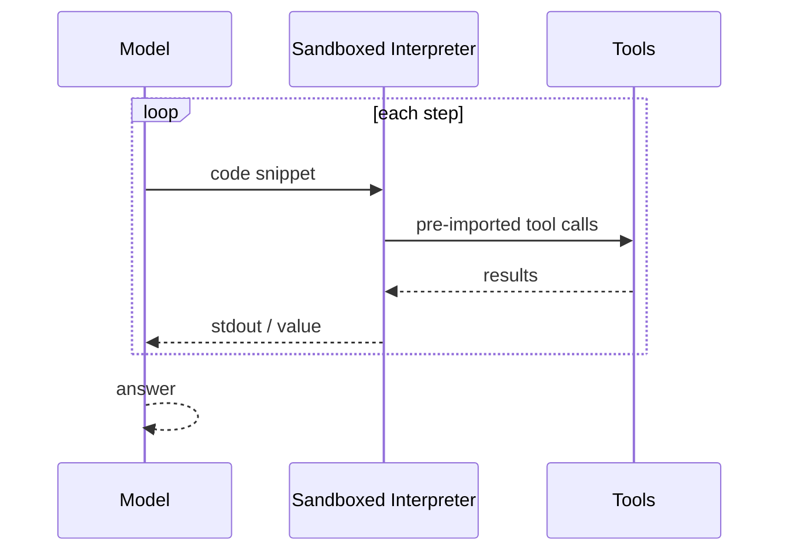

# Code-as-Action Agent

**Also known as:** CodeAct Agent, Code-Writing Agent, Python-Action ReAct, Executable Code Actions

**Category:** Tool Use & Environment  
**Status in practice:** emerging

## Intent

Have the agent emit a code snippet as its action each step, executed in a constrained interpreter, instead of emitting JSON tool calls; tool composition becomes function nesting and control flow inside the snippet.

## Context

A team is building an agent whose steps frequently need to compose multiple tool results: fetch a list, filter it by some predicate, then call a second tool for each remaining item. The model is strong at writing short snippets of Python or JavaScript, and the deployment can host a sandboxed interpreter that the agent's actions can run in.

## Problem

When the action channel is JSON tool calls, the agent has to unroll every composition across many turns. Expressing 'fetch orders, keep the ones over a threshold, then call refund on each' takes a turn for the fetch, a turn to inspect, then one turn per refund, with the whole intermediate list passing through the context window each time. Token cost balloons and the natural composability of a programming language (loops, conditionals, local variables) has to be faked through bespoke meta-tools or multi-turn glue.

## Forces

- Programming languages express composition (loops, conditionals, function nesting) natively.
- JSON tool-call format flattens that composition into a sequence of turns.
- Executing model-generated code is a real security surface.
- Models trained on code emit composed actions more compactly than JSON ones.

## Therefore

Therefore: replace the JSON tool-call channel with a sandboxed code snippet whose host pre-imports tools as functions, so that the agent composes loops, conditionals, and intermediate variables inside a single action instead of unrolling them across turns.

## Solution

Replace the JSON tool-call channel with a code-snippet channel. The agent emits a Python (or DSL) snippet; the host executes it in a sandboxed interpreter that pre-imports the available tools as functions and an allow-list of safe builtins/modules. Tool results are returned as Python values usable by subsequent code. The agent can compose tools inside one snippet (loops, conditionals, intermediate variables) and observe the printed output. Bracket every snippet with a sandbox that whitelists imports and prevents arbitrary IO.

## Structure

```
Agent -> code snippet -> Sandbox(allowlisted imports + tool functions) -> stdout/return -> Agent.
```

## Diagram



## Example scenario

A data-analysis agent needs to fetch a list of orders, filter to those over a threshold, and call a second tool for each one. With JSON tool calls, it takes a turn per order plus glue. The team switches to Code-as-Action: each step the agent emits a small Python snippet that runs in a constrained interpreter, so the whole composition is one snippet — fetch, filter, loop, call. Tool composition becomes ordinary control flow, and the conversation collapses from twenty turns to one.

## Consequences

**Benefits**

- Empirically ~30% fewer steps and tokens than JSON tool calls.
- Natural composability: function nesting, loops, conditionals in one action.
- Models trained on code (most modern frontier models) emit better code than JSON.

**Liabilities**

- Sandbox correctness is load-bearing; weak sandbox means arbitrary code execution.
- Debugging silent failures inside snippets is harder than per-call JSON tracing.
- Some hosted environments forbid model-generated code execution.

## Failure modes

- Sandbox escape — the interpreter allows an import or system call that should be blocked, and a generated snippet runs arbitrary code on the host.
- Silent snippet failure — a loop inside the snippet swallows an error or skips items, and the printed output looks fine while half the refunds never ran.
- Over-long snippet — the agent packs a whole workflow into one script, so a bug in the middle is hard to locate and the trace shows only the final print.
- Injected data as code input — untrusted tool output flows into later calls inside the snippet with no model check in between.

## What this pattern constrains

The agent may only execute Python operations against the explicitly allowlisted imports and tool functions; arbitrary import or system calls fail at the sandbox boundary.

## Applicability

**Use when**

- Tool composition is natural in code (filter, map, conditional chains) and clumsy as JSON tool calls.
- A sandboxed interpreter with pre-imported tools and an allow-list of safe builtins is feasible.
- Saving turns by composing multiple operations per step would meaningfully cut token cost.

**Do not use when**

- The deployment cannot host or trust a sandboxed interpreter.
- Tools are simple atomic calls with no useful composition.
- Auditors require explicit per-call structured arguments rather than free-form code.

## Components

- Agent — emits a code snippet as its action each step
- Sandboxed Interpreter — executes the snippet with pre-imported tools and an allow-listed standard library
- Tool Function Bindings — expose available tools as importable functions inside the sandbox
- Result Channel — returns stdout, return values, and exceptions to the agent
- Step Budget Controller — caps the number of code-snippet steps per task

## Tools

- Python sandbox (Pyodide or restricted CPython) — runs the agent-emitted snippets with pre-imported tool functions
- Static allow-list of builtins and modules — restricts what the snippet may import or call

## Evaluation metrics

- Steps to completion versus JSON tool calling — compression from composing inside one snippet
- Snippet-validity rate — fraction of emitted snippets that parse and run without exception
- Tool-composition depth per snippet — how often the agent actually chains multiple tools in one step
- Sandbox containment incidents — number of attempted escapes or disallowed imports caught
- End-to-end task success on agent benchmarks — headline quality of the code-action channel

## Known uses

- **[Hugging Face smolagents](https://github.com/huggingface/smolagents)** _available_ — CodeAgent emits Python; pre-imported tool functions; allow-listed modules.
- **Hugging Face Transformers Agents** _available_ — Original ReactCodeAgent / CodeAgent variants; beat the GAIA benchmark.
- **[Manus](https://manus.im/)** _available_ — Sandbox VM with shell + file edit; agent action vocabulary includes code execution.

## Related patterns

- _alternative-to_ **Tool Use**
- _uses_ **Code Execution**
- _uses_ **Sandbox Isolation**
- _specialises_ **ReAct**
- _alternative-to_ **Parallel Tool Calls**
- _complements_ **Structured Output**
- _composes-with_ **MCP-as-Code-API**
- _alternative-to_ **JSON-Only Action Schema**
- _complements_ **Code-Then-Execute with Dataflow Analysis**
- _complements_ **Repo Map**
- _complements_ **On-Demand Tool Synthesis** — Code-as-Action runs code as the answer; here the code is packaged and registered as a reusable, callable tool.

## References

- [Executable Code Actions Elicit Better LLM Agents](https://arxiv.org/abs/2402.01030) — Wang et al., 2024
- [Introducing smolagents: simple agents that write actions in code](https://huggingface.co/blog/smolagents)
