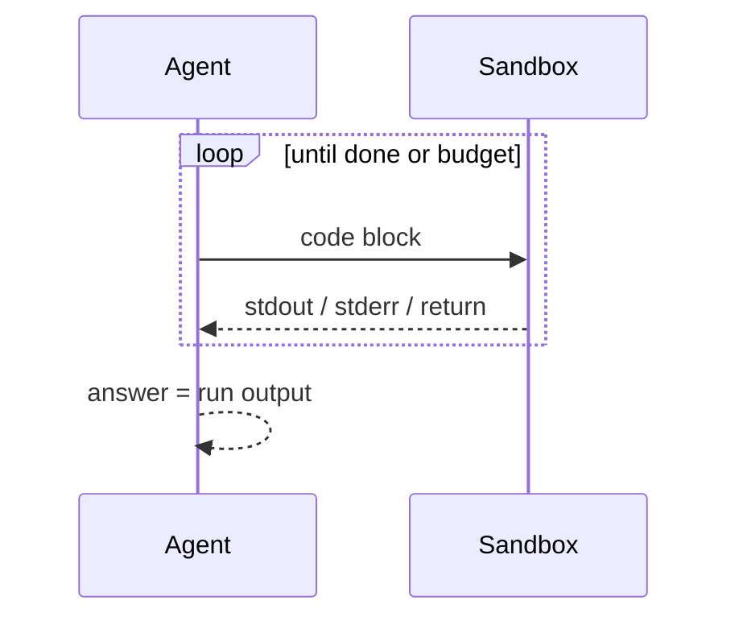

# Code Execution

**Also known as:** Code-Then-Execute, CodeAct, Program of Thoughts

**Category:** Tool Use & Environment  
**Status in practice:** mature

## Intent

Let the model emit code, run it in a sandbox, and treat the run as the answer instead of trusting the model to compute in its head.

## Context

A team is building an agent for a task that involves arithmetic, data manipulation, parsing, or other deterministic computation. The deployment can host a sandboxed Python or JavaScript interpreter (or another container-based execution environment) that the agent's code blocks can run inside.

## Problem

Large language models routinely get arithmetic wrong, miscount items in a list, and round numbers inconsistently when they try to compute the answer in their head. A small numeric error early in a workflow invalidates every downstream step, and the model offers no audit trail for how it arrived at a wrong number. Asking the model to be more careful does not fix the underlying issue: the computation never becomes a step the model can rerun or inspect.

## Forces

- Sandbox setup adds latency.
- Generated code may import unsafe modules or run forever.
- Execution results must round-trip back into the model's working context.

## Therefore

Therefore: route any step that requires computation through a sandboxed interpreter and feed stdout/stderr back into the loop, so that arithmetic, parsing, and transformation are executed rather than hallucinated.

## Solution

The agent emits a code block; a controlled interpreter (Python sandbox, JS VM, container) runs it; stdout/stderr/return value flow back. Repeat under a step budget. CodeAct treats code as the action language directly.

## Structure

```
Agent --code block--> Sandbox (Python / JS VM / container) --stdout, stderr, return value--> Agent --(repeat until done or step budget)--> Answer = run output
```

## Diagram



## Example scenario

A finance agent answers 'what was the average gross margin across these 47 orders?' by reading the rows and trying to compute the answer in its head, getting it wrong by 1.4 percentage points. The team enables Code Execution: the agent emits a short Python snippet that loads the data and computes the average in a sandbox, and the run's stdout becomes the answer. The model's strength stays at constructing the right calculation; the arithmetic stops being something it has to hallucinate.

## Consequences

**Benefits**

- Deterministic computation on top of probabilistic intent.
- Code is auditable; the same script can be replayed for debugging.

**Liabilities**

- Sandbox security is its own engineering problem.
- Very flexible action space increases failure modes versus a curated tool palette.

## Failure modes

- Weak sandbox — the interpreter can reach the network or file system it should not, and model-written code does real damage.
- Head math anyway — the model skips the code step for a simple-looking sum and states a number it never ran.
- Budget exhaustion — the agent keeps fixing the same failing code block until the step budget runs out without an answer.
- Wrong program, right run — the code executes cleanly but computes the wrong quantity, and the run output is trusted as the answer.

## What this pattern constrains

Computation happens in the sandbox; the model's free-form numeric output is not trusted.

## Applicability

**Use when**

- The task involves calculation, parsing, or transformations that LLMs hallucinate.
- A controlled interpreter or sandbox is available and trusted enough to run model-emitted code.
- stdout, stderr, and return values can flow back to the agent under a step budget.

**Do not use when**

- The task is pure language with no computation that benefits from running code.
- No safe execution environment is available and the security risk is unacceptable.
- Latency or sandbox cost outweighs the accuracy gain over in-context computation.

## Components

- Agent — emits a code block and treats the run result as the answer
- Sandbox Runtime — executes the code with capped CPU, memory, and time
- Result Capture — collects stdout, stderr, and return value for the agent
- Step Budget — bounds how many execute-observe loops a task may consume

## Tools

- Python interpreter sandbox (Pyodide, Deno, or container) — runs the emitted code under resource limits
- Standard library and pinned scientific packages — provide arithmetic, parsing, and numeric primitives the model offloads to

## Evaluation metrics

- Accuracy on numeric and code-grounded benchmarks (GSM8K, HumanEval) — lift from offloading computation to the interpreter
- Runs per task — how many code-observe iterations are needed on average
- Sandbox-violation rate — attempted escapes or resource-cap breaches per 1000 runs
- Code-validity rate — fraction of emitted code blocks that execute without exception
- p95 execution latency — time from emit to result available to the model

## Known uses

- **OpenAI Code Interpreter / Advanced Data Analysis** _available_
- **Anthropic Claude with code execution tool** _available_
- **CodeAct paper implementations** _available_
- **[Claude Code (Bash tool)](https://docs.claude.com/en/docs/claude-code/overview)** _available_
- **[Replit Agent](https://replit.com/ai)** _available_
- **[v0](https://v0.app/)** _available_
- **E2B Sandboxes** _available_

## Related patterns

- _specialises_ **Tool Use**
- _composes-with_ **ReAct**
- _composes-with_ **Deterministic-LLM Sandwich**
- _composes-with_ **Skill Library**
- _complements_ **Sandbox Isolation**
- _complements_ **WebAssembly Skill Runtime**
- _used-by_ **Code-as-Action Agent**
- _complements_ **Code-Then-Execute with Dataflow Analysis**
- _complements_ **Vibe-Coding Without Security Review**
- _complements_ **Recursive Language Model** — The recursive language model runs the root model in a code/REPL environment that holds the prompt as data.
- _alternative-to_ **Tool-Output Arithmetic Trust** — Code Execution is the corrected counterpart: it runs the computation in a sandbox and treats the run as the answer, which is exactly the offload this anti-pattern omits.
- _alternative-to_ **Solver-Ready Formulation Handoff** — Both take the computation away from the model, but there the artefact is imperative code and the run is the answer; here the artefact is a declarative model that is separately validated, and the solver rather than the execution is the authority.

## References

- [PAL: Program-aided Language Models](https://arxiv.org/abs/2211.10435) — Gao et al., 2022
- [Executable Code Actions Elicit Better LLM Agents (CodeAct)](https://arxiv.org/abs/2402.01030) — Wang et al., 2024
- [Program of Thoughts Prompting](https://arxiv.org/abs/2211.12588) — Chen, Ma, Wang, Cohen, 2022
