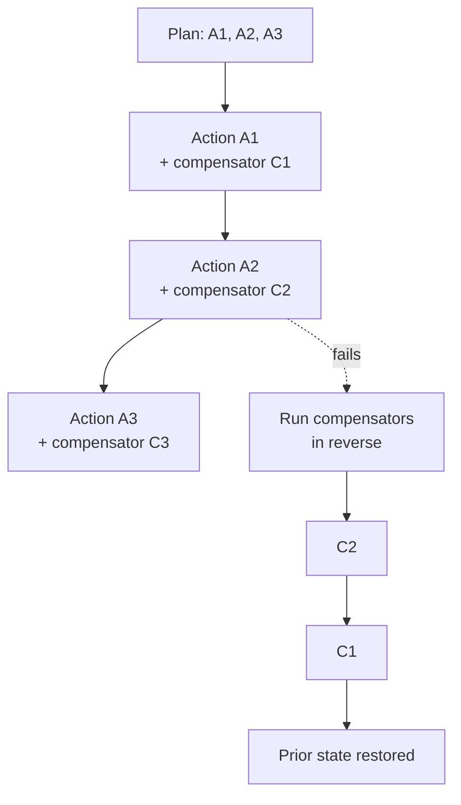

# Compensating Action

**Also known as:** Saga, Undo Step, Rollback Action

**Category:** Safety & Control  
**Status in practice:** mature

## Intent

Pair every irreversible-looking agent action with a compensating action that can undo or counteract it.

## Context

An agent is executing a multi-step plan that writes to several systems in sequence — book a flight, then a hotel, then a car, or charge a card, then provision an account, then send a welcome email. Each step succeeds or fails independently, and the agent is operating across services that have no shared transactional boundary. Some of the early steps will have already landed in the real world by the time a later step fails.

## Problem

Most agent tool palettes do not offer distributed transactions across the third-party systems the agent talks to, so there is no built-in mechanism to roll back a multi-step plan when one step fails. Without an explicit undo strategy, a failure halfway through the plan leaves the world in an inconsistent state: the flight is booked but the hotel is not, the card has been charged but the account does not exist. The agent then either retries blindly and double-books, or stops and leaves a human to clean up by hand.

## Forces

- Not every action has a clean compensator.
- Compensation logic is a separate code path.
- Idempotency matters: compensating an already-compensated action must be safe.

## Therefore

Therefore: register a paired, idempotent undo with every forward action and run the undos in reverse order on failure, so that partial-failure state can be walked back instead of leaking into the world.

## Solution

For each forward action, define a compensating action (delete-after-create, refund-after-charge, archive-after-publish). On failure mid-plan, run compensators in reverse order to restore the prior state. Idempotent compensators.

## Structure

```
Plan [A1, A2, A3] --> A1 (+ C1) --> A2 (+ C2) --> A3 (+ C3); on failure at An --> run Cn-1 ... C1 in reverse --> prior state restored
```

## Diagram



## Example scenario

A booking agent reserves a flight, then a hotel, then realises the dates conflict with the user's calendar. There's no two-phase commit across these vendors. The team requires every irreversible-looking action to be paired with a compensating action: book_flight registers cancel_flight(reservation_id) on a stack, book_hotel pairs with cancel_hotel. When the agent detects the conflict, it walks the stack and undoes the steps in reverse order, leaving the user where they started.

## Consequences

**Benefits**

- Partial-failure consistency.
- Confidence to attempt multi-step writes.

**Liabilities**

- Doubles the number of action implementations.
- Some actions cannot truly be compensated (sent emails, public posts).

## Failure modes

- Uncompensable step — the plan includes a sent email or a public post, so the reverse run restores everything except the one effect that mattered.
- Non-idempotent undo — a compensator runs twice after a retry and refunds the charge twice or deletes the wrong record.
- Wrong order — compensators run in forward order, and undoing an early step breaks the undo of a later step that depended on it.

## What this pattern constrains

Forward actions cannot be invoked without a registered compensator; uncompensable actions need explicit operator approval.

## Applicability

**Use when**

- Agent actions are irreversible-looking and distributed transactions are unavailable.
- For each forward action a meaningful undo (delete-after-create, refund-after-charge) can be defined.
- Compensators can be made idempotent so retrying them is safe.

**Do not use when**

- Actions are truly irreversible (sent emails, physical world effects) with no compensator possible.
- Native transactional semantics are available and simpler than building per-action compensators.
- The cost of authoring and testing compensators outweighs the rare failure cases they would handle.

## Components

- Forward action — the original step that mutates external state
- Compensator registry — pairing of each forward action with its idempotent undo
- Compensation stack — ordered record of landed actions used to walk back on failure
- Saga coordinator — orchestrator that detects mid-plan failure and runs compensators in reverse

## Tools

- Idempotency-key store — ensures repeated compensator calls converge to a single effect
- Provenance ledger — records which forward actions landed so the reverse walk has truth

## Evaluation metrics

- Compensator coverage — fraction of forward actions with a registered, tested undo
- Rollback success rate — fraction of mid-plan failures that restored prior state cleanly
- Uncompensable-action escape count — landed actions with no available undo path
- Compensator idempotency violations — repeat-invocation effects that diverged from a single-call result

## Known uses

- **Saga pattern in microservices, transferred to agents** _available_

## Related patterns

- _complements_ **Human-in-the-Loop**
- _uses_ **Provenance Ledger**
- _complements_ **Approval Queue**
- _used-by_ **Kill Switch**
- _alternative-to_ **Simulate Before Actuate**
- _complements_ **Race Conditions on Shared Tool Resources**
- _complements_ **Missing Idempotency on Agent Calls**
- _complements_ **Dry-Run Harness**
- _complements_ **Stochastic-Deterministic Boundary (SDB)**
- _complements_ **Scatter-Gather Plus Saga**
- _used-by_ **Interruptible Agent Execution**
- _complements_ **Risk-Tiered Action Autonomy** — Release-gating prevents the worst actions from auto-executing; compensating actions reverse staged ones that prove wrong.
- _alternative-to_ **Shadow Workspace** — Compensating Action undoes an effect by running an inverse action; a shadow workspace reverts by discarding a diff/checkpoint instead.
- _complements_ **Reversibility-Aware Action Filter** — Compensating actions undo a step after it executes; this filter prevents the genuinely irreversible step from being taken in the first place, so the two cover the reversible and irreversible halves of the action surface.
- _complements_ **Deployment-Correlated Rollback Gate** — The rollback is the compensator for a bad release; this pattern decides when the agent may fire that compensator autonomously versus escalate.
- _complements_ **Forkable Agent Sandbox** — The remedy for effects that escape the snapshot boundary: what cannot be rolled back has to be compensated.

## References

- [Sagas (Garcia-Molina, Salem)](https://dl.acm.org/doi/10.1145/38713.38742) — 1987
