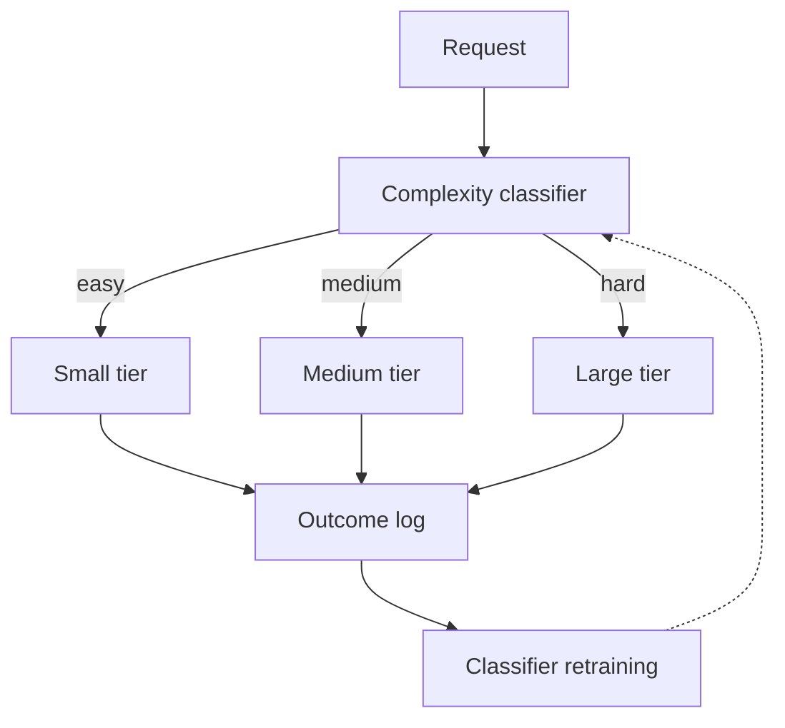

# Complexity-Based Routing

**Also known as:** Difficulty-Aware Routing, Cost-Quality Routing, Query-Difficulty Routing

**Category:** Routing & Composition  
**Status in practice:** emerging

## Intent

Estimate a request's difficulty up front and bind it to the cheapest model tier that can answer well, using an explicit complexity classifier as the routing key.

## Context

A team runs an agent against a heterogeneous mix of requests where some queries are trivially solvable by a small model and others genuinely need a frontier model's depth. The team already has access to several model tiers across one or more providers, and treats difficulty as the dominant driver of per-request quality and cost — orthogonal to topic, modality, or which provider hosts the weights. They are willing to pay for an extra classification step if it lets the bulk of traffic land on a cheap tier without hurting the hard cases.

## Problem

Sending everything to the strong tier overpays on the easy majority of traffic. Sending everything to the cheap tier silently degrades the hard minority. Topic-based or provider-based routing does not help when two queries on the same topic differ by orders of magnitude in difficulty — 'what is 2+2' and 'prove this lemma' are both maths. Without an explicit difficulty signal, the team has no way to make spend track the property that actually matters.

## Forces

- Difficulty is not directly observable; the classifier is approximating a latent variable.
- Classifier cost has to stay well under the saving it unlocks, or the routing destroys its own value.
- Misclassifying a hard query as easy is much costlier than the reverse, because the user sees a wrong answer instead of an unnecessary spend.

## Therefore

Therefore: place an explicit complexity classifier in front of the model tiers and bind each request to the cheapest tier that meets its predicted difficulty, so that spend follows difficulty instead of defaulting to the strongest model.

## Solution

Define a small set of model tiers (small/medium/large, or open-weight/hosted-mid/hosted-frontier). Build a complexity classifier that scores each request on a difficulty axis — a learned router trained on win-rate data, a heuristic over query features (length, presence of operators, retrieval-hit count), or an LLM-judge on a cheap model. Dispatch each request to the tier matched to its score. Log per-tier outcomes and re-train the classifier on observed wins and losses. Distinct from open-weight-cascade (which tries cheap first and escalates on failure or low confidence) and multi-model-routing (which mixes class- and tier-based dispatch): here the routing decision is taken once, up front, from a difficulty signal — there is no cheap-first attempt to escalate from.

## Structure

```
Request -> Complexity classifier -> Tier registry -> Dispatch to small | medium | large -> Response (+ logged outcome for classifier retraining).
```

## Diagram



## Example scenario

A coding-assistant product pays frontier-model prices on every request, including 'rename this variable' and 'fix this typo'. The team trains a small complexity classifier on logged outcomes: features include prompt length, presence of multi-file context, and whether the user previously rejected a small-model answer. The classifier scores each new request and routes simple edits to an 8B open-weight model, mid-complexity tasks to a hosted mid-tier model, and hard architectural questions to a frontier model. Average cost per request drops by roughly 60%; hard-query quality on the eval set holds within 1 point of the strong-tier-only baseline.

## Consequences

**Benefits**

- Spend tracks difficulty, not the worst-case tier.
- Tiers can be swapped independently as model prices and capabilities move.
- Difficulty is logged as a first-class signal that informs eval, capacity planning, and prompt work.
- Avoids the cheap-first wasted call that a cascade incurs on hard queries.

**Liabilities**

- Classifier accuracy is load-bearing; misroutes on hard queries are user-visible as wrong answers.
- Difficulty drifts as the product, the model lineup, and user behaviour change; the classifier needs retraining.
- Classifier training data depends on having outcome labels — wins, losses, judge scores — which not every team has.
- The extra hop adds latency on every request, including the easy ones.

## Failure modes

- Hard-as-easy misroute — the classifier scores a hard query as easy, the small tier answers it, and the user gets a confident wrong answer.
- Difficulty drift — the product and user mix change, the classifier keeps its old boundaries, and per-tier quality slips without anyone retraining.
- Override creep — callers add per-call tier overrides for their own cases, and the routing key stops being difficulty.
- Classifier cost eats the saving — the difficulty judge is slow or expensive enough that the extra hop on every easy request cancels the tier discount.

## What this pattern constrains

A request reaches a tier only through the complexity classifier's decision; ad-hoc bypasses or per-call overrides are forbidden, or the routing key stops being difficulty.

## Applicability

**Use when**

- Traffic mixes trivial and hard requests at meaningful volume and the cost gap between tiers is large.
- Outcome labels (judge scores, win rates, human grades) exist or can be collected to train and monitor the classifier.
- A small extra latency hop is acceptable on every request.
- Difficulty is a stronger signal than topic, provider, or modality for the workload at hand.

**Do not use when**

- Traffic is uniform in difficulty and a single tier already meets the price-performance target.
- Outcome labels cannot be collected and classifier quality cannot be measured.
- A cheap-first cascade with confidence-based escalation is simpler and adequate.
- Misroute risk on hard queries is unacceptable and the classifier cannot meet the required precision on that tail.

## Components

- Complexity classifier — learned model, heuristic, or LLM-judge that scores each request on a difficulty axis.
- Tier registry — declared set of model tiers with capability and price descriptors.
- Dispatcher — binds the scored request to a tier and refuses ad-hoc overrides.
- Outcome log — per-request difficulty score, tier chosen, and observed quality used for retraining.
- Drift monitor — tracks shifts in score distribution and per-tier quality as the workload evolves.

## Tools

- Trained routing libraries — RouteLLM, Not Diamond SDK, or in-house classifier.
- Multi-provider gateway — LiteLLM, OpenRouter, Portkey to reach tiers behind one interface.
- Outcome-logging store — captures (query, tier, score, judgment) tuples for classifier retraining.
- Eval harness — held-out hard-query suite that pins the classifier's recall on the dangerous tail.

## Evaluation metrics

- Cost per resolved request vs single-strong-tier baseline — the saving the pattern is meant to deliver.
- Classifier accuracy on a held-out set, split by difficulty bucket — especially recall on the hard tail.
- Share of traffic routed to each tier — confirms the routing assumption matches reality and reveals drift.
- Quality delta on hard queries between predicted-hard and predicted-easy lanes — sizes the cost of misroutes.
- Classifier latency and cost overhead per request — the price paid to make the routing decision.

## Known uses

- **[RouteLLM (LMSYS)](https://github.com/lm-sys/RouteLLM)** _available_ — Trained routers (matrix factorisation, BERT classifier, causal LLM, similarity-weighted) score each query and route to a strong or weak model against a user-set cost threshold; reports up to ~85% cost reduction while preserving ~95% of GPT-4 quality on standard benchmarks.
- **[Not Diamond](https://www.notdiamond.ai/)** _available_ — Per-prompt model recommender that predicts the best LLM for each input across providers; reports ~10% accuracy lift and ~50% cost reduction on long-running agent workloads.
- **[OpenRouter Auto](https://openrouter.ai/openrouter/auto)** _available_ — Meta-model picks among dozens of candidate models per request and bills at the chosen model's rate; aimed at best output for the prompt rather than a fixed cost lane.

## Related patterns

- _specialises_ **Routing**
- _specialises_ **Multi-Model Routing** — multi-model-routing mixes class-based and tier-based dispatch; complexity-based-routing fixes the key to predicted difficulty
- _alternative-to_ **Open-Weight Cascade** — cascade tries cheap first and escalates on failure or low confidence; this pattern decides upfront via classifier
- _complements_ **Mixture of Experts Routing** — MoE routes by domain/skill; complexity-based-routing routes by difficulty within or across domains
- _complements_ **Topic-Based Routing** — topic-based routes inter-agent messages by named topic; this pattern routes a single request by difficulty
- _complements_ **Provider-String Routing**
- _complements_ **Provider Fallback**
- _complements_ **Fallback Chain**
- _complements_ **Adaptive Compute Allocation**
- _alternative-to_ **Top-Tier Model For Everything (Cost)**
- _complements_ **Large Action Models (LAMs)**
- _complements_ **Large Reasoning Model (LRM) Paradigm**
- _complements_ **Behavior-Space Architecture** — Complexity routing binds a query to a model tier by difficulty; behavior-space routing binds it to a subset of architectural subsystems. They stack: difficulty picks the model, capability need picks the subsystems.
- _alternative-to_ **SLA-Aware Triage Scoring** — Both pick a routing key, but complexity-based-routing keys on estimated request difficulty to choose a model tier; here the key is a deadline-x-entitlement-x-sentiment score that orders a human work queue.
- _alternative-to_ **Advisor Consult** — A complexity classifier must predict difficulty from the request alone; the advisor defers that call to the executor, which sees difficulty as it arises.
- _complements_ **Semantic Decision Node** — A complexity classifier is one semantic decision node; benchmarks of decision models show this particular question, which asks the model to predict another model's failures, is among the hardest to answer from local text.

## References

- [A Two-Dimensional Framework for AI Agent Design Patterns: Cognitive Function x Execution Topology](https://arxiv.org/abs/2605.13850) — Jia Huang, Joey Tianyi Zhou, 2026
- [A Survey on the Optimization of Large Language Model-based Agents](https://arxiv.org/abs/2503.12434) — Du et al., 2025
- [RouteLLM: Learning to Route LLMs with Preference Data](https://arxiv.org/abs/2406.18665) — Ong et al., 2024
- [RouteLLM repository](https://github.com/lm-sys/RouteLLM)
- [Not Diamond — model recommender](https://www.notdiamond.ai/)
