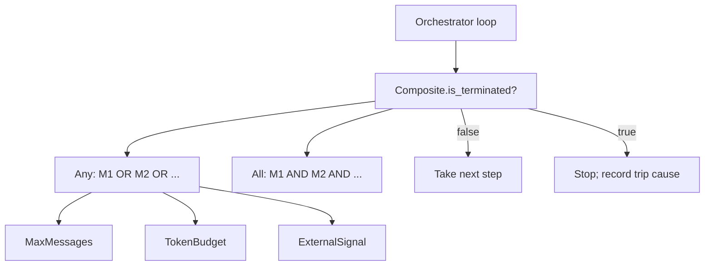

# Composable Termination Conditions

**Also known as:** Termination DSL, Stop-Condition Composition

**Category:** Safety & Control  
**Status in practice:** emerging

## Intent

Express agent stop criteria as small single-purpose conditions composed with AND/OR into one explicit termination contract instead of ad-hoc loop guards.

## Context

An agent or orchestrator loops over model calls, tool invocations, and message exchanges until something tells it to stop. The realistic stop criteria are heterogeneous: a max number of messages, a token budget, a phrase the model emitted, a particular tool call (e.g. submit_final), a handoff to another agent, a timeout, an external operator signal, or a user cancellation.

## Problem

Inlining these stop conditions as ad-hoc `if` statements in the orchestrator loop scatters the termination logic, makes its precedence implicit, and prevents reuse across loops. Adding a new condition requires editing the loop. Combining conditions (stop on max_messages OR external signal AND a specific tool call) becomes an unreadable nest. Operators reading a trace cannot tell why a run ended without re-reading the loop code.

## Forces

- Different agents need different combinations of the same primitive conditions.
- Conditions must compose with AND/OR while preserving short-circuit semantics.
- The trace must record which condition tripped, for postmortem.
- External signals (operator cancellation, kill-switch) must be expressible as a condition like any other.

## Therefore

Therefore: model each stop criterion as a typed termination condition and compose them with AND/OR into a single decision the loop consults each iteration, so termination is one explicit contract whose trip cause is recorded.

## Solution

Define a small set of primitive termination conditions: MaxMessages, TokenBudget, TextMention, FunctionCall, Handoff, Timeout, ExternalSignal, Cancellation. Each implements a single method `is_terminated(state) -> bool, reason`. Define a Composite that combines conditions with `any` (OR) or `all` (AND) semantics. The orchestrator loop consults the composite once per step. The trip cause (which leaf condition fired) is logged with the termination event.

## Structure

```
Orchestrator loop --each step--> Composite.is_terminated(state) [any / all over MaxMessages, TokenBudget, Timeout, ExternalSignal, ...] --false--> next step | --true--> Stop + log trip cause
```

## Diagram



## Example scenario

A research-agent loop is configured with `MaxMessages(50) | TokenBudget(200_000) | TextMention('final_answer') | ExternalSignal(cancel_token)`. Each step the orchestrator asks the composite whether to stop. When the cancel token flips, the loop ends and the trace records `terminated_by=ExternalSignal`; when the model emits 'final_answer' first, the trace records that instead.

## Consequences

**Benefits**

- Stop criteria are testable in isolation.
- AND/OR composition reads as a single contract per loop.
- External operator signals are expressible as conditions, unifying termination paths.
- Trip cause is structured for postmortem.

**Liabilities**

- An expressive DSL invites complex compositions that surprise on edge cases.
- Polling-based conditions (timeout, external signal) need a clock the loop trusts.

## Failure modes

- Surprising composite — an AND nested inside an OR stops the run too early or never, and the edge case only shows up in production.
- Untrusted clock — a timeout or external-signal condition polls a clock the loop does not control, so the stop fires late or not at all.
- Lost trip cause — the composite returns true but the firing leaf is not logged, and operators again cannot tell why the run ended.

## What this pattern constrains

Termination criteria must not be inlined as ad-hoc loop guards; they must be expressed as named conditions and composed with AND/OR into a single termination contract per loop.

## Applicability

**Use when**

- An agent loop must combine multiple heterogeneous stop criteria.
- Operators need structured trip-cause for postmortem.
- External signals (cancellation, kill-switch) need to share termination semantics with intrinsic stops.

**Do not use when**

- Only a fixed max-steps budget is needed — a single primitive is fine.
- The orchestrator is a one-shot non-looping call.

## Components

- TerminationCondition base — is_terminated(state) -> (bool, reason).
- Primitives — MaxMessages, TokenBudget, TextMention, FunctionCall, Handoff, Timeout, ExternalSignal, Cancellation.
- Composite — any/all combinator preserving short-circuit semantics.

## Tools

- Token-usage tracker — feeds TokenBudget
- External signal channel — feeds ExternalSignal (kill-switch, cancel)
- Wall-clock — feeds Timeout

## Evaluation metrics

- Trip-cause distribution — share of runs ended by each leaf condition
- Premature termination rate — runs flagged as ended too early
- Unbounded runs — share that ran to wall-clock instead of any meaningful condition

## Known uses

- **[AutoGen TerminationCondition + handoff/text/maxmessages set](https://microsoft.github.io/autogen/)** _available_
- **[picoagents (Dibia, Designing Multi-Agent Systems) — full termination package](https://github.com/victordibia/designing-multiagent-systems)** _available_

## Related patterns

- _complements_ **Kill Switch** — ExternalSignal condition is the in-loop side of the kill-switch.
- _specialises_ **Step Budget** — MaxMessages / TokenBudget are conditions of the budget family.
- _uses_ **Cost Gating**
- _complements_ **Degenerate-Output Detection**
- _composes-with_ **Interruptible Agent Execution**
- _alternative-to_ **Unbounded Loop**
- _complements_ **Symptom-Remediation Thrashing** — An explicit escalate-after-N-attempts termination is the corrective; thrashing lacks any stop-or-escalate condition on repeated remediation.
- _complements_ **Ghost Delegation** — An explicit timeout and completion contract on each delegated subtask is part of the corrective; ghost delegation is what happens when a subtask can wait forever with no stop condition.

## References

- [Designing Multi-Agent Systems](https://multiagentbook.com/) — Victor Dibia, 2025
- [AutoGen TerminationCondition](https://microsoft.github.io/autogen/stable/user-guide/agentchat-user-guide/quickstart.html)
