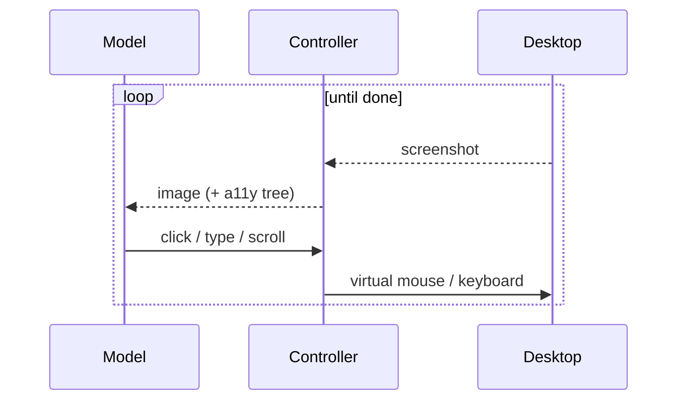

# Computer Use

**Also known as:** Desktop Agent, GUI Agent, Screen Control

**Category:** Tool Use & Environment  
**Status in practice:** emerging

## Intent

Let the model drive a desktop end-to-end via screenshots plus virtual mouse/keyboard tool calls instead of bespoke per-app APIs.

## Context

A team needs an agent to drive a desktop application or chain together work across several apps that have no public API and no plug-in integration: a legacy accounting suite, an internal CRM, a remote desktop, a custom Windows utility. The agent has to operate exactly the same screen, mouse, and keyboard a human would.

## Problem

Building a bespoke integration for every target application takes weeks per app and has to be redone the moment the vendor changes a screen. Most enterprise software has no API at all, or only an API that covers a fraction of what users actually do in the UI. Without a way to drive the screen visually, the agent simply cannot reach those applications, and per-app integration work scales linearly with the surface area the agent is expected to cover.

## Forces

- Latency and reliability are open problems.
- Prompt injection via on-screen content is a real attack surface.
- Cost: every step pays vision tokens.

## Therefore

Therefore: drive the desktop with screenshots in and mouse/keyboard tool calls out under a ReAct loop, so that the agent reaches any application without per-app API integration.

## Solution

The model receives screenshots (optionally augmented with accessibility-tree or set-of-mark annotations) and emits typed tool calls (move mouse, click, type, scroll, screenshot). A controller executes them against a real or virtual desktop. The loop is ReAct-shaped: screenshot → think → act → screenshot.

## Structure

```
Desktop --screenshot--> Controller --image (+ accessibility tree)--> Model (think) --click / type / scroll--> Controller --virtual mouse / keyboard--> Desktop --(loop until done)
```

## Diagram



## Example scenario

A solo founder wants their agent to update a spreadsheet in a desktop accounting app that has no API and no plug-ins. Building a bespoke integration would take weeks and they'd need to do it again for the next tool. They put the agent on Computer Use: it receives screenshots of the desktop and emits virtual mouse and keyboard actions to navigate menus, click cells, and type. Clunkier and slower than an API, but it works on the software the founder actually owns.

## Consequences

**Benefits**

- Universal coverage of GUI software.
- No per-app integration work.

**Liabilities**

- Slow and brittle on dynamic UIs.
- Screen content is now part of the prompt; injection becomes possible.

## Failure modes

- Layout shift — a dialog or animation moves the target between screenshot and click, and the agent clicks the wrong control.
- Screen-borne injection — text on a web page or document in the screenshot carries instructions, and the model follows them as if they came from the user.
- Slow loop — every step needs a fresh screenshot and a model call, so a short task takes many minutes and times out.
- Lost state — the agent misreads where it is in a multi-window flow and repeats or skips a step.

## What this pattern constrains

The agent operates the desktop only through the typed action vocabulary; arbitrary code execution is not part of this surface.

## Applicability

**Use when**

- The target software has no clean API and the agent must drive a real desktop visually.
- Screenshots plus virtual mouse/keyboard tool calls fit the target environment.
- The vendor exposes a model with sufficient screen-grounding capability.

**Do not use when**

- A clean API exists and is faster, cheaper, and more reliable than visual control.
- The deployment cannot tolerate the latency or cost of screenshot-think-act loops.
- Security or compliance forbids screen-content capture from the target machine.

## Components

- Multimodal Model — receives screenshots and emits typed mouse and keyboard calls
- Computer-Use Controller — translates emitted calls into virtual mouse and keyboard events against the desktop
- Screenshot Pipeline — captures frames and optionally overlays accessibility-tree or set-of-mark annotations
- Virtual Desktop — real or VM-hosted environment that receives the events and renders the next frame
- Loop Controller — drives the screenshot-think-act ReAct cycle until done or budget

## Tools

- Desktop automation library (xdotool, PyAutoGUI, or platform equivalent) — executes the typed mouse and keyboard calls
- Screen capture and annotation pipeline — produces the image observation, optionally with a11y or SoM overlays

## Evaluation metrics

- Task success on OSWorld and similar desktop benchmarks — headline capability on real applications
- Steps per task — how many screenshot-act loops are spent on average
- Click accuracy — fraction of clicks landing on the intended UI element
- Recovery rate from misclicks — share of runs that complete despite at least one wrong action
- Vision token cost per step — prompt-side cost of feeding the screenshot back each loop

## Known uses

- **[Anthropic Computer Use (Claude 3.5+)](https://www.anthropic.com/news/3-5-models-and-computer-use)** _available_
- **[OpenAI Operator](https://operator.chatgpt.com/)** _available_

## Related patterns

- _alternative-to_ **Browser Agent**
- _uses_ **ReAct**
- _complements_ **Input/Output Guardrails**
- _alternative-to_ **Mobile UI Agent**
- _generalises_ **Dual-System GUI Agent**
- _alternative-to_ **Multilingual Voice Agent Stack**
- _complements_ **Proactive Goal Creator**
- _generalises_ **Policy-Localizer-Validator**
- _complements_ **Large Action Models (LAMs)**
- _complements_ **Magentic-One Generalist Multi-Agent**
- _generalises_ **Full-Desktop Computer Use**
- _uses_ **Foveated Perception Escalation** — Screen control is where the cost of full-acuity observation bites hardest, because every step produces another dense screenshot.

## References

- [Introducing computer use, a new Claude 3.5 Sonnet, and Claude 3.5 Haiku](https://www.anthropic.com/news/3-5-models-and-computer-use) — Anthropic, 2024
