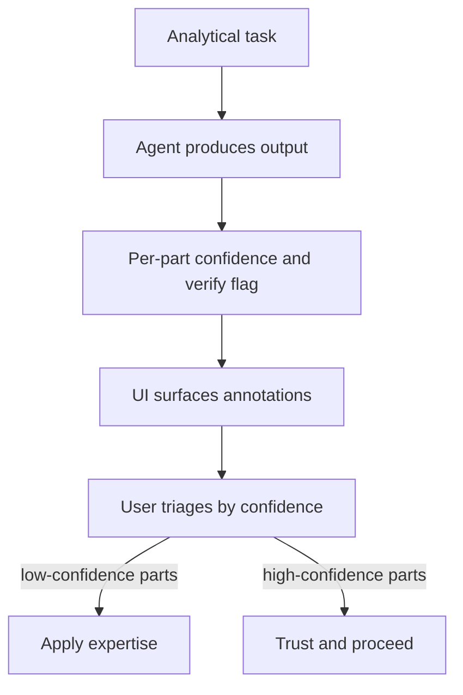

# Confidence-Checking Workflow

**Also known as:** Per-Part Confidence Annotation, Junior-Analyst Triage

**Category:** Verification & Reflection  
**Status in practice:** emerging

## Intent

Always ask the agent, for each part of its output, to state its confidence and identify which parts need human verification, like triaging a junior analyst's work.

## Context

The agent produces analyses (financial, medical, research) with mixed-confidence parts. The user takes the output as homogeneous. Confident-sounding false claims (false-confidence-syndrome) get equal trust as well-grounded conclusions. Errors slip through where the user lacks the expertise to spot them.

## Problem

A homogeneous output hides per-part confidence variation. The user has no signal to apply expertise selectively. The agent has the information (it 'knows' where it is uncertain) but defaults to confident prose throughout.

## Forces

- Per-part confidence is awkward in narrative outputs.
- Asking for confidence adds prompt complexity and output size.
- Calibrated confidence is itself unreliable (false-confidence-syndrome).

## Therefore

Therefore: build the workflow such that every analytical output is annotated per part with the agent's confidence and an explicit list of parts that need human verification; the user reads the annotations and applies expertise selectively.

## Solution

Modify the agent's output template to require per-part annotations: each conclusion / fact / recommendation tagged with confidence (high/medium/low or numeric) and a 'verify' flag for the riskiest parts. The user UI surfaces these annotations prominently. Time saved is spent on the flagged parts, not on full re-verification. Pair with confidence-reporting, false-confidence-syndrome (the failure this addresses), reflexive-metacognitive-agent.

## Structure

```
Analytical task -> agent output with per-part confidence (high/medium/low or numeric) + verify flag on riskiest parts -> UI surfaces annotations -> user triages: low-confidence / flagged parts -> apply expertise; high-confidence parts -> trust and proceed
```

## Diagram



## Example scenario

A financial agent produces an acquisition analysis. Output sections: revenue projection (confidence: HIGH, no flag), synergy estimate (confidence: MEDIUM, verify), regulatory risk (confidence: LOW, verify-required). The CFO spends 90% of review time on the LOW-confidence regulatory risk section — which is where a flaw is in fact found. Without the workflow, the same review time would have been distributed uniformly and the regulatory flaw missed.

## Consequences

**Benefits**

- User attention focuses where it adds the most value.
- Errors in low-confidence parts get caught faster.
- Output becomes triagable rather than a wall of uniform prose.

**Liabilities**

- Output structure more complex.
- Calibration of the agent's confidence remains imperfect.
- Users may stop reading low-confidence flags after a while (alert fatigue).

## Failure modes

- Flag fatigue — low-confidence and verify flags appear everywhere, the user stops reading them, and the risky parts get no extra check.
- Miscalibrated tags — the agent marks a wrong claim high and skips its verify flag, and the user trusts exactly the part that needed checking.
- Uniform tagging — every part gets the same medium label, so the annotations carry no triage signal.
- Hidden annotations — the UI tucks the tags away, and the user reads the output as plain confident prose.

## What this pattern constrains

Analytical outputs must carry per-part confidence and verify flags; uniform-prose outputs are not accepted for downstream decisions.

## Applicability

**Use when**

- Analytical outputs with mixed-confidence parts.
- Users have expertise to apply selectively.
- Workflow can carry per-part annotations through the UI.

**Do not use when**

- Single-claim outputs.
- Users without expertise to act on flags.
- Latency-critical outputs where annotation overhead is unacceptable.

## Components

- Output template — required confidence and verify-flag fields
- Agent prompt — instructs per-part annotation
- UI / display layer — surfaces annotations prominently
- Triage workflow — user reads annotations first

## Tools

- Output template with per-part confidence and verify-flag fields
- UI surface for annotations
- Triage workflow

## Evaluation metrics

- Per-part confidence-flag accuracy
- User triage time saved vs full review
- Calibration error per agent

## Known uses

- **[Bornet et al. — Agentic Artificial Intelligence, Chapter 6 (financial-analyst confidence-checking practitioner pattern)](https://www.worldscientific.com/worldscibooks/10.1142/14380)** _available_

## Related patterns

- _complements_ **Confidence Reporting**
- _alternative-to_ **False Confidence Syndrome**
- _complements_ **Reflexive Metacognitive Agent**
- _complements_ **Human-in-the-Loop**
- _complements_ **Human Reflection**
- _alternative-to_ **Calibrated Help-Gate via Conformal Prediction** — Both decide when a human should step in, but the help-gate uses calibrated set size rather than self-reported per-part confidence.

## References

- [Agentic Artificial Intelligence — Chapter 6](https://www.worldscientific.com/worldscibooks/10.1142/14380) — 2025
