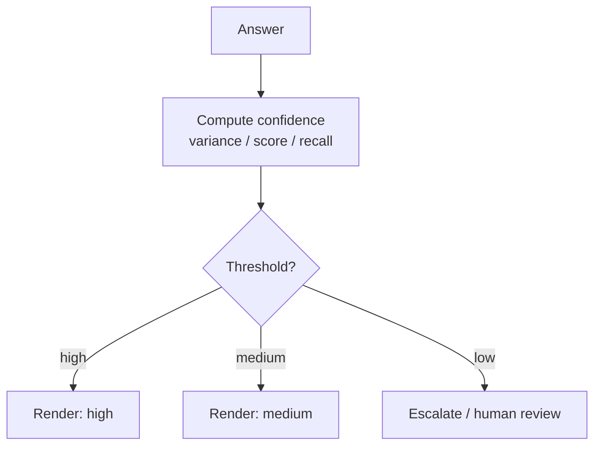

# Confidence Reporting

**Also known as:** Uncertainty Surfacing, Calibrated Output

**Category:** Verification & Reflection  
**Status in practice:** emerging

## Intent

Surface the agent's uncertainty about its answer alongside the answer itself.

## Context

A team ships an assistant whose answers feed into a downstream decision: a user choosing whether to trust a recommendation, a coder choosing whether to route a record to a senior reviewer, a workflow engine choosing whether to auto-approve a change. The cost of acting on a wrong answer is meaningfully higher than the cost of pausing to verify. The agent already produces answers; the question is how to attach a usable signal of how sure it is.

## Problem

Large language models produce answers in the same confident tone whether they actually know the answer or are guessing, so downstream code and human readers cannot tell the two cases apart. Users either trust everything (and get burned on the cases the model fabricated) or distrust everything (and lose the value of the cases the model got right). A routing layer that should escalate uncertain cases to human review has no signal to route on, so it either escalates everything or nothing. Self-reports of confidence from the model are themselves miscalibrated, so simply asking the model whether it is sure does not solve the problem on its own.

## Forces

- Confidence signals are themselves miscalibrated by the model.
- Surfacing uncertainty erodes user trust if overdone.
- Sample-based confidence (self-consistency) costs N calls.

## Therefore

Therefore: attach a calibrated uncertainty label to every answer and route low-confidence cases to a fallback path, so that downstream consumers can act on confidence instead of treating each output as equally trustworthy.

## Solution

Produce a confidence label (high/medium/low or numeric) alongside each answer. Derive from sample variance (self-consistency), evaluator score, retrieval recall, or rubric score. Render in UI; route low-confidence to fallback or human review.

## Structure

```
Answer -> compute confidence (sample variance / evaluator score / retrieval recall / rubric score) -> label high | medium | low -> UI renders label; low -> fallback or human review
```

## Diagram



## Example scenario

A medical-coding assistant proposes ICD-10 codes for clinician review. Coders trust every suggestion equally because the tone is uniform, and miss the cases where the model was actually guessing. The team adds Confidence Reporting: each suggested code carries an explicit calibrated probability and a 'low / medium / high' band, surfaced beside the code. Coders now spend their attention on the low-confidence rows and rubber-stamp the high-confidence ones, and the workflow tool can auto-defer low-confidence cases to a senior coder.

## Consequences

**Benefits**

- Downstream code can branch on confidence.
- Users learn when to verify.

**Liabilities**

- Calibration is empirical and drifts.
- False confidence remains the failure mode.

## Failure modes

- Confident and wrong — the label says high while the answer is fabricated, and downstream code trusts it more than an unlabelled answer.
- Calibration drift — thresholds tuned on last quarter's data no longer match the current model, so the high/medium/low split stops meaning anything.
- Self-report only — the label comes from asking the model whether it is sure, with no variance or score behind it, and reflects tone rather than accuracy.
- Escalate everything — the low threshold is set too wide, every answer goes to human review, and the routing signal is ignored.

## What this pattern constrains

Outputs without a confidence label are not consumable by confidence-aware downstream code.

## Applicability

**Use when**

- Downstream code or UI needs to distinguish 'I know' from 'I am guessing' on each answer.
- A confidence signal can be derived from sample variance, evaluator score, or retrieval recall.
- Low-confidence answers can be routed to fallback or human review usefully.

**Do not use when**

- Confidence labels would be ignored by both the UI and the routing layer.
- No reliable signal exists to derive confidence from and the label would be cosmetic.
- Calibration cannot be maintained, so reported confidence misleads more than it helps.

## Components

- Generator — LLM producing the answer alongside an uncertainty signal source
- Confidence estimator — derives a calibrated label from logprobs, sample variance, or rubric score
- Threshold router — branches outputs into high/medium/low handling paths
- Fallback or human-review channel — destination for low-confidence cases
- Calibration audit — ongoing check that reported confidence matches observed accuracy

## Tools

- LLM API exposing logprobs — token-level probabilities feeding the estimator
- Self-consistency sampler — N samples whose variance becomes the confidence signal
- Calibration dataset — held-out pairs of (confidence, correctness) for periodic recalibration

## Evaluation metrics

- Expected calibration error (ECE) — gap between reported confidence and empirical accuracy
- Brier score — mean squared error of probabilistic confidence against outcomes
- Selective accuracy at coverage — accuracy on the fraction the system chose to answer
- Escalation precision — share of low-confidence routes that were genuinely wrong
- Calibration drift over time — ECE trend that triggers recalibration

## Known uses

- **[OpenAI logprobs-derived confidence](https://cookbook.openai.com/examples/using_logprobs)** _available_

## Related patterns

- _uses_ **Self-Consistency**
- _complements_ **Disambiguation**
- _complements_ **Fallback Chain**
- _complements_ **Attention-Manipulation Explainability**
- _complements_ **Hypothesis Tracking**
- _complements_ **Reflexive Metacognitive Agent**
- _alternative-to_ **False Confidence Syndrome**
- _complements_ **Confidence-Checking Workflow**
- _complements_ **Preference-Uncertain Agent**
- _complements_ **Risk-Averse Reward Proxy**
- _alternative-to_ **Calibrated Help-Gate via Conformal Prediction** — Confidence reporting surfaces an uncalibrated self-assessment; the help-gate replaces it with a calibrated prediction-set size.
- _complements_ **Uncertainty Neglect Bias** — Confidence-reporting surfaces the uncertainty; uncertainty neglect is the failure to act on it, collapsing a distribution to its mean.
- _complements_ **Confident Inconsistency** — Confidence-reporting surfaces per-answer uncertainty; confident inconsistency is invisible to it because each individual output looks confident and correct — only cross-time comparison reveals the variance.
- _complements_ **Modality-Conflict Arbitration** — Supplies the surface for the uncertainty this pattern computes, turning an inter-channel disagreement into a stated confidence rather than an introspective guess.
- _complements_ **Semantic Decision Node** — Confidence reporting surfaces uncertainty to a human reader; here the probability is consumed by code, which is why it must be calibrated rather than merely stated.

## References

- [Language Models (Mostly) Know What They Know](https://arxiv.org/abs/2207.05221) — Kadavath et al., 2022
